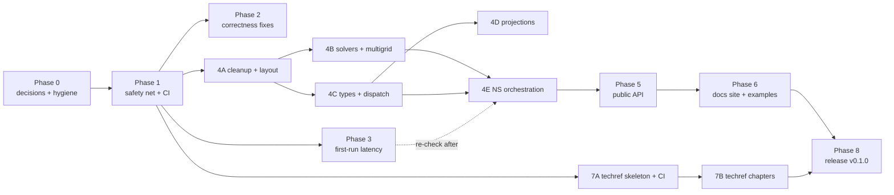

# TwoPhaseAMR.jl — refactor work plan

Derived from [AUDIT.md](AUDIT.md) and the slice reports; finding IDs (C…, F…, A…, E-…, D…, T-…, CI-…, TST-…, HYG-…) refer to those reports. Effort: S ≤ ½ day, M ≤ 2 days, L > 2 days.

## Ground rules

- **One PR = one coherent change**, merged only when `ci-ok` is green. No behaviour change in refactor PRs unless the PR title says so.
- **Numerical safety net**: from Phase 1 on, every refactor PR must pass the regression oracle (PR 1.6): bitwise equality where the PR claims "no numerical change", stated tolerance otherwise, and the result is quoted in the PR description.
- **Performance guard**: PRs touching solvers, stepping or kernels quote `benchmark/` numbers before/after (PR 1.6 baseline). Regressions > 5 % need a justification.
- **File moves are separate PRs** (pure `git mv` + include list), so they never mix with logic changes.
- Clean cutover: when an API changes, all callers, tests, examples and docs move in the same PR; no aliases (decision O2).

## Dependency overview

Phases 2, 3, 4A and 7A can run in parallel once Phase 1 is done. Phase 3 is re-measured after 4E, because the type-parameter reduction there affects compile time.

---

## Phase 0 — Decisions and unblocking (owner, before any code)

| # | Task | Done when |
|---|---|---|
| ✔ 0.1 | Decisions (2026-11-07): **O1** make repo public; **O2** pre-release, delete aliases/legacy paths now; **O3** minimum Julia 1.11; **O4** rewrite failing assertions to observed behaviour; **O5** delete `GFM(conservative=false)`; **O6** base-level multigrid coarsening in Phase 4B. Workflow: one branch + PR per item; the orchestrator merges after running the acceptance tests locally | recorded here |
| 0.2 | Fix billing or make repo public; enable Pages on `gh-pages` | a `workflow_dispatch` run starts; `gh api repos/…/pages` returns 200 |
| 0.3 | Workstation check (memory test, see `audit-threading.md` §5) | memtest/stressapptest log clean, or hardware issue identified |
| ✔ 0.4 | Failed job logs of run 35495856106 archived to `~/data/TwoPhaseAMR-leftovers/ci-logs-2026-09/` | done 2026-11-07 |
| ✔ | Delete merged branches | done 2026-10-20 (`main`, `threading`, `claudit`, `gh-pages` remain) |
| ✔ | Untracked leftovers (`benchmark/scaling/`, `research/`, `docs/src/assets/`, 4.7 GB) moved to `~/data/TwoPhaseAMR-leftovers/`; empty `.agents/`, `.codex/` removed | done 2026-11-07 |

**Progress log**

| Date | Item | PR | State |
|---|---|---|---|
| 2026-11-07 | 1.1 repo hygiene (TODO_LATER → issues #8–#16, CITATION.cff, .gitignore) | #17 | merged |
| 2026-11-07 | 1.6 regression oracle + perf baseline | #18 | merged (check.jl re-run by orchestrator: PASS) |
| 2026-11-07 | 1.2–1.4 test env, Aqua, groups, Julia 1.11 | #19 | merged (full default suite locally: 20 747 pass, 2 pre-existing failures → 1.5) |
| 2026-11-07 | 1.7 tiered CI, docs deploy | #20 | merged (YAML validated; runs once the repo is public) |
| 2026-11-07 | finding | — | `mimetic_projection_variants.jl:65` regressed in 0b00093 ("no ghf fallback by default": default `reconstruction_method` → `:lhf`); handled in 1.5 |
| 2026-11-07 | 3.1 first-run latency investigation | #22 | merged (probe re-run: Stokes-3 84.8 s, 99.9 % compilation) |
| 2026-11-08 | 1.5 integration assertions, PhaseFaceScalar AMR fix, face-schedule check | #23 | merged (oracle bitwise PASS; 10 792 pass, 1 broken: mimetic KH spatial non-convergence, flagged) |
| 2026-11-08 | 2.1/2.4/2.5 time-step safety, option validation, doc corrections | #24 | merged (oracle PASS; lid cavity 1 → 1 900 steps); missed a step-count assertion in `examples`, fixed in #26 |
| 2026-11-08 | 3.3 PrecompileTools workload | #25 | merged (orchestrator: Stokes-3 TTFS 84.8 → 3.4 s, capillary CMDGFM → 9.8 s; image 4.6 → 95 s, 3.7 GB peak); closes #10 |
| 2026-11-08 | 2.2 multigrid reuse key (`max_level`), two-velocity fixed-dt CFL check, example AMR smoke tests | #26 | merged (oracle PASS; examples 290, two_phase 8 537, navier_stokes 5 537); original lgpi exception not reproducible |
| 2026-11-08 | 2.3 asynchronous visualization | #27 | merged (0/21 → 21/21 frames during `simulate!` at 1 thread; Makie suite passes) |
| 2026-11-08 | 7A tech-ref skeleton, CI build, link checks | #28 | merged (42 pages, 0 undefined refs; docs build fixed: `size_threshold` < `size_threshold_warn`) |
| 2026-11-08 | 6.1 static figure API | #29 | merged (`snapshot_figure`, `plot_diagnostics!`, `record_checkpoints`) |
| 2026-11-08 | 4A.1 delete dead code, aliases, legacy constructor, `GFM(false)` | #30 | merged (src −366 lines net; oracle PASS) |
| 2026-11-08 | fix: hierarchy reuse compares face schedules (regression from #26) | #31 | merged (reuse restored; oracle PASS; mesh 1 529 pass) |
| 2026-11-08 | 4A.2 shared small helpers | #32 | merged (full suite 21 312 pass, 0 fail; oracle PASS) |
| 2026-11-08 | 4A.3 source layout (pure moves) | #33 | merged (interface/, embedded/, vof/, two_phase/{projection,diffusion}/, multigrid split) |
| 2026-11-08 | 6.2 illustrated examples gallery | #34 | merged (12 `NN_name/` folders with At-a-glance READMEs and assets; docs gallery renders) |
| 2026-11-08 | 4B.1/4B.2 one Krylov driver + one tree-coarsening plan | #35 | merged (src +565/−823; 18 043 pass; warm steps 0–10 % faster) |
| 2026-11-08 | 4C.1/4C.2 type stability | #37 | merged (`InterfaceField{T,M,G}`; non-periodic cavity 113 872 → 4 080 B/step; full suite 22 067 pass) |
| 2026-11-08 | 4B.3 multigrid coarsening below root blocks (O6) | #38 | merged (flat 128² TG 19.0 → 10.1 ms/step; capillary k=4 50.8 → 30.9 ms; full suite 21 857 pass); issue #36 (periodic half-period tie) filed |
| 2026-11-08 | 4C.3/4C.4 dispatch on types, validation in constructors | #39 | merged (full suite 23 918 pass; oracle PASS; merge interaction with #37 caught by the oracle and fixed) |
| 2026-11-08 | 4B.4/4B.5 coarse-factor reuse, dt refresh, CSC topology lookups | #40 | merged (truncated-step pair 42 ms/59 MB → 30 ms/17 KB; 26k-cell rebuild operator 2.19×, hierarchy 1.55×; full suite 27 302 pass) |
| 2026-11-08 | 4E.5 VOF/reconstruction allocations | #41 | merged (1V/CMDGFM k=2 −0.23 MB/step; −50 % target not reachable in these files; full suite 27 662 pass) |
| 2026-11-08 | Repo public; Pages enabled; `main` protected (PR required, no force push/deletion, admins included) | — | first CI run: format (92 files), Julia 1.13 adaptivity (9), Julia 1.11 (7 incl. Aqua unbound args) failing — fixes queued |
| 2026-11-08 | 4D shared projection layer, mimetic caching, honest stats | #44 | merged (mimetic oracle 13.6 → ~5.5 ms, 17.6 → 9.3 MB/step; k=2 84.8 → 58.6 ms; mimetic baseline re-recorded, others bitwise; full suite 27 691 pass); #45 Float32 mimetic non-convergence (pre-existing) filed |

## Phase 1 — Safety net and working CI

Goal: a green, cheap CI and a numerical/performance baseline before any refactoring.

| PR | Content | Refs | Depends | Done when | Effort |
|---|---|---|---|---|---|
| 1.1 | Repo hygiene: ignore/move `benchmark/scaling/`, `research/`, `docs/src/assets/` leftovers; delete `.agents/`, `.codex/`; `TODO_LATER.md` → GitHub issues; `CITATION.cff`; parameterise path in `test/reference-validation.md` | HYG-01..08, D4 | 0.1 | `git status` clean on a fresh clone + workstation; issues created | S |
| 1.2 | Test environment: `test/Project.toml` (Test, Random, SpecialFunctions, AlgebraicMultigrid, LimitedLDLFactorizations, Aqua), `test/makie/Project.toml`; drop `[extras]/[targets]`; remove `SpecialFunctions`, `Random` from `[deps]`; stdlib `[compat]`; fix `Diagnostic(::Symbol,::Symbol)` ambiguity; docstring for `MimeticProjectionSolver`; `test/aqua.jl` | A4, A15, A16, TST-02, TST-03, TST-13 | — | `Aqua.test_all(TwoPhaseAMR)` passes in the unit group | S |
| 1.3 | Test groups: `test/groups.jl` registry, selection by `ARGS`; orphan-file check; delete wording/implementation pins (TST-04 list); fix order-dependent extension test; migrate tests off the deprecated constructor (or delete with O2) | TST-01, 04, 07, 08 | 1.2 | `julia --project=test test/runtests.jl unit` runs only the unit group; no `occursin` on printed text remains | M |
| 1.4 | Julia 1.10: CHOLMOD `ldiv!` fallback in `ExternalPreconditioner` + unit test, **or** `julia = "1.11"` (O3) | CI-03 | 0.1 | unit group green on the lowest supported Julia | S |
| 1.5 | Integration assertions: rewrite dt-monotonicity checks (`two_phase_waves.jl:341`, `two_velocity_instabilities.jl:180,195`) against the spatial-error floor; CI-sized cylinder check inside its `@testset`, long study manual; cherry-pick `PhaseFaceScalar` union fix + `test/two_phase/phase_face_lifecycle.jl` from `threading`; face-schedule invariant check at mesh construction | CI-04..06, `audit-threading.md` §3.1, §5 | 1.3 | all integration groups green locally; cylinder group < 15 min | M |
| 1.6 | Regression oracle + performance baseline: `benchmark/oracle/` script running ≈ 8 short reference cases (TG, lid cavity, capillary 1V/2V-CMDGFM/2V-mimetic, sessile, vortex reverse, stokes3 at small size) writing field hashes and L2 norms; extend `benchmark/` with time-per-step, allocations-per-step and time-to-first-step for the 4 audit cases; record baseline JSON (small, committed) | E-1..E-10 | 1.2 | `julia --project=benchmark benchmark/oracle/check.jl` prints PASS against the committed baseline | M |
| 1.7 | CI rewrite (tiered T0–T3, `timeout-minutes`, `concurrency`, `ci-ok` aggregate, cache, pinned runner, docs deploy on main, preview cleanup, dependabot, CompatHelper); fix coverage upload; branch protection on `ci-ok` | CI-01..13, DOC-01..03 | 0.2, 1.3–1.5 | `ci-ok` green on a PR in ≤ 35 min; `…/dev/` serves the docs; monthly billed minutes forecast ≤ 1 100 | M |

**Phase exit**: CI green on `main`; docs at `/dev/`; oracle and baseline committed.

## Phase 2 — Correctness and user-facing bugs

| PR | Content | Refs | Done when | Effort |
|---|---|---|---|---|
| 2.1 | Time-step safety: single-phase explicit-`dt` stability check with numbers in the message (both models); `simulate!` caps the first step when the CFL bound is infinite (lid cavity) | A6, E1 | lid cavity default run takes > 100 steps; test for the error message type, not its text | S |
| 2.2 | `lgpi` at `max_level=2` "sparsity differ": reproduce, fix, add AMR smoke test (`max_level ≥ 1`, 5 steps) for every example | E2, E7 | smoke tests green for all examples | M |
| 2.3 | Async visualization: publisher yields; `simulate!` handles the spawn when `asynchronous=true`; remove the `fetch(Threads.@spawn …)` boilerplate from 11 examples | A5 | headless test: frames delivered during `simulate!` > 0 | S |
| 2.4 | `advect!` aliasing guard; Symbol options validated at construction (`krylov`, `preconditioner`, mimetic `preconditioner`) | C25, F20 | `@test_throws ArgumentError` for each | S |
| 2.5 | Docs truth fixes: getting-started AMR snippet (`max_level`), "incremental" → non-incremental, document Inflow/Outflow, `(5)` cross-reference | D1, T-F1, T-F5 | docs build; snippet executed as `@example` | S |
| 2.6 | `cylinder_flow.jl`: drag guard decision (keep `main` behaviour unless justified) | `audit-threading.md` §3.3 | — | S |

## Phase 3 — First-run latency (P0)

| PR | Content | Done when | Effort |
|---|---|---|---|
| 3.1 | Investigation script `benchmark/latency_breakdown.jl`: `@time_imports`, `--trace-compile` counts, per-phase timing (load, `FlowSimulation`, initial AMR, first `step!`, viz), SnoopCompile invalidations and inference-time top list for `stokes3_wave` and `capillary_wave`; short report in `benchmark/README.md` | breakdown table for both examples; top-10 inference-time methods named | M |
| 3.2 | Low-risk fixes from 3.1 (invalidations, `@nospecialize` on configuration paths, avoid `Val`/kwarg explosion in constructors) | measured reduction ≥ 30 % | M |
| 3.3 | PrecompileTools workload (start with the subset that does not crash 1.12.7; test on 1.13; file upstream MWE for the LLVM SIGSEGV) | first `simulate!` step of every example < 10 s on the workstation (fresh process, after precompile); package precompile time stays < 3 min | M |
| 3.4 | CI guard: T1 job measuring time-to-first-step of 2 examples; fails above 2× target | job present and green | S |

Re-measure after Phase 4E (fewer type parameters) and update the target.

## Phase 4 — Internal refactor

Every PR: oracle PASS (bitwise unless stated), baseline benchmark quoted.

### 4A Cleanup and layout (first, to shrink everything else)

| PR | Content | Refs | Lines | Effort |
|---|---|---|---|---|
| 4A.1 | Delete dead code, test-only reference paths (move to `test/`), compat aliases, legacy constructor/keywords, `AbstractEllipticOperator`, `assemble_stiffness=false` branch, migration/api-decisions pages (per O2); `GFM(false)` per O5 | C8–C10, F5, F8, F15, F21, A2, A3 | −350…450 | M |
| 4A.2 | Small shared helpers: one `_cell_index`, `_csr_offsets`, one sparse row-mul kernel, geometry utils (clip, unit cell, local→physical), named tolerances | C11, C12, C21–C23, F14, nits | −150 | S |
| 4A.3 | **Pure file moves** to the target layout (`interface/`, `embedded/`, `vof/`, `two_phase/projection/`, `two_phase/diffusion/`, `visualization/plic_geometry.jl`, split `geometric_preconditioner.jl`), per-directory include manifests; update `architecture.md` | F13, C24, T-F16 | ±0 | S |

### 4B Solvers and multigrid

| PR | Content | Refs | Done when | Effort |
|---|---|---|---|---|
| 4B.1 | One Krylov-solve-with-stats driver; trait-table `_run_krylov!`; one Jacobi-weight helper; `MultigridOptions` passed as one kwarg; resize test per Krylov workspace type | C2–C4, C6 | oracle bitwise; −250 lines | M |
| 4B.2 | Shared tree-coarsening plan for the three hierarchy builders (scalar GMG, staggered diffusion, variable diffusion) | C1, F4 | oracle bitwise; −350 lines | L |
| 4B.3 | Base-level coarsening below the root blocks (on top of 4B.2) | E-2, O6 | flat 128² TG ≥ 1.5× faster; iteration counts reported | L |
| 4B.4 | In-place coarse refactorization (`cholesky!`/`lu!`, symbolic reuse); `dt` change with tolerance instead of `==` | E-4, E-5 | two-phase step −15 % or better; no allocation spike on truncated last step | M |
| 4B.5 | Topology rebuild: CSR search instead of `Dict{Tuple{Int,Int},Int}`; `StiffnessRefresh{T}` struct; `matrix::Nothing` for matrix-free | E-9, C7, C14 | `EllipticOperator` + TreeGMG rebuild ≥ 2× faster at 26k cells | M |

### 4C Types and dispatch

| PR | Content | Refs | Done when | Effort |
|---|---|---|---|---|
| 4C.1 | `InterfaceField{T,M,G}`; drop `WYAdvectionWorkspace.geometry`; delete the ~20 function-barrier pairs | F3 | `@code_warntype` clean on `_reconstruct_interface_cell!`; oracle bitwise | M |
| 4C.2 | Concrete caches replacing `Ref{Any}`/`Vector{Any}`/`Dict{Any}` (boundary conditions, advection workspace, CMDGFM cache, two-velocity workspace typed by velocity model) | C13, C17, F17, E-8 | non-periodic step allocations < 10 KB | M |
| 4C.3 | Dispatch instead of branching: transport policy methods, `CGFM`/`CSF`/`GFM` as types, scheme ladders → `_canonical_staggered_scheme`, `MimeticProjection{V}` | F6, F7, F16, C26 | no `isa FrozenInterfaceFluxes` / `formulation.conservative` left; −150 lines | M |
| 4C.4 | Validation in inner constructors (`SinglePhase`, `TwoPhase`, `SurfaceTension`, options); `TwoPhaseModel` built from validated `TwoPhase`; one `SupportedReal` check | F9, C18, A §3.2 | positional constructors validate; error messages use current keyword names | S |

### 4D Projections

| PR | Content | Refs | Done when | Effort |
|---|---|---|---|---|
| 4D.1 | Shared projection layer `two_phase/projection/common.jl` (incidence, gauge partition, face data, gradient core, defects, `project!` skeleton); split mimetic variants into files | F2, F16 | oracle bitwise for CMDGFM and mimetic; −170 lines | M |
| 4D.2 | Mimetic caching (operator/incidence/slices keyed on topology+geometry revision), MINRES allocated once, `ldiv!` preconditioner, joint-fit scratch | F1, E-3 | mimetic step ≥ 3× faster, allocations ≥ 10× lower | M |
| 4D.3 | Honest `MimeticProjectionStats` (no duplicated fields), common stats accessors (`converged`, `iterations`, `final_residual`) for all projection stats | F18, A §4.3 | `print_simulation_summary` has no `hasproperty` probes | S |

### 4E Navier–Stokes orchestration and threading

| PR | Content | Refs | Done when | Effort |
|---|---|---|---|---|
| 4E.1 | Store `options::NavierStokesOptions` and physics in the system; delete flatten/expand round-trip; rename struct to `NavierStokesSystem`, field `flow.system` | A9, A11 | system struct ≤ 8 type parameters; −90 lines | M |
| 4E.2 | Deduplicate single/1V/2V stepping (time-step bounds, force substeps, prologue, rebuild blocks, `_transport_substep_other_policy!`) | A10, F10 | −200 lines; oracle bitwise | M |
| 4E.3 | `step!(flow, dt)` with bookkeeping/AMR/diagnostics; `simulate!` as a loop over it; private `_transport_geometry_prepared` kwarg moved into workspace; `force` stored in `FlowSimulation` | A7, A14 | manual loop with AMR test; `simulate!` result unchanged (oracle) | M |
| 4E.4 | **Owner: one Opus agent, high effort, brief `audit/briefs/threading.md` (decisions taken; no further approval needed).** Threading: ≤ 2 launch primitives, correct docstrings, document callback execution context; parallelize serial streaming loops (`_phase_face_average!` via connectivity, residual/RHS loops, `diffusion!` gather/scatter, `surface_tension!`); serial-vs-threaded equivalence test | C15, C16, C20, F11, F23, E-7 | 4-thread speed-up ≥ 2× on TG 128² (hierarchical) and capillary k=4; equivalence test in CI (2 threads) | L |
| 4E.5 | Remaining efficiency items: `reconstruct!` allocations, VOF scalar buffers, curvature fallback search | E-6, E-10, F12, F22 | two-phase step allocations −50 % | M |

**Phase exit**: removable-line target reached (≈ −1 100…1 400 in `src/`); all baseline benchmarks equal or better; Phase 3 latency re-measured.

## Phase 5 — Public API

| PR | Content | Refs | Done when | Effort |
|---|---|---|---|---|
| 5.1 | Export ≈ 45 standard names; `public` for supported advanced names (native on 1.11, `Compat.@compat public` on 1.10); rename session `simulation_state` → `session_state`; one spelling per name | A1 | `names(TwoPhaseAMR)` ≈ 45; `checkdocs = :public` passes | M |
| 5.2 | Usability: keyword whitelist with did-you-mean in `FlowSimulation`/`simulate!`; model-compatibility errors (`SinglePhase` + `TwoVelocityModel`); explicit `periodic`; 0-step `simulate!` stats; `print_simulation_summary(io, flow)`; diagnostic arity check at registration and errors wrapped with the diagnostic name | A §4.2 | misuse table of `audit-api.md` §4.2 re-run: every case gives a one-line actionable message | M |
| 5.3 | `add_callback!(flow, f, schedule)`; checkpoint/restart (`write_checkpoint`, `FlowSimulation(path)`); one output writer | A8 | restart test: run 2T == run T + restart + T (bitwise) | L |
| 5.4 | Documented extension contracts (refinement indicator, diagnostic subtype, schedule, visualization backend hooks without `_`), each with a tested ≤ 15-line example; Makie ext uses only the documented interface | A12, A14 | `extending.md` examples executed in docs build | M |
| 5.5 | Public helpers needed by docs/examples/tests: `getindex(::CellField, ::CellRef)`, velocity error helper, pressure-drag diagnostic; migrate 130 `_get` uses in tests and `_`-calls in examples | TST-05, D9, E6 | `grep -c 'TwoPhaseAMR\._' examples/` = 0 | M |

## Phase 6 — Docs site and examples gallery

| PR | Content | Refs | Done when | Effort |
|---|---|---|---|---|
| 6.1 | Static figure API in the Makie ext: `snapshot_figure`, `plot_diagnostics!`, `record_checkpoints` (CairoMakie headless) | G1 | renders TG and capillary snapshots in a test | M |
| 6.2 | Examples restructure `examples/NN_name/{name.jl, README.md, make_figures.jl, assets/}`, `examples/Project.toml`, `make_all_figures.jl`, Prosperetti helper moved; README "At a glance" for all 12; committed assets; test helpers resolve new paths; lint test for README headings/links | E3, E4, E9–E11, `audit-docs.md` §4 | `make_all_figures.jl` regenerates all assets; lint test green | L |
| 6.3 | Site restructure: page tree of `audit-docs.md` §3.3; explanation pages reduced to `method-overview.md` (links to PDF); delete migration/api-decisions/literature-todos/how-to; README ≤ 90 lines | D7, D8, D10, D11 | nav matches tree; no page > 150 lines except reference | M |
| 6.4 | API reference: 8 grouped `@docs` pages with `## [..](@id api-…)` anchors; `checkdocs = :public`; size warnings gone | D5, D6 | no `size_threshold_warn`; anchor list exported for the techref link check | S |
| 6.5 | Executed docs: Quick start, tutorials (single-phase, new two-phase capillary tutorial), how-tos as `@example`; FAQ, installation, citing, changelog pages; gallery pickup in `docs/make.jl` | D2, D3, D11 | docs build executes ≥ 40 blocks in ≤ 5 min CI; 0 static `julia` blocks in tutorials | M |

## Phase 7 — Technical reference (LaTeX)

| PR | Content | Refs | Done when | Effort |
|---|---|---|---|---|
| 7A.1 | Skeleton `docs/techref/` (memoir, `techref-notation.sty` derived from thesis `preamble.tex:342-617` + `newcommands.tex`, nomenclature, bib subset, `deviation`/`implnote` environments, `\apitype`/`\apifun` with CI-written `\apibase`) | T §5.3–5.4 | PDF builds in CI and is published at `…/dev/assets/techref.pdf` | M |
| 7A.2 | Link checks both ways: every `\apitype/\apifun` target exists in built HTML; every docstring/`method-overview.md` label exists in `.aux` | T §5.4 | CI job fails on a deliberately broken link | S |
| 7B.1 | Ch. 1 overview + algorithm box + temporal order (derivation-checker on single-phase order); ch. 13 stability limits table; deviations appendix | T-F1, T-F6 | each deviation of `audit-techref.md` §5.1 has a `deviation` box | M |
| 7B.2 | AMR chapters (not in the thesis): ch. 2 block tree, ch. 3 discrete setting on AMR, ch. 11 solvers/tree GMG, ch. 12 criteria + conservative transfer with invariant proofs | T-F10, T-F11 | derivation-checker audit archived for each invariant | L |
| 7B.3 | Two-phase chapters: ch. 4 interface/curvature, 5 VOF transport, 6 momentum, 8 forces (CSF/CGFM/GFM, gravity), 9 viscosity, 10 projections (CMDGFM β deviation, mimetic KKT, BCs incl. Inflow/Outflow), 7 cut cells | T-F2, T-F3, T-F5, T-F7, T-F8 | every exported numerical type has an `implnote` reference | L |
| 7B.4 | Ch. 14 verification: scripts in `docs/techref/verification/` producing CSV/TeX tables (replacing hand-typed tables), claim → test index | T-F4, T-F12 | tables regenerated by a T2/T3 CI job artifact | M |

Explanation pages in `docs/src` are deleted only when the corresponding chapter has merged (7B.x), so the site never loses content.

## Phase 8 — Release

| # | Task | Done when |
|---|---|---|
| 8.1 | `CHANGELOG.md`, version `0.1.0`, tag → `stable/` docs and PDF; README badges to `stable/` | `…/stable/` and `…/stable/assets/techref.pdf` resolve |
| 8.2 | Archive `threading` (tag `archive/threading-2026-10`, delete branch); delete `claudit` after the plan is moved into issues/milestones | only `main` and `gh-pages` remain |
| 8.3 | Convert remaining plan items into GitHub issues with a milestone per phase | milestones exist; this file links to them |

## Suggested order with one developer

1. Phase 0, then Phase 1 (≈ 1–1.5 weeks).
2. Phase 2 and Phase 3.1–3.3 interleaved with 4A (≈ 1–1.5 weeks).
3. 4B and 4C in parallel streams, then 4D and 4E (≈ 3–4 weeks); 7A can be done in between.
4. Phase 5 (≈ 1.5 weeks), Phase 6 (≈ 2 weeks), Phase 7B alongside 6 and after (≈ 3–4 weeks of writing).
5. Phase 8.

Durations are rough [INFERENCE] and assume reviewer/derivation-checker agents for the numerical PRs.

## Queue (2026-11-08, kept here so nothing cancelled is lost)

| Item | State |
|---|---|
| #60/#61/#62 staggered momentum transport (upwind everywhere in bounded two-phase transport) | StaggeredFixes running — top priority |
| #63/#64 cut-cell consistency (CutConsistencyFixes) | cancelled to free a slot — **restart next** |
| Cylinder flow higher Re / +1 level / third README hero (CylinderHero) | cancelled to free a slot — **restart after #62 merge** |
| #58 zero curvature for unresolved faces (UnresolvedCurvature) | running → then merge into viz/lgpi and regenerate LGPI |
| #59 triple-cell fix | CI → merge |
| Regenerate two-phase examples + README heroes after #62 | pending |
| Techref stable refs + ch. 4 triple cells + ch. 6 polish (TechrefStableRefs); ch. 6 derivation audit | running / pending |
| Viz phase 3 (Studio), phase 4 cutover | pending |
| 4E NS orchestration + threading | pending (after transport fixes) |

### Phase 5 decision items (recorded 2026-11-08)

- `ProjectedLiquidVelocity` (velocity extrapolation carrier) is historical and not normally used (owner). Mark legacy now; decide keep vs remove in the Phase 5 public API review. Its temporal-convergence gate with Lax–Wendroff momentum fails after the #62 fix (LW overshoot at the extrapolated velocity jump) and is recorded as a NUMERICS CONCERN.
- Expose `ctu_threshold` (CTU switch near the interface) through the velocity model / options.
- #90 (short final step force spikes): owner chose incremental pressure-correction (p^{n+1} = p^n + φ) for all projections (1V, CMDGFM, mimetic); scheduled after #76; techref ch. 10 to be updated after it lands.
- Mimetic projection (owner, 2026-11-09): legacy option, never prioritised; if it blocks development, drop support (decide at the latest in the Phase 5 API review). It keeps the old absolute projection form (not incremental); its hydrostatic limitation (#76) is documented, not fixed.
- `ProjectedLiquidVelocity` (two-velocity extrapolation carrier, owner 2026-11-09): legacy option like the mimetic projection; `FrozenInterfaceFluxes` (frozen cut-cell fluxes) is the main method. No effort to improve or keep it equivalent; failing behaviour is recorded (NUMERICS CONCERN / issue) rather than fixed; drop support if it blocks development (Phase 5 at the latest). Docs and techref present it as legacy.
