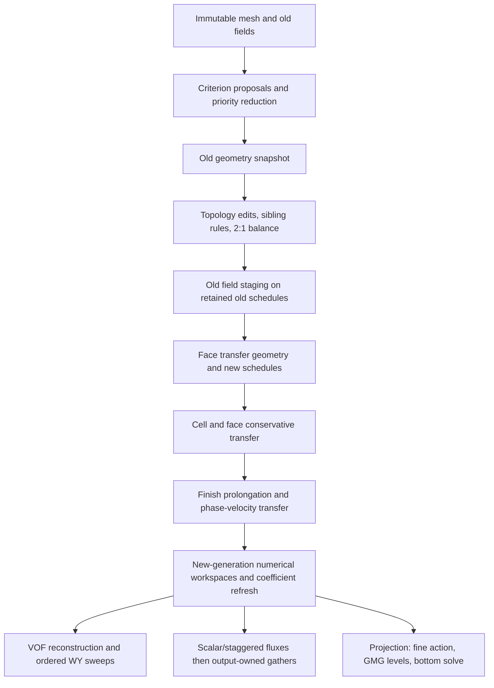

# Cross-process threading correctness control

Run from the repository root:

```sh
julia --project=. benchmark/correctness/run.jl
julia --project=. benchmark/correctness/run.jl --all --output-dir=/tmp/twophase-correctness
julia --project=. benchmark/correctness/toy_run.jl --all --output-dir=/tmp/twophase-toy-correctness
```

The default checks one and four Julia compute threads. `--all` checks
1, 2, 3, 4, 7, 8, 16, and 32 in fresh Julia processes. Individual counts
are accepted as positional arguments; one thread is added automatically.
Use `--project=PATH` with either runner when testing a separately resolved
Julia environment; the main worker hashes that project's `src/` tree and
compares the hash across processes. Start the runner with the same Julia
binary intended for its child processes.
The worker starts with `--threads=p,0 --gcthreads=1` on Julia 1.12+ and
`--threads=p --gcthreads=1` on Julia 1.10–1.11; these versions have no
interactive pool by default. BLAS is held to one thread. The runner compares
complete serialized states,
including flattened field values, mesh keys, face/cell counts, CFL time steps,
phase integrals, and refinement labels. `--output-dir` retains each process's
versioned `.bin` result for audit; otherwise temporary records are removed.
These are correctness records, not benchmark timings. Use a single Julia
binary/project and unchanged source across the run.

The frozen comparison budget is `512eps(Float64)` times the magnitude of each
finite value (or one, whichever is larger), applied to these short trajectories.
Integer counts, mesh keys, labels, lengths, and other discrete state must
agree exactly. Every process also checks scalar/phase mass conservation and
the adaptive transfer mass budget against its own initial state. NaNs
must match at the same positions. A mismatch stops the run and prints its path;
do not change the bound in response to a failure without an independent serial
roundoff analysis. The saved one-thread record is the per-run reference; long
convergence and physics gates remain in the package test suite.

| Fixture | Contract exercised |
|:--|:--|
| `scalar_one`, `scalar_many` | Same 32×32 uniform domain with one block or 16 blocks; upwind field, signed face fluxes, CFL and mass. |
| `scalar_mixed` | 32×32 base with a fixed 2:1 refined patch, coarse–fine segments, same upwind update. |
| `wy` | 32×32 interface and two intrinsic phase scalars, alternating directional sweeps, phase integrals and all cell values. |
| `staggered` | 32×32 prescribed carrier and separately transported two-component velocity, LW scheme. |
| `adaptive` | Small criterion-driven refine followed by criterion-driven coarsen, conservative transfer and key/label history; a lifecycle smoke, below the numerical threading grain. |
| `concurrent_one`, `concurrent_many` | Two independent scalar meshes/workspaces launched concurrently in each multiworker process; each must match its ordinary serial fixture. |

The fixtures follow [cell advection tests](../../test/operators/advection/cell_advection.jl),
[WY transport tests](../../test/two_phase/transport.jl),
[staggered advection tests](../../test/operators/advection/staggered_advection.jl),
and [adaptive transfer tests](../../test/mesh/adaptivity.jl). They are deliberately
small to catch scheduling and ownership failures before performance tuning.
They do not certify a 50% efficiency target or replace vortex, solver, and
long adaptive-flow integration tests.

`toy_run.jl` is a separate fresh-process check for the independent
`UniformLWAdvection` package. It records complete cell fields and mass for
each combination of recomputed/stored face fluxes and serial, Julia dynamic,
spawned, and Polyester backends. Its three cases are a square periodic
translation, an odd rectangular periodic translation, and a midpoint-updated
variable-speed shear. It compares every backend to a serial recomputation
reference within a process and against the one-worker process at the same
fixed trajectory. Polyester is loaded as an optional extension through the
main project environment. The toy source and extension bytes are embedded
in the artifact and checked for changes between processes. This driver does
not time any operation; use the scaling harness for the Stage 2 performance
gate. The callback refresh cost and a deforming-flow performance curve still
need separate benchmark fixtures.

## Dependency and ownership inventory

The following is a source-audited execution map for deciding which later
parallel changes are legal. Arrows mean a result is consumed by the next
phase, not that phases may be reordered.



The precise [adaptation implementation](../../src/mesh/adaptivity/adapt.jl)
copies geometry, edits and balances topology, stages old fields using retained
old schedules, builds transfer geometry/new schedules, transfers registered
fields, finishes prolongation and phase velocities, then records actual edits.
The [workspace](../../src/mesh/adaptivity/workspace.jl) owns the old/new key
dictionaries, field buffers, transfer scratch, and indicator labels. It uses
shared mutable dictionaries and bit vectors, so topology commit and schedule
publication must remain controlled until an ownership scheme is demonstrated.
Field identity and transfer registration are part of the lifecycle.
The two concurrent fixtures use **distinct meshes and distinct workspaces**.
They check independent simulations; they do not test concurrent calls on
separate workspaces sharing one mesh, which might expose lazy shared-cache
construction and needs its own ownership audit before claiming support.

For transport, [cell advection](../../src/operators/advection/cell_advection.jl)
forms fluxes before the cell-owned update. [WY transport](../../src/indicator/phase/vof_fluxes.jl)
uses directional sweeps; the second consumes the first sweep's state.
[Reconstruction validity](../../src/indicator/phase/interface_field.jl)
depends on geometry and phase revisions, so workers may read only a complete
cache for the current state. [Staggered schedules](../../src/operators/advection/staggered_schedules.jl)
and [updates](../../src/operators/advection/staggered_update.jl) add dual-volume
dependencies and require separate scratch ownership for concurrent components.

For projection, [multigrid cycles](../../src/solvers/multigrid/cycles.jl)
sequence fine action, smoothing, residual, restriction, bottom solve,
prolongation, correction and true residual checks. The
[hierarchy](../../src/solvers/multigrid/hierarchy.jl) currently calls sparse
`mul!` for transfers, while some actions use destination-owned row traversal.
The coarse level may be too small for a thread launch; its direct factor and
the topology/coefficient refresh rules must be included in complete-solve
measurements. CMDGFM adds jump assembly, numeric cache validation, jump
preconditioning, and final physical defect checks after this pressure path.

Before carrying a policy from one stage to the next, compare numerical states
here, run the corresponding integration tests, and then use the separate
performance harness on fixed trajectories. The retained `.bin` records help
locate differences but are intentionally not treated as portable CI snapshots.
