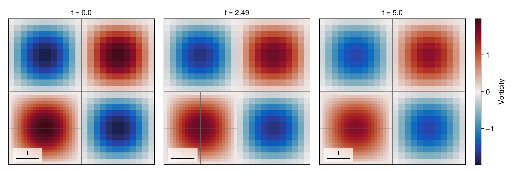
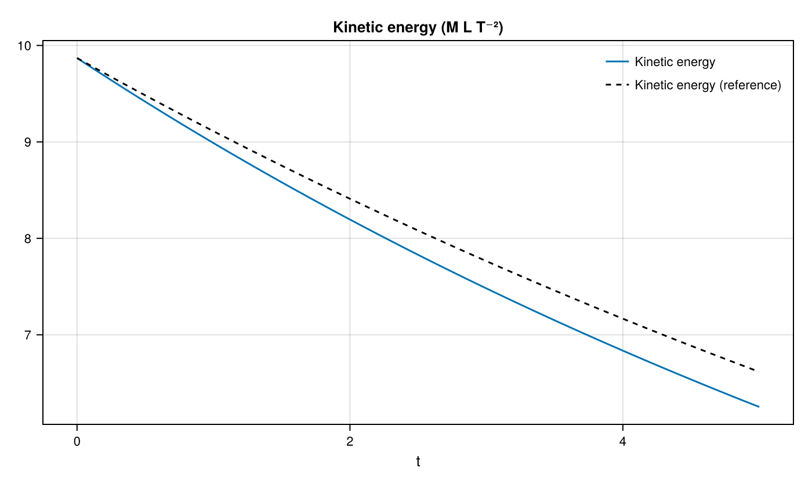

# 01 – Taylor–Green vortex

A periodic vortex decays by viscosity on a fixed mixed-level mesh, with kinetic energy compared against the exact solution.



## At a glance

| | |
| --- | --- |
| **Physics** | Single phase, density 1, Reynolds number `reynolds=50` and kinematic viscosity `1/reynolds=0.02`; periodic square `[0, 2π]²`. |
| **Algorithms** | Staggered `FaceVelocity`; Lax–Wendroff momentum advection with a monotonized-central coarse–fine flux, implicit-midpoint diffusion and pressure projection. Pressure uses CG/tree-geometric multigrid; diffusion uses tree multigrid and selects CG or BiCGSTAB by matrix symmetry. The `(0, 0)` branch is statically refined through `max_level=2`; no dynamic refinement. Automatic time stepping uses CFL 0.45. |
| **Worth varying** | `reynolds=50` changes the decay rate; `max_level=2` changes the fixed mesh; `final_time=0.2` changes the run duration; `dt=nothing` selects an automatic step, while a numeric `dt` fixes it. |
| **Validated against** | Exact kinetic-energy decay `π²exp(-4t/reynolds)` versus `:kinetic_energy`: at docs size and `t=5`, numerical energy is `6.28788` versus `6.61579` exact, an absolute error of `0.327914` (also the maximum sampled error). |
| **Cost** | Default: level 2, `T=0.2`, 1008 cells; a previous one-thread audit measured 7 steps and 0.04 s warm, with a 27 s first call before the current precompile workload. Docs: level 2, `T=5`, 1008 cells, 169 steps; setup and simulation took 6.14 s and the whole figure script 23.40 s in a shared, single-thread gallery process, including first-use compilation and rendering. |

The gallery timings use Julia 1.12.7, one Julia thread and one BLAS thread; package loading is excluded and compilation costs depend on previous cases in the process.

## Setup

With density one and viscosity `ν = 1/reynolds`, the periodic solution is

```math
u=e^{-2\nu t}\sin x\cos y,\qquad
v=-e^{-2\nu t}\cos x\sin y,\qquad
E(t)=\tfrac12\int_{[0,2\pi]^2}(u^2+v^2)\,dx\,dy
    =\pi^2 e^{-4\nu t}.
```

The numerical energy is the face-dual-volume-weighted `KineticEnergy()` diagnostic, not an analytical value normalized to its initial numerical sample. See the [method reference](../../docs/src/method.md) for the staggered discretization, diffusion, projection and solvers.

## Run

From the repository root, run headlessly:

```julia
using TwoPhaseAMR
include("examples/01_taylor_green/taylor_green.jl")
run = run_example(max_level = 2, final_time = 5.0)
energy = diagnostic_history(run.flow, :kinetic_energy)
```

Or run the live example, or generate the static figures with CairoMakie:

```sh
julia --project=examples examples/01_taylor_green/taylor_green.jl
julia --project=examples examples/01_taylor_green/make_figures.jl
```

The figure entry point accepts `make_figures(; outdir=..., size=:docs)` or `size=:default`; it prints the simulation summary, energy errors and runtime.

## Results

The hero shows vorticity at the initial, middle and final checkpoints; titles use the actual nearest completed-step times, and each panel has its own symmetric color scale. Gray lines mark leaf blocks.



At `t=5`, the numerical energy is `6.28788`, the exact energy is `6.61579`, and their absolute difference is `0.327914`.

## Variations

After including the example, try:

```julia
run_example(reynolds = 100, final_time = 5.0)  # slower viscous decay
run_example(max_level = 3)                     # finer mesh in one corner branch
run_example(dt = 0.01, final_time = 0.2)       # fixed time step
```

## Files

- [taylor_green.jl](taylor_green.jl) — simulation and recorded keyframes.
- [make_figures.jl](make_figures.jl) — headless snapshot and analytical-energy plots.
