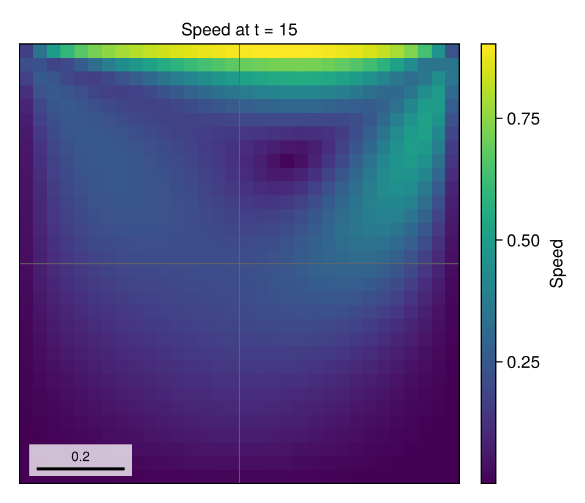
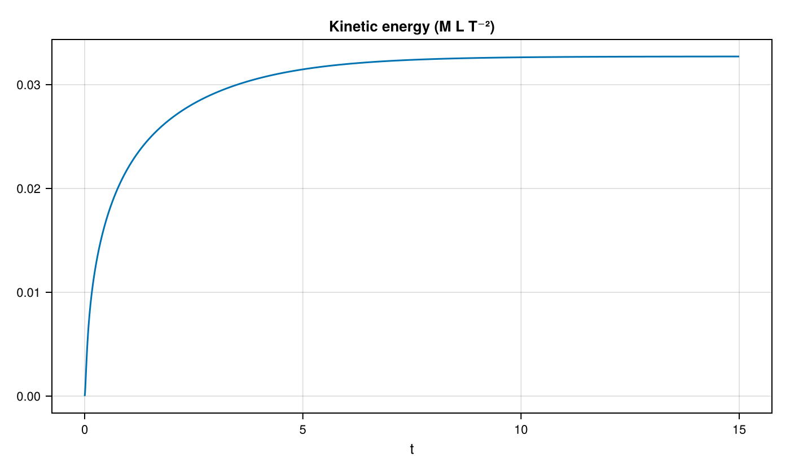

# 02 – Lid-driven cavity

A moving lid spins up a viscous fluid in a square cavity, exposing the transient speed and kinetic energy.



## At a glance

| | |
| --- | --- |
| **Physics** | Single phase in the nonperiodic unit square, density 1, `reynolds=100` and dynamic viscosity 0.01; the top lid moves right at unit speed and the other walls are stationary. |
| **Algorithms** | Staggered velocity, Lax–Wendroff momentum advection, implicit-midpoint diffusion and pressure projection. Pressure uses CG/tree multigrid; diffusion uses tree multigrid and selects CG or BiCGSTAB by matrix symmetry. The mesh is uniformly refined to `max_level=1`, with no dynamic AMR. |
| **Worth varying** | `reynolds=100` changes viscosity; `max_level=1` changes uniform resolution; `final_time=15` changes the simulated duration; `dt=nothing` uses automatic steps, while a numerical `dt` fixes them. |
| **Validated against** | Exact incompressibility gives a zero reference for `:divergence_norm`; at docs size the final volume-weighted norm is `2.39154e-7`, and `:kinetic_energy` is `0.0327184` at `t=15`. The steady [Ghia et al. benchmark](https://doi.org/10.1016/0021-9991(82)90058-4) is not compared here. |
| **Cost** | Default: level 1, `T=15`, 1024 cells and automatic steps; runtime unmeasured. Docs: same grid and duration, fixed `dt=0.005`, 3000 steps; setup and simulation took 6.34 s. Incremental generator compilation, including rendering, was 11.59 s in a shared single-thread process. |

The fixed step is deliberately smaller than the current advective stability bound; an older audit's `dt=0.05` no longer passes that bound.

## Setup

The fluid starts at rest. The `NoSlip` wall callback prescribes unit horizontal tangential speed at the top and zero wall speed elsewhere; all wall-normal velocities vanish. For cavity width `L=1`, lid speed `U=1`, and `ρ=1`,

```math
\mathrm{Re}=\frac{UL}{\nu}=100,\qquad \nu=\mu/\rho=0.01.
```

The docs-size figure uses `dt=0.005` for the full transient. The example itself defaults to automatic stepping; if the initial stability bound is infinite, the solver caps its first step at one 128th of the requested interval. See the [method reference](../../docs/src/method.md) for momentum transport, viscosity and the projection.

## Run

From the repository root, a headless run matching the figures is:

```julia
using TwoPhaseAMR
include("examples/02_lid_driven_cavity/lid_driven_cavity.jl")
run = run_example(max_level = 1, final_time = 15.0, dt = 0.005)
energy = diagnostic_history(run.flow, :kinetic_energy)
```

The direct example records keyframes in `run.recorder` (accessible via `snapshot_store(run.recorder)`); the figure script uses CairoMakie:

```sh
julia --project=examples examples/02_lid_driven_cavity/lid_driven_cavity.jl
julia --project=examples examples/02_lid_driven_cavity/make_figures.jl
```

`make_figures(; outdir=..., size=:docs)` uses the fixed-step settings above; `size=:default` uses automatic steps as in the example. Both print the diagnostic summary and runtime.

## Results

The hero is the final cell-centred speed reconstructed from the face velocity; gray lines show leaf-block boundaries.



The fixed-step plot reaches `:kinetic_energy = 0.0327184` at `t=15`; it does not by itself establish that a steady state has been reached.

## Variations

After including the example, try:

```julia
run_example(reynolds = 400, dt = 0.005)     # lower viscosity
run_example(max_level = 2, dt = 0.0025)      # finer uniform grid and smaller step
run_example(final_time = 5.0, dt = 0.005)   # shorter transient
```

## Files

- [lid_driven_cavity.jl](lid_driven_cavity.jl) — simulation and recorded keyframes.
- [make_figures.jl](make_figures.jl) — headless speed and energy plots.
