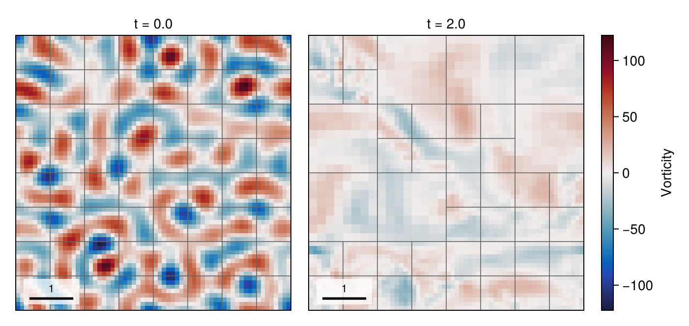
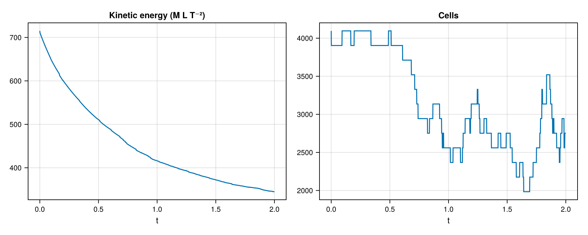
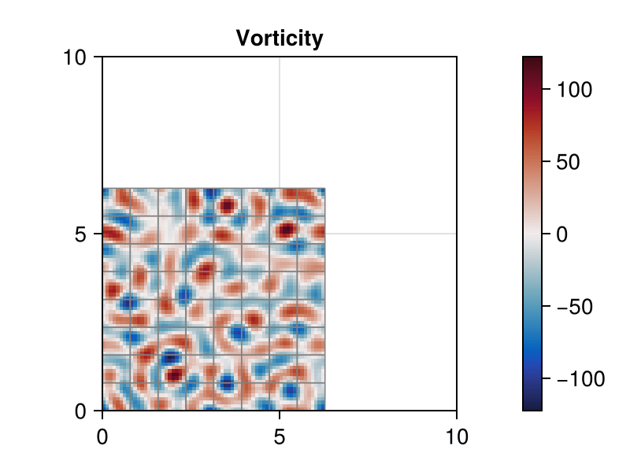

# 03 – Decaying turbulence

A seeded periodic velocity field decays while pressure-driven adaptation changes the block mesh.



## At a glance

| | |
| --- | --- |
| **Physics** | Single phase on the periodic square `[0, 2π]²`, density 1, `reynolds=400` and dynamic viscosity 0.0025; initially random, band-limited solenoidal modes. The Reynolds parameter sets viscosity and is not a measured turbulent Reynolds number. |
| **Algorithms** | Initial velocity projection, Lax–Wendroff staggered advection, implicit-midpoint diffusion and pressure projection. Pressure uses CG/tree multigrid; diffusion uses tree multigrid and selects CG or BiCGSTAB by matrix symmetry. Pressure interpolation-error AMR uses refine/coarsen thresholds 0.6/0.2, update interval 5, coarsen delay 25 and minimum level `min(2, max_level)`. Automatic stepping uses CFL 0.45. |
| **Worth varying** | `reynolds=400` changes viscosity; `max_level=4` changes the finest possible level; `final_time=10` sets the duration; `dt=nothing` selects automatic steps. At `max_level=2` the protected minimum equals the maximum, so no coarsening below level 2 is possible. |
| **Validated against** | Incompressibility has exact reference zero: the final volume-weighted `:divergence_norm` is `1.03542e-6` at docs size. `:projected_kinetic_energy` decreases from `715.044` to `344.946`; no exact turbulent-flow trajectory is claimed. |
| **Cost** | Default: level 4, `T=10`, initially 16384 cells; runtime unmeasured. Docs: level 3, `T=2`, initially 4096 and finally 2752 cells, 1744 steps and 67 mesh updates; setup and simulation took 20.48 s. Incremental generator compilation, including rendering, was 7.70 s in a shared single-thread process. |

The gallery measurement used Julia 1.12.7, one Julia thread and one BLAS thread; compilation depends on earlier examples and package loading is excluded.

## Setup

A `MersenneTwister(20250308)` generates phases and normally distributed amplitudes for modes with `3 ≤ |k| ≤ 9`, weighted toward `|k|=6`. The velocity initializer sums terms of the form

```math
\boldsymbol{u}_k=A_k\sin(k_x x+k_y y+\phi_k)(-k_y,k_x),
\qquad \nu=1/\mathrm{Re}.
```

The example projects this field before time stepping. All blocks start at the selected maximum level; the pressure criterion can subsequently refine or coarsen subject to the minimum level. See the [method reference](../../docs/src/method.md) for momentum transport, projection and AMR criteria.

## Run

From the repository root, reproduce the gallery's simulation settings headlessly:

```julia
using TwoPhaseAMR
include("examples/03_decaying_turbulence/decaying_turbulence.jl")
run = run_example(max_level = 3, final_time = 2.0)
cells = diagnostic_history(run.flow, :cells)
```

The direct example records keyframes in `run.recorder` (accessible via `snapshot_store(run.recorder)`) using the larger example defaults. The figure command uses CairoMakie and the smaller gallery settings:

```sh
julia --project=examples examples/03_decaying_turbulence/decaying_turbulence.jl
julia --project=examples examples/03_decaying_turbulence/make_figures.jl
```

Use `make_figures(; outdir=..., size=:default)` for the level-4, `T=10` simulation. Both sizes print the simulation and diagnostic summary, including cell and regrid counts, and runtime.

## Results

The hero compares the initial and final retained vorticity states, with leaf-block boundaries. Each panel uses its own symmetric color scale.



The projected energy falls from `715.044` to `344.946`, while active cells fall from 4096 to 2752. The figure registers `:projected_kinetic_energy` after the initial projection; the example's original initial energy sample predates it.



The animation shows 41 nearest completed-step states (not interpolated), with one symmetric vorticity range over all frames, next to the kinetic energy and active cell count with a cursor at the shown time.

## Variations

After including the example, try:

```julia
run_example(max_level = 2, final_time = 2.0)  # protected uniform minimum level
run_example(max_level = 3, final_time = 0.5)  # shorter adaptive run
run_example(reynolds = 200, max_level = 3, final_time = 2.0)  # stronger viscosity
```

## Files

- [decaying_turbulence.jl](decaying_turbulence.jl) — seeded initial condition, AMR and recorded keyframes.
- [make_figures.jl](make_figures.jl) — headless checkpoints, histories and animation.
