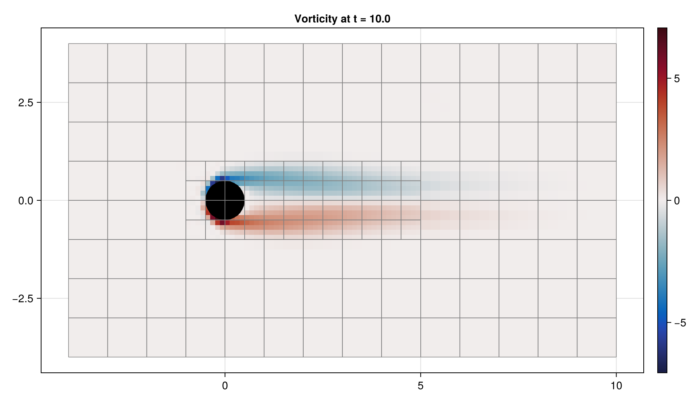
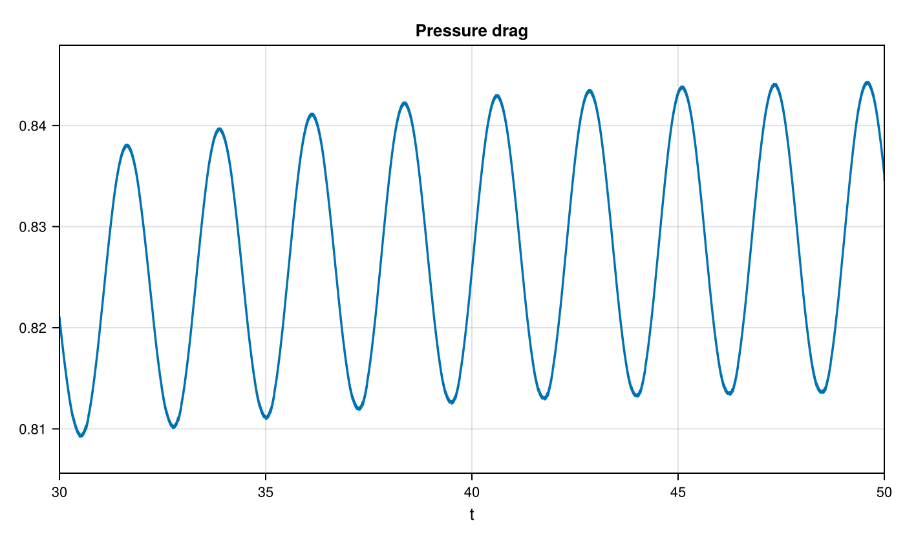
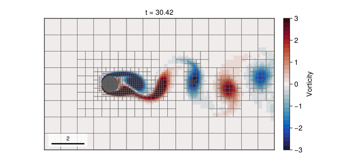

# 04 – Cylinder flow

A uniform inflow passes an embedded circular cylinder while adaptive blocks follow the solid and vorticity.



## At a glance

| | |
| --- | --- |
| **Physics** | Single phase, density 1, unit free-stream speed and unit cylinder diameter. The default is `reynolds=100` (viscosity 0.01); the gallery uses `reynolds=200` (viscosity 0.005). The domain is `[-4, 10] × [-4, 4]`; left inflow is `(1, 0)`, the right is outflow, and top and bottom use zero-gradient velocity. |
| **Algorithms** | Embedded `GeometryField` with PLIC solid geometry, staggered Lax–Wendroff advection, implicit-midpoint diffusion and pressure projection. Pressure uses CG/tree multigrid; diffusion uses tree multigrid and selects CG or BiCGSTAB by matrix symmetry. Geometry and vorticity indicators drive AMR above the base level, with update interval and coarsen delay 5. |
| **Worth varying** | `reynolds=100` changes viscosity; `max_level=3` changes finest resolution and AMR availability; `final_time=40` changes the simulated duration; `dt=nothing` selects automatic steps. At `max_level ≤ 1`, the example disables dynamic criteria. |
| **Validated against** | The gallery's `t=30–50` mean pressure drag is `1.02563` and its filtered-lift crossing estimate is `St=0.2303`, respectively 4.0% below and 17.6% above the two-dimensional Re = 200 results of [Qu et al. (2013), Table 3](https://doi.org/10.1016/j.jfluidstructs.2013.02.007): `C_D,p=1.068`, `St=0.1958` (their total drag is `1.316`). The lift FFT estimate rises from `0.1978` over the transient `t=7–22` window, close to the reference, to `0.2362` over `t=30–50`. Increasing `H/D` from 8 to 10 barely changed the latter peak, so this tested blockage change does not explain the discrepancy; larger domain effects remain untested. The level-4 comparison is inconclusive because only transient data were obtained. Short downstream distance and outflow, AMR wake coarsening, and late-time evolution are possible causes, not established ones. See the [sensitivity table](#results). This is not a grid- or domain-independent benchmark; pressure drag excludes viscous stress. |
| **Cost** | Default: level 3, `T=40`, runtime and final cells unmeasured. The gallery uses level 3 and `T=50`, with 83169 steps and 6160 final cells; setup and simulation took 1349 s on one thread. The larger figure setting uses level 4 and `T=50`. |

## Setup

The solid is initialized from `hypot(x, y) - 0.5`, with `4 × 4`-cell blocks on a `28 × 16` base mesh. The default initial fluid velocity is the unit inflow. The gallery adds a localized divergence-free initial vortex with streamfunction `0.1 exp(-((x-1)^2+(y-0.5)^2)/(2×0.5^2))` to seed the wake early; the inflow boundary stays `(1,0)`. Re = 200 was chosen for comparison with a published two-dimensional benchmark while encouraging shedding. Geometry is refined to `max_level`, while the vorticity criterion uses thresholds 0.2 for refinement and `0.2/3` for coarsening. The pressure-only drag diagnostic reports

```math
C_{D,p}=\frac{F_{p,x}}{\tfrac12\rho U^2D}=2F_{p,x}
\quad (\rho=U=D=1).
```

The analogous `:pressure_lift` uses the vertical force. Neither diagnostic includes viscous stresses. See the [method reference](../../docs/src/method.md) for cut cells, pressure projection and refinement criteria.

## Run

From the repository root, use the gallery settings headlessly:

```julia
using TwoPhaseAMR
include("examples/04_cylinder_flow/cylinder_flow.jl")
run = run_example(max_level = 2, final_time = 10.0)
drag = diagnostic_history(run.flow, :pressure_drag)
```

The direct example records keyframes in `run.recorder` (accessible via `snapshot_store(run.recorder)`) with the longer defaults. The second command renders the smaller gallery run using CairoMakie:

```sh
julia --project=examples examples/04_cylinder_flow/cylinder_flow.jl
julia --project=examples examples/04_cylinder_flow/make_figures.jl
```

Use `make_figures(; outdir=..., size=:default)` for level 4 and `T=50`. Both sizes print the diagnostic summary and runtime.

## Results

The hero shows final vorticity, gray leaf-block outlines and the reconstructed solid cylinder in black.





The last 20 time units of the docs run (48 retained keyframes from approximately `t=30.42` to `t=50`): vorticity with a fixed range of ±3, AMR block outlines and the embedded cylinder in gray.

For the frequency estimate, lift was sampled every 0.05 time units, averaged over an 11-sample window, and its upward mean crossings used to estimate the period. The residual of the raw sampled lift minus the smoothed signal has RMS `0.05367`, about 5.13% of the smoothed lift amplitude; this noise and the limited averaging window should be considered in the comparison. Initial pressure force samples are deliberately `NaN`, because the impulsive-start state is not a developed force. These diagnostics exclude viscous stresses.

| Run | Domain | D/H | Levels | D/h | St (FFT / crossings) | Mean pressure drag | Lift noise RMS / amplitude | Runtime |
| --- | --- | ---: | --- | ---: | --- | ---: | --- | ---: |
| Gallery | `[-4,10] × [-4,4]` | 0.125 | 1–3 | 16 | 0.2362 / 0.2303 | 1.02563 | 0.0539 / 5.2% | 1349 s |
| Wider | `[-4,10] × [-5,5]` | 0.100 | 1–3 | 16 | 0.2371 / 0.2347 | 1.02282 | 0.0391 / 4.1% | 1343 s |
| Wake tolerance 0.15 | `[-4,10] × [-4,4]` | 0.125 | 1–3 | 16 | 0.2335 / 0.2283 | 0.99974 | 0.301 / 32.5% | 673 s |
| Wake tolerance 0.10 | `[-4,10] × [-4,4]` | 0.125 | 1–3 | 16 | — | — | — | stopped at 1500 s |
| Finer cylinder, target `T=60` | `[-4,10] × [-4,4]` | 0.125 | 1–4 | 32 | — | — | — | stopped at 5400 s |
| Gallery, early `t=7–22` | `[-4,10] × [-4,4]` | 0.125 | 1–3 | 16 | 0.1978 / 0.1983 | 0.77277 | 0.0248 / 3.9% | 1349 s |
| Finer, early `t=7–22` | `[-4,10] × [-4,4]` | 0.125 | 1–4 | 32 | 0.1938 / 0.2029 | 0.90881 | 0.0601 / 8.2% | stopped at 10800 s |

As a sensitivity check, resampling at 0.05 time units, applying the same
11-point moving average and taking the zero-padded Hann-windowed FFT peak over
`30 ≤ t < 50` gives `St=0.2362` for the gallery data (the 20-unit window has
native frequency spacing 0.05; zero-padding does not add resolution). The wider
`[-4,10] × [-5,5]` domain keeps the same cell size, changing `D/H` from 0.125 to
0.1, and gives `St=0.2371`, `C_D,p=1.02282`. With the original domain and
vorticity threshold 0.15, the FFT peak is `0.2335` and `C_D,p=0.99974`.
The latter run was resumed at two-unit intervals and has substantial force
spikes; its lift noise RMS is 0.301 (33% of the smoothed amplitude), so it is
not clean evidence of wake-refinement convergence. A threshold of 0.1 did not
finish within 1500 seconds, and no force series was saved for that run.
The sensitivity-run drag values are time averages by linear interpolation;
the published gallery value is the mean of recorded adaptive-step samples.
An uninterrupted level-4 run targeting `T=60` was stopped after 5400 s
without producing a force series. A second uninterrupted run targeting `T=45`
streamed its force history but reached only `t=22.139` in 10800 s. Its
wall time averaged 486 s per simulated unit through `t=22`; the last full
unit took 644 s. The table reports the available `t=7–22` interval and the
same interval from the gallery for comparison. This is **not** a developed
window: level-4 lift RMS rose from 0.159 over `t=7–12` to 0.546 over
`t=17–22`, and only two upward mean crossings occurred. Consequently these
early estimates cannot establish the cause of the developed-window error.
At level 3, the cylinder has only 16 cells per diameter. The gallery window
covers only about four to five
cycles; Qu et al. report reaching the saturated 2-D state around `t=60` at
Re = 200, so the gallery window may also contain transient effects.
For context, Qu et al. (§4.4.2) cite experimental `St=0.182–0.184` near
Re = 200, including [Norberg (1994)](https://doi.org/10.1017/S0022112094003332);
these are three-dimensional physical wakes, unlike the two-dimensional example.

## Variations

After including the example, try:

```julia
run_example(max_level = 1, final_time = 10.0)  # base-level mesh, no dynamic criteria
run_example(max_level = 2, final_time = 20.0)  # longer adaptive wake
run_example(reynolds = 50, max_level = 2, final_time = 10.0)  # more viscous flow
```

## Files

- [cylinder_flow.jl](cylinder_flow.jl) — embedded geometry, AMR and pressure-drag diagnostic.
- [make_figures.jl](make_figures.jl) — headless solid/vorticity and drag plots.
