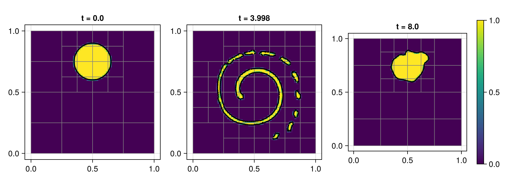
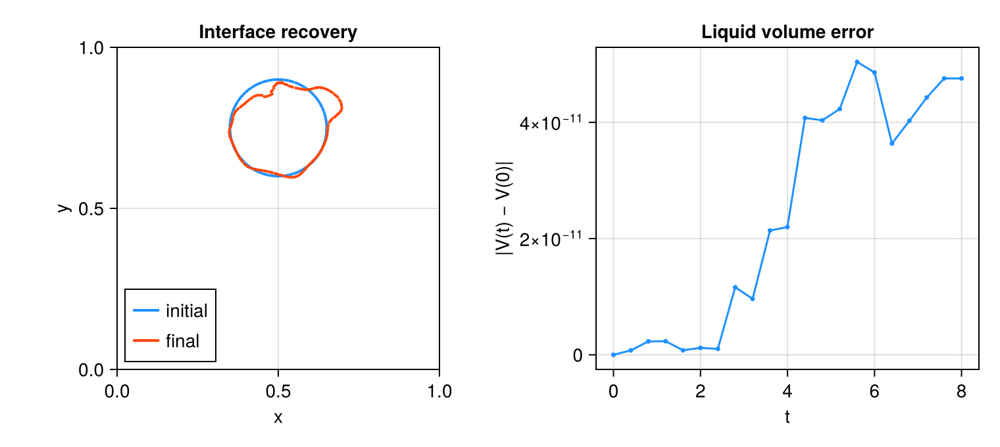
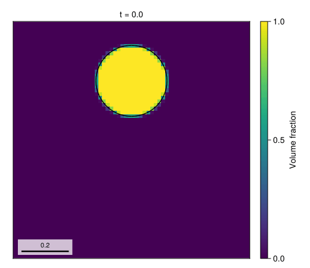

# 05 – Vortex reversal

A prescribed reversing vortex stretches a circular liquid patch and then returns it toward its initial shape.



## At a glance

| | |
| --- | --- |
| **Physics** | Standalone liquid volume-of-fluid (VOF) transport in the periodic unit square; initial radius `0.15`, centre `(0.5, 0.75)`. The carrier velocity is prescribed, not solved; density, viscosity, gravity and surface tension are not parameters of this problem. |
| **Algorithms** | Weymouth–Yue geometric VOF advection with alternating sweep order and CFL `0.4`; `:lhf` PLIC reconstruction with WY fallback. Interface and curvature refinement use minimum level 1 (clamped to `max_level`) and 8 cells per radius, with adaptation every 5 steps and coarsening delay 2; there is no pressure or diffusion solver. |
| **Worth varying** | `max_level=5` controls the finest mesh; `final_time=8.0` changes both the run duration and the reversal period; `reconstruction_method=:lhf` selects the PLIC normal method (`:lhf_ghf` and `:wy` are also supported). |
| **Validated against** | The exact reversing flow returns to its initial shape and conserves liquid volume. At docs size `abs(V(T)-V(0)) = 4.75607e-11`; a geometric shape-error norm was not measured. |
| **Cost** | The default level-5 run is unmeasured. Docs: level 3, `T=8`, 1661 steps, 64 regrids and 1792 final cells; setup and simulation took 87.98 s. Incremental generator compilation, including rendering, was 40.30 s in a shared single-thread process. |

## Setup

The streamfunction and time-dependent carrier velocity are

```math
\psi(x,y) = \frac{\sin^2(\pi x)\sin^2(\pi y)}{\pi},\qquad
\mathbf u(x,y,t) = \cos(\pi t/T)(\partial_y\psi,-\partial_x\psi).
```

The velocity reverses at `T/2` and its integrated displacement over `T` vanishes. The exact solution therefore returns to the initial circle, although discrete interface transport and AMR need not return it exactly. See the [method reference](../../docs/src/method.md) for geometric VOF transport, PLIC reconstruction and AMR.

## Run

From the repository root, in a Julia session started with `--project=examples`:

```julia
include("examples/05_vortex_reverse/vortex_reverse.jl")
run = run_example(max_level = 3, final_time = 8.0)
@show run.result
```

Run the example headlessly or regenerate the Cairo assets:

```sh
julia --project=examples examples/05_vortex_reverse/vortex_reverse.jl
julia --project=examples -e 'include("examples/05_vortex_reverse/make_figures.jl"); make_figures()'
```

Append `--studio` to the example command to follow the run in a browser;
press Ctrl+C to close Studio after the run.

`make_figures(size=:default)` uses the example's level-5 default. This example owns its VOF stepping loop rather than a `FlowSimulation`, and records keyframes in `run.recorder` (accessible via `snapshot_store(run.recorder)`) for the figure script.

## Results

The hero shows liquid fraction and reconstructed interface at the initial state, near maximum stretching, and the final state. Keyframes are the nearest completed steps, so the printed times are the actual times.





The 21 retained states of the docs run: the circle is stretched into a spiral until `T/2` and returns as the flow reverses.

The overlay compares the retained initial and final PLIC segments; the volume curve integrates the stored fractions over actual AMR cell areas. The final absolute volume error is `4.75607e-11`; this is not a measurement of geometric shape recovery.

## Variations

```julia
run_example(max_level = 2)                         # coarser AMR ceiling
run_example(max_level = 3, reconstruction_method = :wy)
run_example(max_level = 3, reconstruction_method = :lhf_ghf)
```

## Files

- [vortex_reverse.jl](vortex_reverse.jl) – prescribed-flow example.
- [make_figures.jl](make_figures.jl) – retained snapshots and conservation plot.
