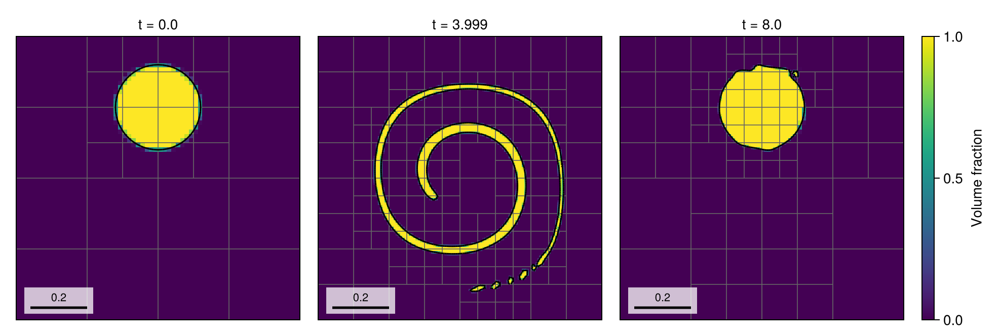
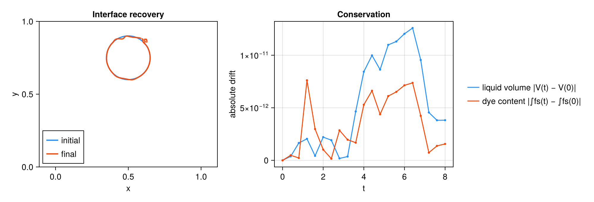
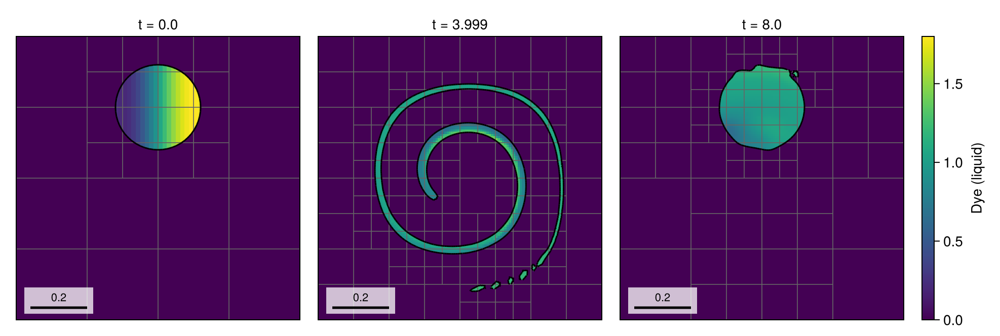
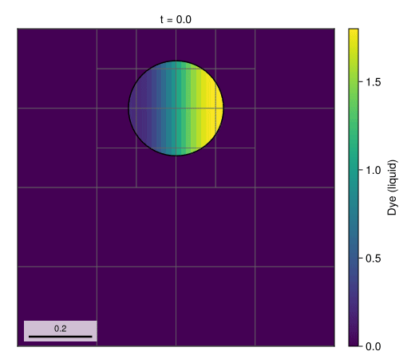

# 05 – Vortex reversal

A prescribed reversing vortex stretches a circular liquid patch and then returns it toward its initial shape.



## At a glance

| | |
| --- | --- |
| **Physics** | Standalone liquid volume-of-fluid (VOF) transport in the periodic unit square; initial radius `0.15`, centre `(0.5, 0.75)`. The carrier velocity is prescribed, not solved; density, viscosity, gravity and surface tension are not parameters of this problem. |
| **Algorithms** | Weymouth–Yue geometric VOF advection with alternating sweep order and CFL `0.4`; `:lhf` PLIC reconstruction with WY fallback. Interface and curvature refinement use minimum level 1 (clamped to `max_level`) and 8 cells per radius, with adaptation every 5 steps and coarsening delay 2; there is no pressure or diffusion solver. |
| **Worth varying** | `max_level=6` controls the finest mesh; `final_time=8.0` changes both the run duration and the reversal period; `reconstruction_method=:lhf` selects the PLIC normal method (`:lhf_ghf` and `:wy` are also supported). |
| **Validated against** | The reversing flow returns the interface and passive liquid scalar toward their initial states and conserves their contents. Docs: final volume error `3.82e-12`, scalar-content error `1.56e-12`, scalar recovery L1 error `0.03346`; a geometric shape-error norm was not measured. |
| **Cost** | The default level-6 run is unmeasured. Docs: level 4, `T=8`, 3311 steps, 457 regrids and 5440 final cells; setup and simulation took 393.4 s on one thread after a level-3 run, while other jobs shared the machine. |

Gallery timings: Julia 1.12.7, one Julia thread and one BLAS thread, AMD Ryzen 9 5950X; package loading is excluded.

## Setup

The streamfunction and time-dependent carrier velocity are

```math
\psi(x,y) = \frac{\sin^2(\pi x)\sin^2(\pi y)}{\pi},\qquad
\mathbf u(x,y,t) = \cos(\pi t/T)(\partial_y\psi,-\partial_x\psi).
```

The velocity reverses at `T/2` and its integrated displacement over `T` vanishes. The exact solution therefore returns to the initial circle, although discrete interface transport and AMR need not return it exactly. See the [method reference](../../docs/src/method.md) for geometric VOF transport, PLIC reconstruction and AMR.

## Run

From the repository root, in a Julia session started with `--project=examples`:

```julia
include("examples/05_vortex_reverse/vortex_reverse.jl")
run = run_example(max_level = 4, final_time = 8.0)
@show run.result
```

Run the example headlessly or regenerate the Cairo assets:

```sh
julia --project=examples examples/05_vortex_reverse/vortex_reverse.jl
julia --project=examples -e 'include("examples/05_vortex_reverse/make_figures.jl"); make_figures()'
```

Append `--studio` to the example command to follow the run in a browser;
press Ctrl+C to close Studio after the run.

`make_figures(size=:default)` uses the example's level-6 default; the docs use level 4. This example
owns its VOF stepping loop rather than a `FlowSimulation` and records keyframes
in `run.recorder` (accessible via `snapshot_store(run.recorder)`) for the figure
script. The recorder's `step_log` also identifies steps that changed the mesh.

## Results

The hero shows liquid fraction and reconstructed interface at the initial state, near maximum stretching, and the final state. Keyframes are the nearest completed steps, so the printed times are the actual times.







The scalar GIF has 81 output frames, one per keyframe, on a uniform simulation-time grid with spacing `0.1` over the whole run; each keyframe is the completed step nearest its requested time. It also shows the PLIC interface and AMR blocks, so it covers the interface evolution as well: the circle is stretched into a spiral until `T/2` and returns as the flow reverses.

The overlay compares the retained initial and final PLIC segments; the volume curve integrates the stored fractions over actual AMR cell areas. The final absolute volume error is `3.82e-12`; this is not a measurement of geometric shape recovery.

The passive liquid scalar starts as `1 + 0.8sin(4πx)`, with zero gas
value, and uses the same WY volume fluxes as the interface; it is transferred
conservatively when the mesh changes. Phase concentrations are upwinded,
which is strongly diffusive here: the final dye is nearly uniform rather than
recovering the initial gradient. Scalar images use PLIC-split mixed cells.
The scalar recovery norm is the integral
of `abs(f(T)s(T) - f₀s₀)`, evaluated against the initial circle and profile
reinitialised on the final mesh. It is `0.04034` at level 3 and `0.03346`
at level 4, an observed two-level rate of about 0.27, not an established
asymptotic convergence order.
Scalar content is evaluated at 21 retained keyframes as `∫ f s`; its maximum
absolute drift is `7.61e-12` and its final drift is `1.56e-12`. The noticeably
diffused final pattern shows that conservation alone does not imply pointwise
recovery.

## Variations

```julia
run_example(max_level = 2)                         # coarser AMR ceiling
run_example(max_level = 3, reconstruction_method = :wy)
run_example(max_level = 3, reconstruction_method = :lhf_ghf)
```

## Files

- [vortex_reverse.jl](vortex_reverse.jl) – prescribed-flow example.
- [make_figures.jl](make_figures.jl) – retained snapshots and conservation plot.
