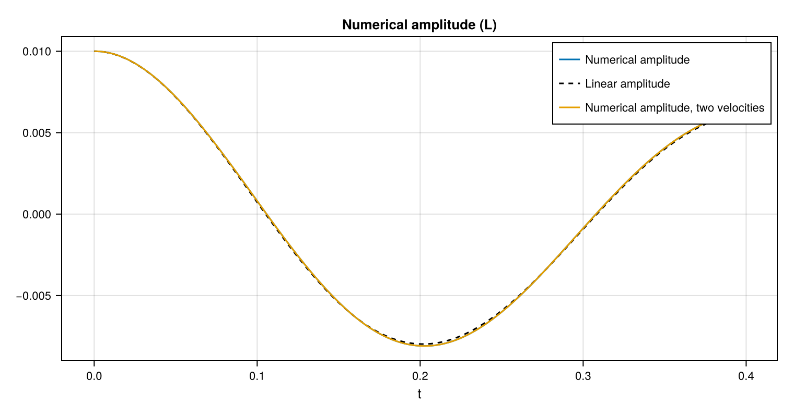
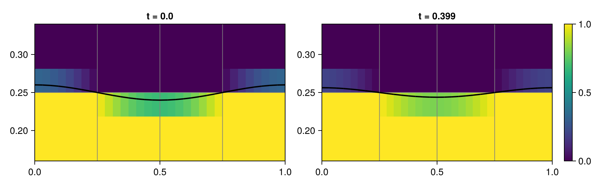
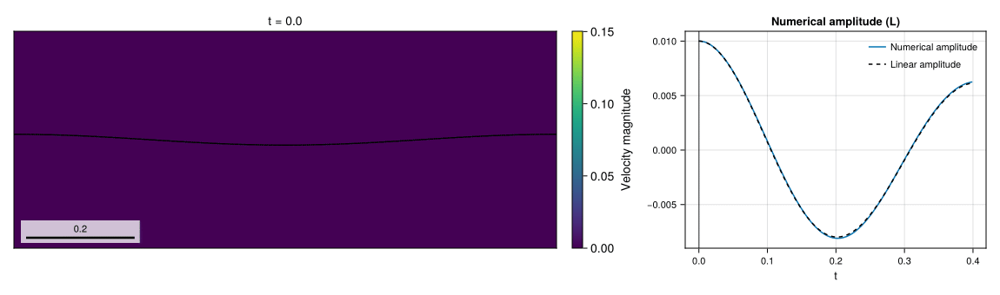

# 06 – Capillary wave

A small standing wave damps under viscosity and surface tension, and its amplitude is compared with Prosperetti's linear solution.



## At a glance

| | |
| --- | --- |
| **Physics** | Two phases with liquid/gas density ratio `1000`, Laplace number `3000`, surface tension `1`, wavelength `1`, initial amplitude `0.01`, equal phase kinematic viscosity and zero gravity. The domain is `[0,1] × [-1.5,1.5]`, periodic in `x` with free-slip `y` walls. |
| **Algorithms** | Default `OneVelocityModel()`; geometric WY interface transport, LHF PLIC with WY fallback and CGFM surface tension. Lax–Wendroff momentum advection, implicit-midpoint diffusion and pressure projection use CG/tree multigrid. Interface AMR refines to `max_level`, with update interval 5 and coarsening delay 2: square cells on every level, `dx = dy = 1/8` on level 0 and `1/128` at the default level 4 around the interface (128 cells per wavelength, 1.3 cells across the initial amplitude), level 1 (`1/16`) in the far field. `TwoVelocityModel()` uses frozen interface fluxes and CMDGFM projection with BiCGSTAB and its default block preconditioner. |
| **Worth varying** | `density_ratio=1000` sets the density contrast; `laplace=3000` sets the common kinematic viscosity; `amplitude=0.01` sets the initial displacement; `max_level=4` controls refinement; `final_time=nothing` selects one linear capillary period. The forwarded `velocity_model` defaults to `OneVelocityModel()`; `TwoVelocityModel()` selects separate phase velocities. |
| **Validated against** | `:amplitude` measures the interface height at `x=0` minus `0.25`; `:analytical_amplitude` is [Prosperetti's equal-kinematic-viscosity solution](https://doi.org/10.1063/1.863522). At docs size and `t=0.399142`, one velocity gives `0.00625680` versus `0.00614806` reference; the maximum sampled absolute error is `1.32120e-4`. |
| **Cost** | Default and `:docs`: level 4, one period (`T≈0.399`), 2048 steps and 6528 final cells. Setup and simulation took 78.24 s for one velocity and 124.86 s for two; the whole figure script took 261.7 s on one thread, including first-use compilation and rendering. |

## Setup

With `k=2π` and `ρ=(1, 0.001)`, the initial interface and linear inviscid capillary frequency are

```math
\eta(x,0)=0.25+0.01\cos(kx),\qquad
\nu=\sqrt{1/3000},\quad \mu_i=\rho_i\nu,\qquad
\omega_0^2=\frac{\sigma k^3}{\rho_l+\rho_g}.
```

The default end time is `2π/ω₀`; viscosity is included in the Prosperetti reference, not in the period used to choose the end time. See the [method reference](../../docs/src/method.md) for the interface, surface-tension force, projection and viscous solver.

## Run

From the repository root, in a Julia session started with `--project=examples`:

```julia
include("examples/06_capillary_wave/capillary_wave.jl")
run = run_example()
@show diagnostic_history(run.flow, :amplitude).values[end]
@show diagnostic_history(run.flow, :analytical_amplitude).values[end]
```

Run the example headlessly or regenerate the Cairo figures:

```sh
julia --project=examples examples/06_capillary_wave/capillary_wave.jl
julia --project=examples -e 'include("examples/06_capillary_wave/make_figures.jl"); make_figures()'
```

Append `--studio` to the example command to follow the run in a browser;
press Ctrl+C to close Studio after the run.

Both `size=:docs` and `size=:default` use the example's level-4, one-period settings. The gallery additionally runs the two-velocity model on the same physical case.

## Results

The one-velocity amplitude ends at `0.00625680` versus `0.00614806` for Prosperetti; its maximum sampled absolute error is `1.32120e-4`. The two-velocity run ends at `0.00625640`, with maximum sampled absolute error `1.31329e-4`.



The interface snapshots show the one-velocity calculation at the nearest retained start and end states, in a window of one wavelength by 0.4 wavelengths with square cells; the 0.01 displacement spans about one finest cell. Gray lines show AMR block boundaries.



One period of the one-velocity run: speed and interface in the same window, next to the numerical and analytical amplitude with a cursor at the shown time.

## Variations

```julia
run_example(max_level = 5)                                # finer interface
run_example(laplace = 1000.0)                             # stronger viscous damping
run_example(velocity_model = TwoVelocityModel())          # two intrinsic velocities
```

## Files

- [capillary_wave.jl](capillary_wave.jl) – flow setup and amplitude diagnostics.
- [prosperetti_amplitude.jl](prosperetti_amplitude.jl) – analytical amplitude helper used by the example.
- [make_figures.jl](make_figures.jl) – numerical/reference curves and interface snapshots.
