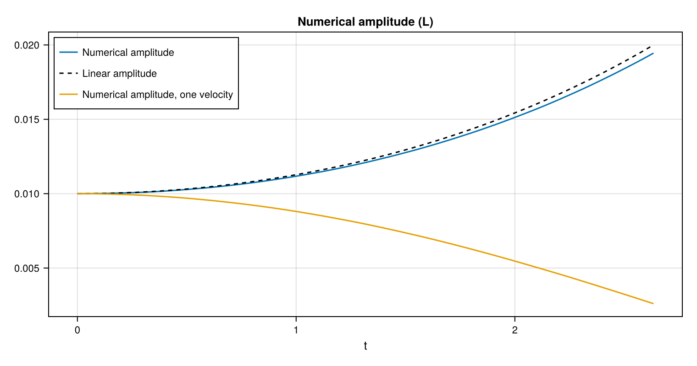
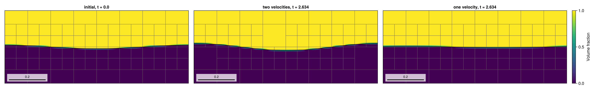
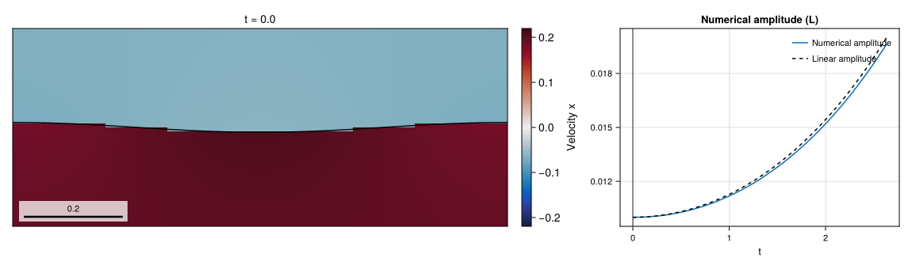

# 07 – Interfacial instability

A tangential velocity jump and gravity perturb a heavy-over-light interface, comparing one- and two-velocity closures with linear theory.



## At a glance

| | |
| --- | --- |
| **Physics** | Inviscid two-phase Kelvin–Helmholtz/Rayleigh–Taylor case; `ρ_l/ρ_g=3`, `We=0.5`, `Bo=0.75`, wavelength `1`, initial amplitude `0.01`. The denser liquid starts above the gas; gravity points downward and surface tension is derived from the density and wavelength. The domain is `[0,1] × [-1.5,1.5]`, periodic in `x` and free-slip at the `y` walls. |
| **Algorithms** | The default `TwoVelocityModel()` uses separate phase velocities, `FrozenInterfaceFluxes()` with WY transport, and `CMDGFMProjection()` (BiCGSTAB with the default pressure-GMG/jump-ILU block preconditioner). Surface tension uses CGFM; PLIC normals use LHF with WY fallback, momentum uses Lax–Wendroff, and interface AMR refines to `max_level`, checking every 5 steps with coarsening delay 2: square cells on every level, `dx = dy = 1/8` on level 0 and `1/128` at the default level 4 around the interface (128 cells per wavelength, 1.3 cells across the initial amplitude), level 1 (`1/16`) in the far field. The example sets both dynamic viscosities to zero, so no viscous solve is needed. |
| **Worth varying** | `density_ratio=3.0`, `weber=0.5` and `bond=0.75` change the derived physical parameters; `max_level=4` sets the AMR ceiling; `final_time=nothing` selects the linear doubling time in the unstable case; the default `velocity_model=TwoVelocityModel(...)` resolves the velocity jump, while `OneVelocityModel()` replaces it by its density-weighted mean. |
| **Validated against** | The `:amplitude` history is compared with `:analytical_amplitude` from small-amplitude linear theory. At `t=2 acosh(2)≈2.634`, the two-velocity amplitude is `0.0194518` versus `0.02`, a maximum sampled absolute error of `5.48172e-4` (`0.00292638` with the former level-1 mesh); the one-velocity closure ends at `0.00260515`. |
| **Cost** | Default and `:docs`: level 4, `T≈2.634`, 859 steps and 5568 final cells. In a shared single-thread gallery process, setup and simulation took 34.3 s for two velocities and 15.6 s for one (30.5 s and 13.9 s warm); incremental generator compilation, including rendering, was 7.6 s. |

## Setup

For `k=2π`, the example computes

```math
\rho=(1,1/3),\quad \sigma=\frac{\rho_l+\rho_g}{k^3},\quad
 g=\frac{\mathrm{Bo}(\rho_l+\rho_g)}{k(\rho_l-\rho_g)},\quad
\eta(x,0)=0.01\cos(kx).
```

The velocity jump is `(ρ_l+ρ_g)√(We/(ρ_lρ_g))/k`, with phase speeds chosen to give zero density-weighted mean. For `r=1-We-Bo`, the linear height at `x=0` is `0.01 cosh(√(-r)t)` when `r<0`, and `0.01 cos(√r t)` otherwise. The one-velocity run starts from the density-weighted mean rather than the discontinuous phase velocities, so it represents a different closure and is not expected to reproduce the same instability. See the [method reference](../../docs/src/method.md) for two-velocity transport and CMDGFM projection.

## Run

From the repository root, in a Julia session started with `--project=examples`:

```julia
include("examples/07_interfacial_instability/interfacial_instability.jl")
run = run_example()
@show diagnostic_history(run.flow, :amplitude).values[end]
@show diagnostic_history(run.flow, :analytical_amplitude).values[end]
```

Run the interactive example or regenerate the Cairo figures:

```sh
julia --project=examples examples/07_interfacial_instability/interfacial_instability.jl
julia --project=examples -e 'include("examples/07_interfacial_instability/make_figures.jl"); make_figures()'
```

`size=:docs` and `size=:default` use the same default level 4 and physical end time; the gallery runs both models.

## Results

The two-velocity amplitude reaches `0.0194518` against the linear reference `0.02`, with maximum sampled absolute difference `5.48172e-4`. The one-velocity result reaches `0.00260515`; its difference from the same reference reflects a different closure, not just discretization error.



The interface panels show the initial two-velocity state and the final state from each model in a window of one wavelength by 0.4 wavelengths with square cells. Checkpoint titles use the actual nearest completed-step times, and gray outlines mark AMR blocks.



The two-velocity run until the amplitude doubles: the horizontal phase velocities and the interface in the same window, next to the numerical and linear amplitudes with a cursor at the shown time.

## Variations

```julia
run_example(max_level = 5)                                    # finer AMR ceiling
run_example(velocity_model = OneVelocityModel())              # mean-velocity closure
run_example(weber = 0.25, bond = 0.5, final_time = 1.0)       # linearly stable regime
```

## Files

- [interfacial_instability.jl](interfacial_instability.jl) – setup, two closures and amplitude diagnostics.
- [make_figures.jl](make_figures.jl) – two-run comparison and interface snapshots.
