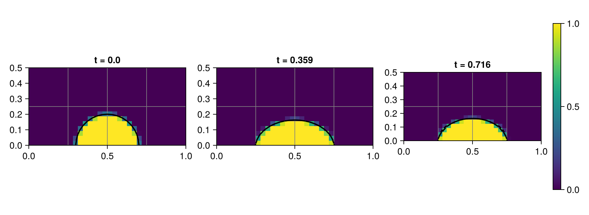
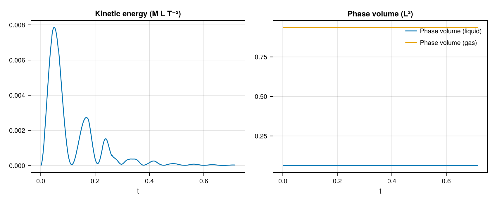

# 08 – Sessile droplet

A circular liquid cap relaxes under gravity and surface tension while maintaining a prescribed static contact angle at the lower wall.



## At a glance

| | |
| --- | --- |
| **Physics** | Two phases in the nonperiodic unit square with no-slip walls; liquid/gas density ratio `1000`, radius `0.2`, surface tension `1`, Bond number `1.21`, Laplace number `550`, and bottom-wall contact angle `π/2`. Gravity points downward, and `μ_g=0.0175 μ_l`. There is no embedded solid. |
| **Algorithms** | Default `OneVelocityModel()` with WY geometric VOF, LHF PLIC normals and WY fallback, CGFM surface tension, Lax–Wendroff momentum transport, implicit-midpoint diffusion and pressure projection with CG/tree-multigrid solvers. Interface and curvature AMR use minimum level 1 (clamped to `max_level`), 8 cells per radius, update interval 5 and coarsening delay 2. The prescribed wall angle enters the curvature approximation, not the PLIC advection plane. |
| **Worth varying** | `bond=1.21` changes gravity; `laplace=550` changes viscosity; `density_ratio=1000` changes phase density and derived gravity; `contact_angle=π/2` changes the initial circular cap and bottom-wall curvature condition; `max_level=3` sets the AMR ceiling; `final_time=nothing` selects eight capillary times. The forwarded `velocity_model` defaults to `OneVelocityModel()`. |
| **Validated against** | `:phase_volume` should remain constant. At docs size the initial discrete liquid area is `0.0628318530718`, matching the continuum semicircle area `π(0.2)^2/2`; the final change is `-5.73358e-12` and the maximum sampled absolute change is `2.43354e-10`. |
| **Cost** | The default level-3 run is unmeasured. Docs: level 2, `T≈0.716`, 460 steps and 640 final cells; setup and simulation took 16.08 s. Incremental generator compilation, including rendering, was 14.80 s in a shared single-thread process. |

## Setup

For radius `R=0.2`, the initial liquid lies inside the circle centred at `(0.5,-R cos θ)`. With `ρ=(1,0.001)` and `σ=1`, the script derives

```math
 g=\frac{\mathrm{Bo}\,\sigma}{(\rho_l-\rho_g)R^2},\qquad
 \mu_l=\sqrt{\frac{\sigma\rho_l R}{\mathrm{La}}},\qquad
 t_c=\sqrt{\frac{(\rho_l+\rho_g)R^3}{\sigma}}.
```

The default end time is `8t_c≈0.716`. The contact angle is imposed only in the lower-wall curvature condition; it is not a measured angle in the plot. See the [method reference](../../docs/src/method.md) for contact-angle curvature, surface tension and the viscous projection.

## Run

From the repository root, in a Julia session started with `--project=examples`:

```julia
include("examples/08_sessile_droplet/sessile_droplet.jl")
run = run_example(max_level = 2)
@show diagnostic_history(run.flow, :kinetic_energy).values[end]
@show diagnostic_history(run.flow, :phase_volume).values[end]
```

Run the interactive example or regenerate the headless Cairo figures:

```sh
julia --project=examples examples/08_sessile_droplet/sessile_droplet.jl
julia --project=examples -e 'include("examples/08_sessile_droplet/make_figures.jl"); make_figures()'
```

Use `make_figures(size=:default)` for the original level-3 setting.

## Results

The hero shows volume fraction and reconstructed interface near `0`, `4t_c` and `8t_c`; titles are actual nearest completed-step times, and gray outlines show AMR blocks.



The final kinetic energy is `7.8926e-5` (peak `0.00896671`), and liquid volume changes by `-5.73358e-12` from its initial discrete value. These diagnose motion and conservation; no contact-angle error is claimed.

## Variations

```julia
run_example(max_level = 2, contact_angle = pi / 3)            # different wall angle
run_example(max_level = 2, bond = 0.3)                        # weaker gravity
run_example(max_level = 2, velocity_model = TwoVelocityModel())
```

## Files

- [sessile_droplet.jl](sessile_droplet.jl) – circular-cap setup and flow diagnostics.
- [make_figures.jl](make_figures.jl) – retained interface snapshots and histories.
