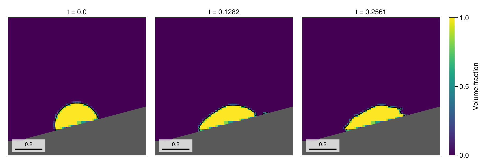
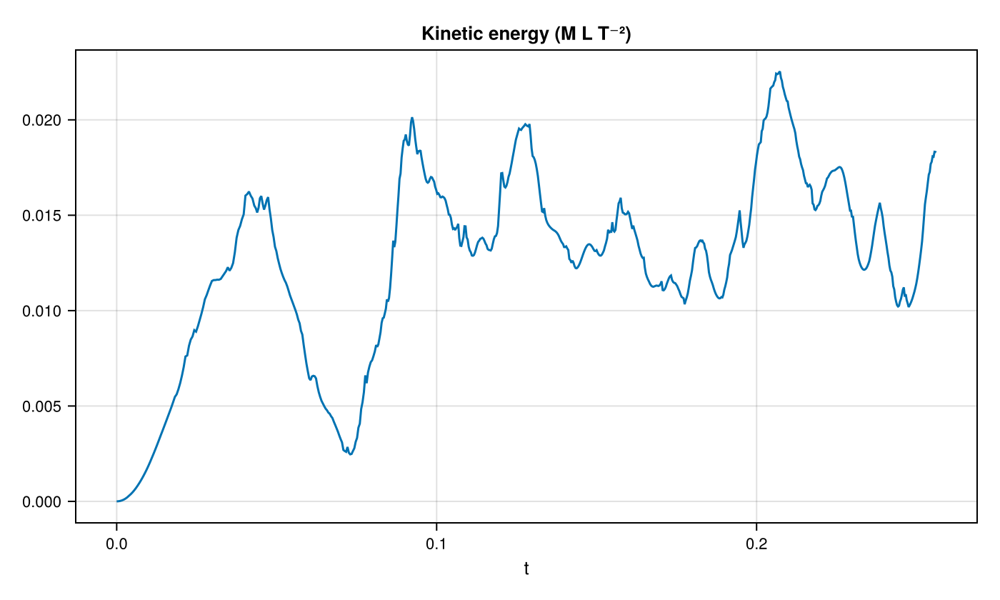
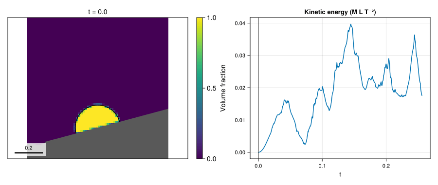

# 09 – Sloped sessile droplet

A liquid drop relaxes against an inclined embedded wall under capillarity and wall-normal gravity.

**Measurement provenance:** The figures and run measurements below predate the
fixed-band and curvature refinement corrections and have not been regenerated
for the current code.



## At a glance

| | |
| --- | --- |
| **Physics** | Two phases with densities `(1, 0.001)`, surface tension `σ=1`, radius `R=0.16`, Bond number `1.21`, Laplace number `550`, and embedded contact angle `π/2`; the nonperiodic unit square uses `FreeSlip()` domain boundaries. The wall passes through `(0.5, 0.22)` at angle `π/12`. |
| **Algorithms** | One velocity by default, geometric WY VOF transport, `:lhf` PLIC reconstruction with WY fallback, CGFM surface tension, Lax–Wendroff momentum advection and implicit-midpoint viscosity. Pressure and two-phase diffusion use CG with tree-geometric multigrid. Interface, curvature (8 cells per radius), and embedded-geometry indicators drive AMR; attempts occur every 2 steps with coarsen delay 2. |
| **Worth varying** | `wall_angle=π/12` rotates both wall and gravity; `bond=1.21` changes gravity; `laplace=550` changes viscosity; `density_ratio=1000` changes gas density and capillary time; `contact_angle=π/2` changes the initial cap and wall curvature condition; `max_level=2` changes the AMR ceiling; `final_time=nothing` selects four capillary times. |
| **Validated against** | Liquid volume should remain constant: `:phase_volume` changes by `-1.46794e-11` at docs size. The final volume-weighted `:divergence_norm` is `7.9249e-8` against zero; 3 curvature faces were unresolved cumulatively. No analytical drop-shape or contact-angle error is claimed. |
| **Cost** | Both gallery sizes use `max_level=3` (square cells, `dx = dy = 1/64` at level 3, 10 cells per radius) and `T=4t_c≈0.2561`; image dimensions differ. The docs run had 722 steps and 1984 final cells and took 96.24 s for setup and simulation in a single-thread shared gallery process, including incremental compilation. `run_example` keeps `max_level=2`. |

## Setup

The solid is the negative side of `n⋅(x−x₀)=0`, where `n=(-sin θ, cos θ)` and `x₀=(0.5,0.22)`. The liquid initially occupies the radius-`R` circle centred at `x₀−R cos(α)n`, clipped by that solid. Gravity is **normal to the wall**, not fixed vertically:

```math
\boldsymbol g=-\frac{Bo\,\sigma}{(\rho_l-\rho_g)R^2}\,\boldsymbol n,
\qquad \mu_l=\sqrt{\frac{\sigma\rho_l R}{La}},\quad
\mu_g=0.0175\mu_l,\quad t_c=\sqrt{\frac{(\rho_l+\rho_g)R^3}{\sigma}}.
```

The curvature calculation uses the static embedded contact angle; it does not impose that angle on the PLIC advection plane. See the [method reference](../../docs/src/method.md) for cut cells, interface transport, forces and projection.

## Run

From the repository root, run headlessly:

```julia
include("examples/09_sloped_sessile_droplet/sloped_sessile_droplet.jl")
run = run_example(max_level=2, final_time=0.1)
print_simulation_summary(run.flow, run.result)
```

Generate the gallery figures with CairoMakie, or run the example to record keyframes in `run.recorder` (accessible via `snapshot_store(run.recorder)`):

```sh
julia --project=examples examples/09_sloped_sessile_droplet/make_figures.jl
julia --project=examples examples/09_sloped_sessile_droplet/sloped_sessile_droplet.jl
```

Append `--studio` to the example command to follow the run in a browser;
press Ctrl+C to close Studio after the run.

## Results

The hero shows liquid volume fraction and reconstructed interface, with the filled wall and block outlines, at the completed states nearest `0`, `2t_c` and `4t_c`; panel titles give the actual retained times.



At the end of the run `:kinetic_energy` is `0.0182955`, while liquid volume changed by `-1.46794e-11` from its initial discrete value.



The 41 retained states: volume fraction, interface and wall, next to the kinetic energy with a cursor at the shown time.

## Variations

```julia
run_example(wall_angle=pi/6, final_time=0.1)   # rotate wall and gravity together
run_example(contact_angle=pi/3, final_time=0.1) # change the cap and contact condition
run_example(max_level=3, final_time=0.1)        # finer local refinement
```

## Files

- [sloped_sessile_droplet.jl](sloped_sessile_droplet.jl): simulation and interactive entry point.
- [make_figures.jl](make_figures.jl): headless snapshot and kinetic-energy figures.
- `assets/`: generated PNGs and GIF.
