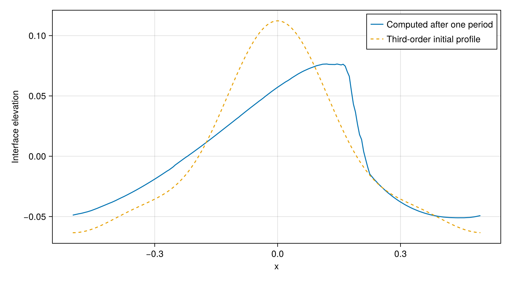
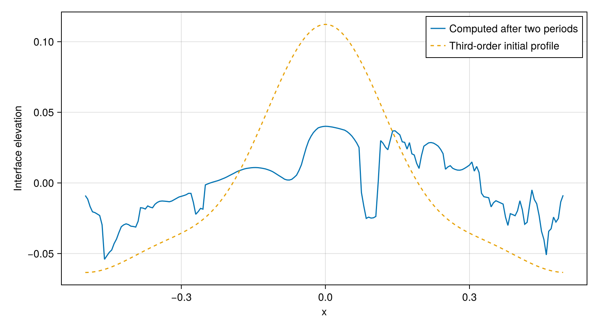
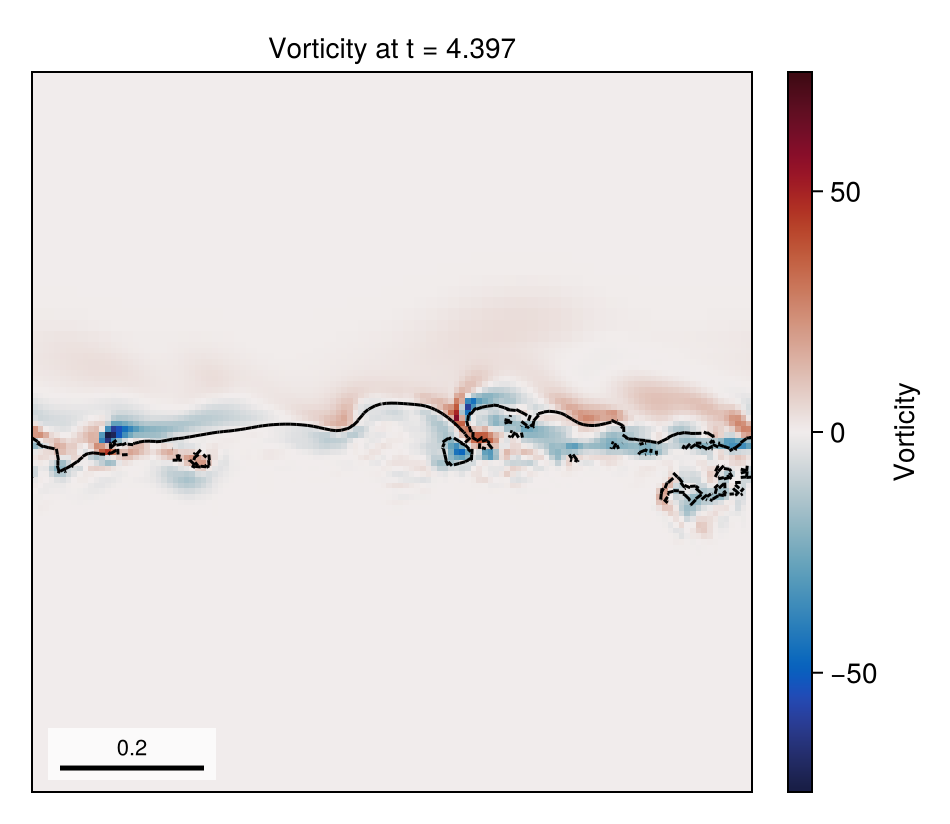
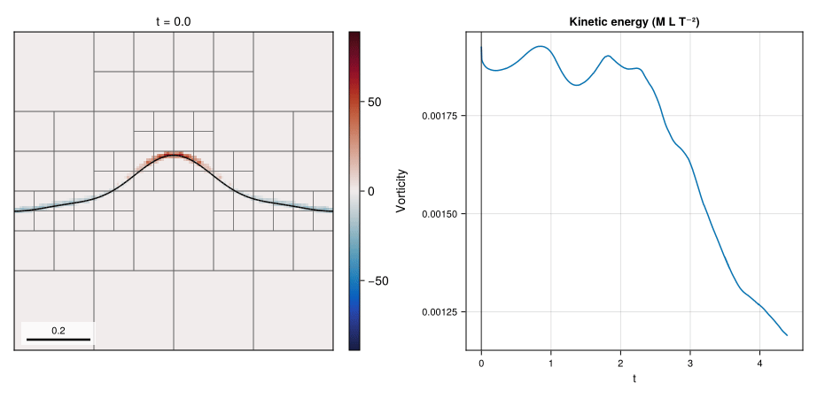

# 10 – Third-order Stokes wave

A steep, finite-depth wave propagates for two nominal periods on an adaptively refined two-phase mesh.



The wave breaks within the first period. The snapshot comes from a separate level-5 run of the first period (finest `dx = dy = 1/256`): the first state with an entrapped gas pocket (`t/T≈0.640`), located by re-running the bracketing keyframe interval with every step stored as a keyframe; half a wavelength wide, vorticity with a symmetric range. The animation and profile below come from the level-4 docs run.

## At a glance

| | |
| --- | --- |
| **Physics** | Two phases, density ratio `850`, `g=1`, Bond number `1000`, Reynolds number `4×10⁴`, steepness `0.55` and depth `0.5`. The domain is `[-0.5,0.5]²`, periodic in `x` with free-slip `y` boundaries. |
| **Algorithms** | One velocity by default; WY geometric VOF, `:lhf` PLIC with WY fallback, CGFM surface tension, Lax–Wendroff momentum advection and implicit-midpoint viscosity. Pressure and two-phase diffusion use CG with tree-geometric multigrid. AMR combines the interface indicator through `t=0.01`, curvature at 8 cells per radius, and vorticity thresholds `0.2` and `0.2/3`; adaptation is attempted every step with coarsen delay 2. |
| **Worth varying** | `steepness=0.55` changes the initialized wave and frequency; `bond=1000` changes surface tension; `reynolds=4e4` changes viscosity; `density_ratio=850` changes gas density; `max_level=5` sets the refinement ceiling; `final_time=nothing` selects one nominal period. |
| **Validated against** | At docs size, the final interface after two periods, at 200 evenly spaced `x` positions, differs from the analytical third-order *initial* profile by sample RMS `0.0449043` and maximum `0.103414`. This approximate Stokes profile is not an exact solution of the viscous, capillary, two-phase problem. |
| **Cost** | `run_example` default: `max_level=5`, one period, runtime and final cells unmeasured. Gallery `:docs`: `max_level=4`, two periods (`T≈4.39705`), 2308 steps and 6208 final cells; setup and simulation took 157.4 s on one thread, including first-use compilation, and the separate level-5 first-period hero and impact-location runs took 288.3 s. The whole figure script took 501.2 s. Gallery `:default` uses `max_level=6`, two periods. |

## Setup

The liquid occupies the region below the third-order profile returned by `stokes3_initial_condition().elevation`; its initial analytical velocity is projected before time integration. With `k=2π`, `h=0.5`, `ε=0.55` and `χ=coth(kh)`, the initialization uses

```math
\omega^2=\frac{gk}{\chi}\left[1+\epsilon^2\left(\frac98(\chi^2-1)^2+\chi^2\right)\right],
\qquad T=\frac{2\pi}{\omega},\qquad
\sigma=\frac{(\rho_l-\rho_g)g}{Bo\,k^2}.
```

The viscosity pair is `(1/Re, 1/(51.15Re))`. The plotted reference is the third-order initialization expression evaluated at the same `x` values, not a fitted or shifted curve. See the [method reference](../../docs/src/method.md) for VOF, projection, viscosity and AMR.

## Run

From the repository root:

```julia
include("examples/10_stokes3_wave/stokes3_wave.jl")
run = run_example(max_level=3)  # one nominal wave period
print_simulation_summary(run.flow, run.result)
```

```sh
julia --project=examples examples/10_stokes3_wave/make_figures.jl
julia --project=examples examples/10_stokes3_wave/stokes3_wave.jl
```

Append `--studio` to the example command to follow the run in a browser;
press Ctrl+C to close Studio after the run.

## Results



After two nominal periods, the sampled interface differs from the third-order initialization by RMS `0.0449043` and maximum `0.103414`; the wave has broken, so these differences include physical model differences as well as numerical error.



Vorticity at the final retained state, with the PLIC interface. The signed vorticity color range is selected automatically.



The animation contains 41 retained states nearest equally spaced requested times over two periods, with one symmetric vorticity range over all frames and the kinetic energy with a cursor at the shown time. The summary also prints kinetic energy, phase volumes, divergence, momentum, regrids, final cell count and elapsed setup/simulation time.

## Variations

```julia
run_example(steepness=0.35, max_level=3)          # reduce wave nonlinearity
run_example(max_level=4)                           # increase spatial refinement
run_example(max_level=3, velocity_model=TwoVelocityModel()) # liquid wave, gas initially at rest
```

The two-velocity option uses the script's phase-specific initializer; the displayed profile comparison above uses the default one-velocity model.

## Files

- [stokes3_wave.jl](stokes3_wave.jl): analytical initialization and simulation.
- [make_figures.jl](make_figures.jl): profile, vorticity, animation, and repository README animation generation.
- `assets/`: generated PNGs (breaking snapshot, profile, final vorticity), the docs-run GIF, and the light and dark repository README GIFs (`readme_light.gif`, `readme_dark.gif`): 81 output frames on a uniform simulation-time grid over `t/T=0.475–1`, each showing the nearest of 49 level-5 keyframes, over plunging, impact and splash-up, with one vorticity range (the 99.9 % quantile of its magnitude) for all frames.
