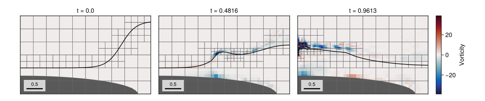
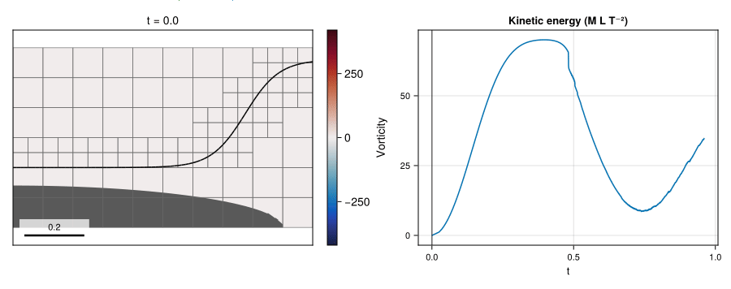

# 11 – Large gas-pocket impact

A steep liquid front evolves over an embedded elliptical bathymetry in a scaled two-phase impact benchmark.



## At a glance

| | |
| --- | --- |
| **Physics** | Liquid/gas densities `(1000, 1)`, dynamic viscosities `(10⁻³, 1.75×10⁻⁵)`, surface tension `0.073` and gravity `(0, -9.81)`. At `scale=20` the nonperiodic domain is `1 × 0.6`, with free-slip outer boundaries and an embedded elliptical solid. |
| **Algorithms** | Two velocities by default (`TwoVelocityModel()`), with frozen-interface WY transport and `CMDGFMProjection()` (a block-preconditioned BiCGSTAB solve); WY geometric VOF, `:lhf` PLIC with WY fallback, CGFM surface tension, monotonized-central (`MonotonizedCentral()`) momentum advection, implicit-midpoint viscosity, and CG/tree-geometric multigrid for diffusion. The interface indicator targets `min(1,max_level)` and the liquid-velocity vorticity indicator refines up to `max_level` at `0.25` and coarsens below `0.25/3`. Both use `ymin=refinement_ymin`; AMR is checked every 5 steps with coarsen delay 10. |
| **Worth varying** | `scale=20` by default; changing it rescales the prescribed domain and initial geometry while leaving the listed physical coefficients fixed. `max_level=4` changes the vorticity-refinement ceiling; `final_time=nothing` selects `1.2` gravity periods. `refinement_ymin` overrides the default solid-adjacent exclusion height; `velocity_model=OneVelocityModel()` selects a shared velocity; `numerics=NavierStokesOptions(advection=AdvectionOptions(scheme=LaxWendroff()))` selects Lax–Wendroff momentum advection, which can leave visible dispersive noise in the vorticity of this impact. Other supported `FlowSimulation` options can be passed as keywords. |
| **Validation status** | In the documented level-3 run, liquid volume changes by `−3.61×10⁻⁹` from about `0.182426` over the full simulation. There are 994 cumulative unresolved-curvature face events; the later fragmented interface is not resolved well enough to validate entrainment. No experimental impact or interface-position error is claimed. |

Gallery timings: Julia 1.12.7, one Julia thread and one BLAS thread, AMD Ryzen 9 5950X; package loading is excluded.
| **Cost** | The documented, instrumented two-velocity run used `max_level=3`, `T≈0.961327` (1.2 gravity periods), 17700 steps, 2982 mesh updates and 10368 final cells; setup and simulation took about 7027 s on one thread in a shared process, including first-call compilation. The example default uses `max_level=4`. |

The cumulative wall time in that run was approximately 104, 112, 121, 141,
307, 882, 1947, 3612 and 5591 s at simulated times near 0.1, 0.2, 0.3, 0.4,
0.5, 0.6, 0.7, 0.8 and 0.9, respectively. The impact and later evolution cost
substantially more than the early motion.

## Setup

The liquid initially lies below the tanh-shaped profile, while the negative side of the ellipse is solid. At the default scale,

```math
\eta(x)=0.38+0.18\tanh\!\bigl(8.8(x-0.775)\bigr),\qquad
\phi_s(x,y)=\sqrt{(x/0.9)^2+(y/0.14)^2}-1.
```

The ellipse reaches its highest point at `y=2.8/scale=0.14`. Adding two
level-zero cell heights (`2 × 0.025`) gives `0.19`; with a base-block height
of `0.1`, the next block boundary is at `0.2`, and half a coarse cell above it
gives `refinement_ymin=0.2125`.
The geometry indicator is omitted because it would refine the solid boundary.
Blocks below this threshold request coarsening, but 2:1 grading can still
refine solid-adjacent blocks by one level next to refined blocks.

The initial velocity is zero. For wavelength `λ=1`, the script uses the gravity-wave timescale

```math
t_g=\sqrt{\frac{\rho_l+\rho_g}{\rho_l-\rho_g}\frac{2\pi\lambda}{g}},
\qquad T=1.2t_g.
```

The fluids and gravity are unchanged when the geometry is rescaled. With a
gravity-based velocity scale, the smaller default geometry has lower Reynolds
and Weber numbers than a larger one.

See the [method reference](../../docs/src/method.md) for embedded cut cells, two-phase transport, forcing and adaptive refinement.

The vorticity plots show the intrinsic value of the majority phase in each
cell, with the reconstructed interface drawn on top. The vorticity refinement
indicator uses the liquid velocity, not the gas velocity.

## Run

From the repository root, a short headless run is:

```julia
include("examples/11_lgpi/lgpi.jl")
run = run_example(max_level=1, final_time=0.1)
print_simulation_summary(run.flow, run.result)
```

The first command runs the full two-velocity level-3 calculation and regenerates
the docs assets; the second runs the level-4 default without exporting
figures. Both use the full end time and are subject to the validation caveat
above:

```sh
julia --project=examples -t 1 examples/11_lgpi/make_figures.jl
julia --project=examples -t 1 examples/11_lgpi/lgpi.jl
```

The figure generator always runs the simulation. It accepts `final_time` to
change the simulated end time and `display_time` to limit the exported frames
without shortening the simulation:

```julia
include("examples/11_lgpi/make_figures.jl")
make_figures(display_time=0.9)
```

By default the figures show all recorded frames.

## Results

The hero displays two-velocity vorticity, the PLIC interface, AMR blocks and
filled bathymetry at three times from the level-3 run.



The GIF shows the same run with block outlines and a synchronized
kinetic-energy cursor; the energy plot includes the full simulation history.
Vorticity uses a symmetric range of ±364.35, the 99.9th percentile of
rasterized magnitudes in the displayed frames. Larger values saturate: the
sampled peak is 3225.67 near `(x,y)=(0.01125,0.59875)` at `t≈0.5047`.
The final displayed frame is at `t≈0.9613`.

The later fragmented interface and its wall interaction are under-resolved at
this level; the full animation is shown for context, not as validated
entrainment.

## Variations

```julia
run_example(max_level=1, final_time=0.1)           # inexpensive short evolution
run_example(max_level=2, final_time=0.3)           # shorter level-2 evolution
run_example(scale=10, max_level=1, final_time=0.1) # rescale initial geometry
run_example(max_level=1, final_time=0.1, velocity_model=OneVelocityModel()) # shared velocity
```

## Files

- [lgpi.jl](lgpi.jl): benchmark geometry and simulation.
- [make_figures.jl](make_figures.jl): three snapshots and animation.
- `assets/`: generated PNG and GIF.
