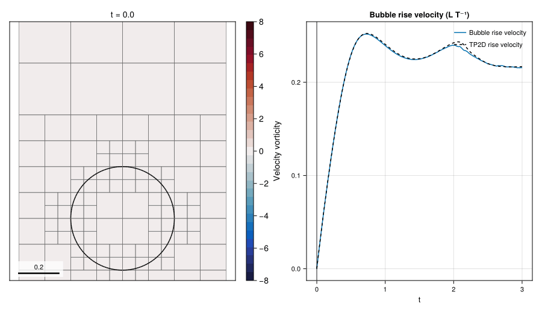
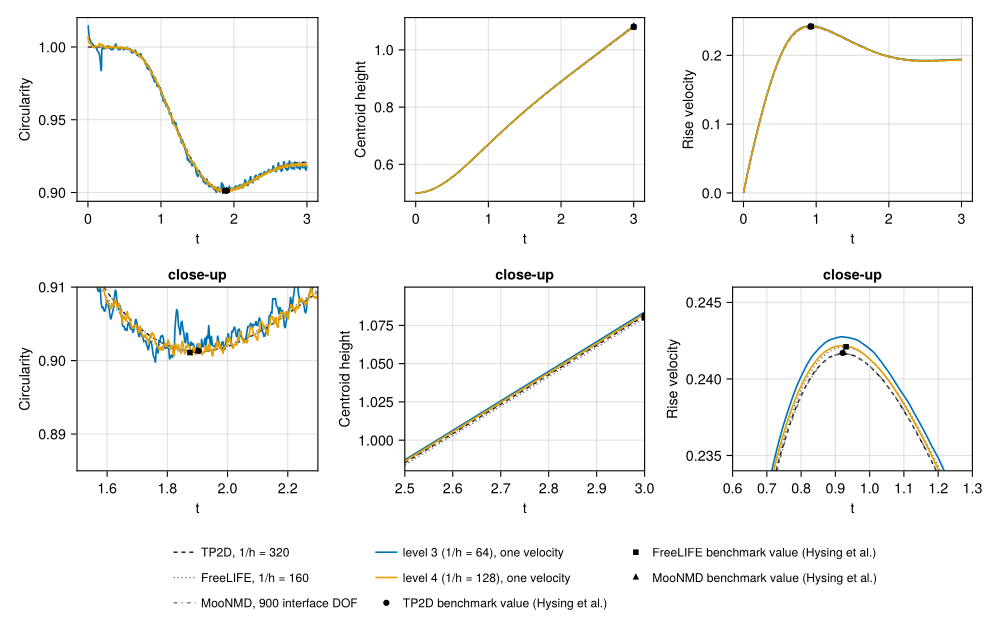
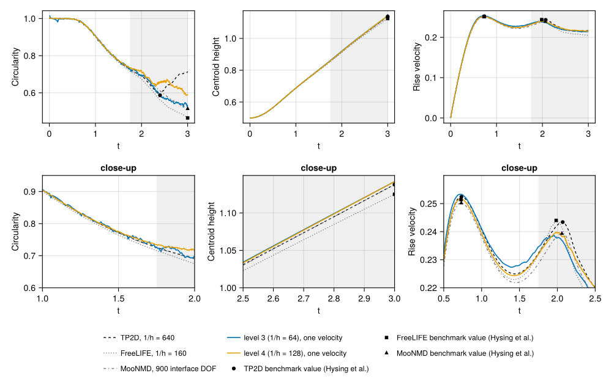
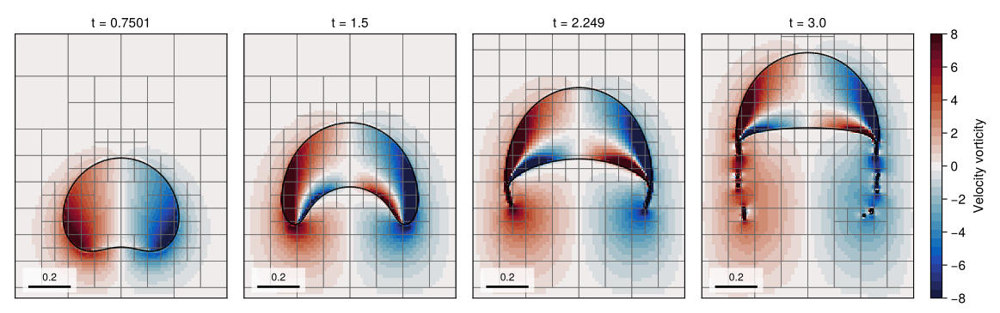
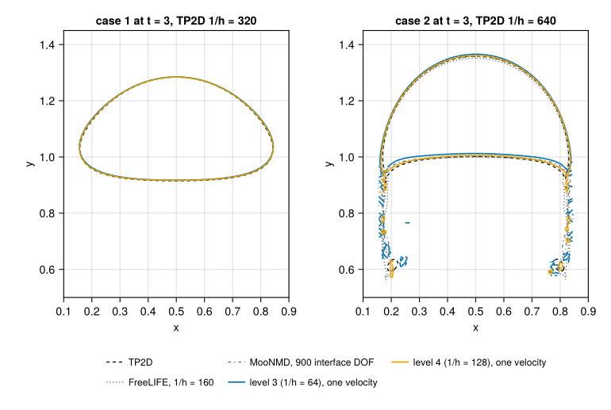

# 11 – Rising bubble

A bubble rises through a heavier liquid in the two-dimensional benchmark of Hysing et al. (2009): in case 1 it settles into an ellipse, in case 2 (density ratio 1000) it grows a skirt whose filaments break into satellite bubbles. Circularity, centroid height and rise velocity are compared with the benchmark's three reference codes.



*The level-4 case-2 run: vorticity of the one-velocity field on a fixed `±8` range with the PLIC interface and AMR blocks, next to the rise velocity with TP2D's `1/h = 640` curve and a cursor at the shown time.*

## At a glance

| | |
| --- | --- |
| **Physics** | Test cases 1 and 2 of [Hysing et al. (2009)](https://doi.org/10.1002/fld.1934): a bubble of radius `0.25` starts at rest at `(0.5, 0.5)` in `[0,1] × [0,2]` under gravity `0.98`, `t ∈ [0, 3]`. Case 1: `ρ = (1000, 100)`, `μ = (10, 1)`, `σ = 24.5` (`Re = 35`, `Eo = 10`); case 2: `ρ = (1000, 1)`, `μ = (10, 0.1)`, `σ = 1.96` (`Re = 35`, `Eo = 125`), liquid first. Both cases use free-slip side walls and no-slip top and bottom walls, matching the benchmark. |
| **Algorithms** | Default `OneVelocityModel()` for both cases, with WY geometric VOF, LHF PLIC normals with WY fallback, CGFM surface tension, Lax–Wendroff momentum transport, implicit-midpoint variable-viscosity diffusion (harmonic mean) and pressure projection with CG/tree-multigrid solvers. Interface AMR refines a band around the interface to `max_level` (update interval 5, coarsening delay 2); the rest of the domain stays at least at `far_field_level = max_level - 2`. Square cells: `dx = dy = 1/8` on level 0, `1/128` at the default level 4 around the interface (64 cells per bubble diameter) and `1/32` in the far field. Circularity, centroid height and rise velocity are custom diagnostics of the gas phase. |
| **Worth varying** | `case=1` selects the test case; `max_level=4` the interface resolution; `far_field_level=max_level-2` the background mesh; `final_time=3.0` the end time; `velocity_model=OneVelocityModel()`, or `TwoVelocityModel(pressure_projection = CMDGFMProjection())` for separate phase velocities. `boundary=FreeSlip()` or `boundary=NoSlip()` overrides the benchmark and uses the same condition on all four walls. |
| **Validated against** | The benchmark quantities and finest-grid time series of TP2D, FreeLIFE and MooNMD, and the paper's relative error norms. At level 5 (`1/h = 256`), case 1 gives `c_min = 0.9008`, `V_c,max = 0.2419`, `y_c(3) = 1.0820` against TP2D's `0.9013`, `0.2417`, `1.0813`. Case 2's velocity peaks, `0.2508` and `0.2401`, are within the three codes' spread. Hysing et al. caution that the final case-2 centroid is not meaningful because the final shape is unknown. The case-2 time-series norms stop at `t = 1.75`. |
| **Cost** | Default and `:docs`: level 4. Case 1 took 2874 steps and ended with 7808 cells; case 2 took 931 steps and ended with 12224 cells. At level 4, setup and simulation took 114.59 s and 70.22 s, respectively, after the level-3 runs (50.17 s and 12.27 s). The full figure script took 283.29 s, including both resolutions, figures and the 81-frame GIF, but excluding package loading. |

Gallery timings: Julia 1.12.7, one Julia thread and one BLAS thread, AMD Ryzen 9 5950X; package loading is excluded.

## Setup

| Case | `ρ_l` | `ρ_g` | `μ_l` | `μ_g` | `σ` | `Re` | `Eo` | Density ratio | Viscosity ratio |
| --- | --- | --- | --- | --- | --- | --- | --- | --- | --- |
| 1 | 1000 | 100 | 10 | 1 | 24.5 | 35 | 10 | 10 | 10 |
| 2 | 1000 | 1 | 10 | 0.1 | 1.96 | 35 | 125 | 1000 | 100 |

With `L = 2r = 0.5` and `U_g = √(gL)`, `Re = ρ_l U_g L/μ_l` and `Eo = ρ_l U_g² L/σ`. The bubble is the gas phase `Ω_b` (fraction `1 − C`) with area `A_b` and perimeter `P_b`; the benchmark quantities are

```math
c=\frac{2\sqrt{\pi A_b}}{P_b},\qquad
y_c=\frac{1}{A_b}\int_{\Omega_b} y\,\mathrm{d}\mathbf{x},\qquad
V_c=\frac{1}{A_b}\int_{\Omega_b} v\,\mathrm{d}\mathbf{x}.
```

`:circularity` takes `A_b` from `PhaseVolume()` and `P_b` from `InterfaceMeasure()`, the total length of the PLIC segments. `:centroid` weights every cell centre with its gas volume. `:rise_velocity` weights every vertical face velocity with the gas volume of its staggered control volume (the spacing-weighted mean of its two cells' fractions); with two velocities it averages the gas velocity, which exists on the faces with gas. All three include satellite bubbles after a breakup, as the benchmark's integrals over `Ω_b` do. Across the one-velocity benchmark runs, the largest absolute change in gas area is `3.7e-9`.

**Walls.** The default is `VelocityBoundaryConditions(left = FreeSlip(), right = FreeSlip(), bottom = NoSlip(), top = NoSlip())`. All four walls are impermeable. The vertical walls allow tangential flow; the floor and lid fix tangential velocity to zero.

**Circularity spikes.** The PLIC perimeter produces short spikes in `c(t)`. At `t = 0`, the circle touches grid lines at four vertices; the PLIC segments in the adjacent sliver cells shorten the summed perimeter by about `1.5h`. This gives `c(0) = 1.0144`, `1.0074`, `1.0037` at levels 3, 4, 5. Similar short dips occur when the moving interface passes a grid line almost tangentially. The tables give the raw minima defined by the benchmark.

See the [method reference](../../docs/src/method.md) for the interface transport, surface tension, viscous step and projection.

## Run

From the repository root, in a Julia session started with `--project=examples`:

```julia
include("examples/11_rising_bubble/rising_bubble.jl")
run = run_example(case = 1, max_level = 3)
@show minimum(diagnostic_history(run.flow, :circularity).values)
@show maximum(diagnostic_history(run.flow, :rise_velocity).values)
@show diagnostic_history(run.flow, :centroid).values[end]
```

Run the example headlessly or regenerate the Cairo figures:

```sh
julia --project=examples examples/11_rising_bubble/rising_bubble.jl            # case 1
julia --project=examples examples/11_rising_bubble/rising_bubble.jl --case=2
julia --project=examples -e 'include("examples/11_rising_bubble/make_figures.jl"); make_figures()'
```

Append `--studio` to the example command to follow the run in a browser;
press Ctrl+C to close Studio after the run.

`make_figures(size = :docs)` runs both cases at levels 3 and 4 and prints their benchmark quantities and error norms; `size = :default` adds level 5. The level-5 and two-velocity rows use `run_example` at `max_level = 5` or with `velocity_model = TwoVelocityModel()`.

## Results

The reference curves are the benchmark's published time series on each code's finest grid (TP2D `1/h = 320` in case 1 and `640` in case 2, FreeLIFE `1/h = 160`, MooNMD 900 interface degrees of freedom), from the [FeatFlow reference data](https://wwwold.mathematik.tu-dortmund.de/~featflow/en/benchmarks/cfdbenchmarking/bubble/bubble_reference.html), subsampled every 0.02 time units into `hysing_reference.csv`; the markers are the values tabulated in Hysing et al. (2009), Tables XII and XVI.

### Case 1



Circularity, centroid height and rise velocity against time, with close-ups below.

| Run | `1/h` | `c_min` (t) | `V_c,max` (t) | `y_c(3)` | Steps | Final cells | Time |
| --- | --- | --- | --- | --- | --- | --- | --- |
| Level 3, one velocity | 64 | 0.8997 (1.760) | 0.2428 (0.922) | 1.0837 | 1016 | 3584 | 50 s |
| Level 3, two velocities | 64 | 0.9021 (1.979) | 0.2429 (0.898) | 1.0842 | 1016 | 3584 | 76 s |
| Level 4, one velocity | 128 | 0.9006 (1.951) | 0.2422 (0.922) | 1.0826 | 2874 | 7808 | 115 s |
| Level 4, two velocities | 128 | 0.9014 (1.890) | 0.2423 (0.921) | 1.0829 | 2874 | 7808 | 193 s |
| Level 5, one velocity | 256 | 0.9008 (1.860) | 0.2419 (0.922) | 1.0820 | 8127 | 22784 | 837 s |
| TP2D | 320 | 0.9013 (1.9041) | 0.2417 (0.9213) | 1.0813 | | | |
| FreeLIFE | 160 | 0.9011 (1.8750) | 0.2421 (0.9313) | 1.0799 | | | |
| MooNMD | 900 DOF | 0.9013 (1.9000) | 0.2417 (0.9239) | 1.0817 | | | |

The one-velocity timings at levels 3 and 4 are from the single `:docs` figure run: the case-1 level-3 run includes compilation, while case 2 follows it in the same process. The other timings include setup and compilation in fresh processes. All were measured with other jobs sharing the machine.

At level 5, the three quantities differ from TP2D by `−0.0005`, `+0.0002` and `+0.0007`. The peak speed is within the codes' spread; the final centroid is `0.0003` above it. The raw circularity minimum is a perimeter spike.
Raising the far field from level 2 to 3 at the same level-4 interface resolution changes `c_min`, `V_c,max` and `y_c(3)` by `−4.5e-5`, `+1.4e-5` and `+2.9e-5`, respectively.

### Case 2



The same quantities for case 2. The codes' benchmark quantities "agree very well with each other up until t=1.75–2.0" (Hysing et al., §5.4); afterwards the filaments of the skirt break up differently in TP2D and FreeLIFE and not at all in MooNMD. The paper calls the late results "rather inconclusive" and the final centroid "quite meaningless" because the final shape is unknown. The listed final centroids are therefore not a validation band.

| Run | `1/h` | `V_c,max1` (t) | `V_c,max2` (t) | `y_c(3)` | `c_min` (t) | Steps | Final cells | Time |
| --- | --- | --- | --- | --- | --- | --- | --- | --- |
| Level 3, one velocity | 64 | 0.2533 (0.727) | 0.2387 (1.959) | 1.1419 | 0.5214 (2.907) | 371 | 5120 | 12 s |
| Level 3, two velocities | 64 | 0.2532 (0.717) | 0.2385 (1.949) | 1.1427 | 0.5417 (2.804) | 336 | 5120 | 66 s |
| Level 4, one velocity | 128 | 0.2516 (0.722) | 0.2398 (1.983) | 1.1418 | 0.5850 (2.969) | 931 | 12224 | 70 s |
| Level 4, two velocities | 128 | 0.2516 (0.722) | 0.2402 (2.021) | 1.1422 | 0.6008 (2.916) | 852 | 11840 | 122 s |
| Level 5, one velocity | 256 | 0.2508 (0.726) | 0.2401 (2.048) | 1.1400 | 0.5325 (2.996) | 2410 | 30656 | 518 s |
| Level 5, two velocities | 256 | 0.2509 (0.726) | 0.2403 (2.047) | 1.1403 | 0.5505 (3.000) | 2410 | 30272 | 592 s |
| TP2D | 640 | 0.2524 (0.7332) | 0.2434 (2.0705) | 1.1380 | 0.5869 (2.4004) | | | |
| FreeLIFE | 160 | 0.2514 (0.7281) | 0.2440 (1.9844) | 1.1249 | 0.4647 (3.0) | | | |
| MooNMD | 900 DOF | 0.2502 (0.7317) | 0.2393 (2.0600) | 1.1376 | 0.5144 (3.0) | | | |

The first maximum falls from `0.2533` to `0.2508` under refinement, from above TP2D's value to between FreeLIFE's and MooNMD's. The level-3 second maximum is `0.0006` below the reference spread, and the level-4 and level-5 values are inside it. The level-5 second peak occurs at `t = 2.048`, between FreeLIFE's `1.984` and MooNMD's `2.060`. The one-velocity `y_c(3)` values lie `0.0020–0.0039` above TP2D's result, and the two-velocity values `0.0023–0.0047` above it; these late centroids are subject to the caveat above. `c_min` falls near `t = 3` and depends on the filaments, for which there is no agreed reference.



The lead animation is the level-4 case-2 run until `t = 3`: vorticity of the one-velocity field on a fixed `±8` range, the PLIC interface and the AMR blocks, next to the rise velocity with TP2D's `1/h = 640` curve and a cursor at the shown time. The GIF has 81 output frames, one per keyframe, on a uniform simulation-time grid with spacing `3/80 = 0.0375`; each keyframe is the completed step nearest its requested time. The range saturates on purpose inside the skirt so that the liquid wake stays visible; the snapshots above show the same run at `t = 0.75`, `1.5`, `2.25` and `3`. The bubble flattens, its rim folds into a skirt, and the skirt's tips thin into filaments and shed satellites. Hysing et al. report breakup around `t = 2.2–2.4` for TP2D at `1/h = 160`.

### Shapes at t = 3



Final PLIC segments of the figure runs against the codes' shapes at `t = 3` (FeatFlow reference data, chained into curves and decimated to within `2e-4` into `hysing_shapes.csv`). In case 1 the level-4 interface visually nearly overlaps the available TP2D shape. In case 2 the cap visually agrees closely with all three codes, but the ends of the skirts differ: MooNMD keeps long filaments, TP2D and FreeLIFE shed satellites, and the example shows finer fragments at level 4.

### Error norms

Hysing et al. (2009, §2.6) measure a whole time series `q_t` against a reference `q_t,ref` with the relative norms

```math
\|e\|_1=\frac{\sum_t |q_{t,\mathrm{ref}}-q_t|}{\sum_t |q_{t,\mathrm{ref}}|},\qquad
\|e\|_2=\left(\frac{\sum_t |q_{t,\mathrm{ref}}-q_t|^2}{\sum_t |q_{t,\mathrm{ref}}|^2}\right)^{1/2},\qquad
\|e\|_\infty=\frac{\max_t |q_{t,\mathrm{ref}}-q_t|}{\max_t |q_{t,\mathrm{ref}}|},
```

and the rate of convergence `ROC = log10(‖e^{l−1}‖/‖e^l‖)/log10(h^{l−1}/h^l)`, with linear interpolation between the sample times. Here both series are interpolated linearly onto `t_k = 0.001 k`, `k = 1, …, 3000` (case 2: up to `t = 1.75`, where the codes part ways); like the paper's sums over time steps this leaves out the initial state. The references are the subsampled series of `hysing_reference.csv`. For case-1 level-5 rise velocity, using the complete published series instead changes the three norms by 5.0–7.3 %. `make_figures` prints all norms, also against FreeLIFE and MooNMD and between the codes.

| Case | Quantity | `1/h` | `‖e‖₁` | ROC₁ | `‖e‖₂` | ROC₂ | `‖e‖∞` | ROC∞ |
| --- | --- | --- | --- | --- | --- | --- | --- | --- |
| 1 | Circularity | 64 | 1.76e-3 | | 2.56e-3 | | 1.65e-2 | |
| | | 128 | 7.58e-4 | 1.22 | 1.00e-3 | 1.35 | 7.42e-3 | 1.15 |
| | | 256 | 3.32e-4 | 1.19 | 4.42e-4 | 1.18 | 4.02e-3 | 0.88 |
| | Centroid | 64 | 1.42e-3 | | 1.68e-3 | | 2.19e-3 | |
| | | 128 | 8.98e-4 | 0.66 | 1.01e-3 | 0.72 | 1.15e-3 | 0.93 |
| | | 256 | 5.51e-4 | 0.71 | 5.99e-4 | 0.76 | 6.16e-4 | 0.90 |
| | Rise velocity | 64 | 4.07e-3 | | 4.25e-3 | | 5.29e-3 | |
| | | 128 | 1.71e-3 | 1.25 | 1.92e-3 | 1.14 | 3.18e-3 | 0.73 |
| | | 256 | 7.35e-4 | 1.22 | 9.43e-4 | 1.03 | 1.77e-3 | 0.84 |
| 2, `t ≤ 1.75` | Circularity | 64 | 2.93e-3 | | 4.25e-3 | | 1.83e-2 | |
| | | 128 | 1.56e-3 | 0.91 | 2.67e-3 | 0.67 | 9.10e-3 | 1.01 |
| | | 256 | 5.80e-4 | 1.42 | 9.35e-4 | 1.51 | 3.89e-3 | 1.23 |
| | Centroid | 64 | 1.58e-3 | | 2.02e-3 | | 3.78e-3 | |
| | | 128 | 7.95e-4 | 0.99 | 9.32e-4 | 1.11 | 1.54e-3 | 1.29 |
| | | 256 | 2.90e-4 | 1.45 | 3.37e-4 | 1.47 | 4.57e-4 | 1.76 |
| | Rise velocity | 64 | 7.33e-3 | | 8.32e-3 | | 1.19e-2 | |
| | | 128 | 2.99e-3 | 1.29 | 3.50e-3 | 1.25 | 5.28e-3 | 1.17 |
| | | 256 | 6.92e-3 | −1.21 | 7.51e-3 | −1.10 | 8.45e-3 | −0.68 |

One velocity against TP2D. For scale, the codes differ from TP2D by

| Case | Code | Circularity `‖e‖₁/‖e‖₂/‖e‖∞` | Centroid | Rise velocity |
| --- | --- | --- | --- | --- |
| 1 | FreeLIFE | 3.70e-4 / 4.90e-4 / 9.85e-4 | 9.44e-4 / 1.06e-3 / 1.34e-3 | 2.17e-3 / 2.25e-3 / 3.11e-3 |
| 1 | MooNMD | 8.63e-5 / 1.19e-4 / 2.64e-4 | 3.23e-4 / 3.52e-4 / 4.01e-4 | 2.39e-4 / 3.19e-4 / 2.66e-3 |
| 2, `t ≤ 1.75` | FreeLIFE | 3.61e-3 / 4.98e-3 / 9.92e-3 | 2.97e-3 / 3.55e-3 / 5.17e-3 | 6.84e-3 / 6.93e-3 / 8.63e-3 |
| 2, `t ≤ 1.75` | MooNMD | 4.07e-4 / 5.36e-4 / 1.02e-3 | 3.95e-4 / 5.75e-4 / 1.09e-3 | 1.06e-2 / 1.11e-2 / 1.46e-2 |

At level 5 in case 1, the relative `‖e‖₁` against TP2D is `5.51e-4` in centroid and `7.35e-4` in rise velocity (FreeLIFE: `9.44e-4` and `2.17e-3`). The earlier all-free-slip level-5 run gives `‖e‖₁ = 2.24e-3` in rise velocity and predates the per-wall API and WY round-off fix. At level 4, rerunning all-free-slip with the current code reproduces the earlier exported diagnostic histories; changing only the floor and lid there reduces the speed `‖e‖₁` from `2.18e-3` to `1.71e-3`.

In case 2 the level-5 rise velocity is farther from TP2D than at level 4 (`‖e‖₁ = 6.92e-3` versus `2.99e-3` over `t ≤ 1.75`), near the difference between FreeLIFE and TP2D (`6.84e-3`). The first speed maximum moves below TP2D's toward MooNMD's. At matched level 4, changing only the floor and lid reduces `‖e‖₁` from `3.89e-3` to `2.99e-3`. The final centroid changes by only `+3.1e-5` from the earlier all-free-slip level-5 run and remains higher than all three reference results.

The paper measures each code against its own finest grid. The example against its level 5, next to Tables IV, VII and X of the paper:

| Code | Grid, against | Circularity `‖e‖₁/‖e‖₂/‖e‖∞` | Centroid | Rise velocity |
| --- | --- | --- | --- | --- |
| This example, case 1 | `1/h = 64`, against 256 | 1.62e-3 / 2.40e-3 / 1.69e-2 | 8.92e-4 / 1.11e-3 / 1.57e-3 | 3.60e-3 / 3.77e-3 / 4.78e-3 |
| | `1/h = 128`, against 256 | 6.32e-4 / 8.46e-4 / 4.03e-3 | 3.52e-4 / 4.30e-4 / 5.66e-4 | 1.24e-3 / 1.35e-3 / 2.07e-3 |
| | ROC | 1.36 / 1.50 / 2.07 | 1.34 / 1.36 / 1.48 | 1.54 / 1.48 / 1.20 |
| TP2D (Table IV) | `1/h = 80`, against 320 | 3.01e-4 / 3.63e-4 / 9.67e-4 | 9.64e-4 / 1.02e-3 / 1.14e-3 | 2.90e-3 / 3.07e-3 / 5.08e-3 |
| | `1/h = 160`, against 320 | 8.83e-5 / 1.10e-4 / 4.32e-4 | 2.62e-4 / 2.71e-4 / 2.96e-4 | 7.73e-4 / 7.85e-4 / 1.94e-3 |
| | ROC | 1.77 / 1.72 / 1.16 | 1.88 / 1.91 / 1.95 | 1.91 / 1.97 / 1.39 |
| FreeLIFE (Table VII) | `1/h = 80`, against 160 | 1.05e-3 / 1.36e-3 / 2.51e-3 | 9.42e-4 / 1.25e-3 / 1.72e-3 | 3.99e-3 / 5.54e-3 / 1.00e-2 |
| MooNMD (Table X) | 600 DOF, against 900 | 1.07e-4 / 1.41e-4 / 2.90e-4 | 1.66e-5 / 2.11e-5 / 3.85e-5 | 2.33e-4 / 3.10e-4 / 1.28e-3 |
| This example, case 2, `t ≤ 1.75` | `1/h = 128`, against 256 | 1.27e-3 / 1.92e-3 / 6.01e-3 | 5.23e-4 / 6.97e-4 / 1.32e-3 | 4.66e-3 / 4.94e-3 / 7.24e-3 |
| | ROC | 1.17 / 1.10 / 1.66 | 1.37 / 1.39 / 1.43 | 1.62 / 1.61 / 1.47 |

Using level 5 as the reference gives observed `‖e‖₁` and `‖e‖₂` rates of 1.10–1.62 for these runs; TP2D reports 1.7–2.0 over its finer levels in case 1. Since each code is measured against its own finest grid, these rates are not direct accuracy comparisons or evidence of an asymptotic order. The paper has no error norms for case 2.

### Wall sensitivity

Level-4 runs with the benchmark walls and with both uniform alternatives, on the same code:

| Case | Walls | `c_min` | `V_c,max` (case 2: first, second) | `y_c(3)` |
| --- | --- | --- | --- | --- |
| 1 | all free-slip | 0.9006 | 0.2420 | 1.0823 |
| 1 | Hysing | 0.9006 | 0.2422 | 1.0826 |
| 1 | all no-slip | 0.9409 | 0.2096 | 1.0159 |
| 2 | all free-slip | 0.5869 | 0.2516, 0.2401 | 1.1422 |
| 2 | Hysing | 0.5850 | 0.2516, 0.2398 | 1.1418 |
| 2 | all no-slip | 0.7908 | 0.2235, 0.2140 | 1.0866 |

The floor and lid have little effect on the peak rise speeds and final centroid at this resolution, but reduce the rise-speed error over the trajectories. Making the side walls no-slip as well lowers the first peak by 13.4% in case 1 and 11.2% in case 2. The side walls are only `0.25` from the initial bubble and border the return flow.

### Velocity model

At level 4 the two velocity models give peak speeds and final centroids within `4e-4` in either case. The one-velocity model remains the default: with viscous phases the physical velocity is continuous across the interface, and separate phase velocities offer no clear accuracy advantage here. In fresh level-4 processes, one velocity took 141 s versus 193 s in case 1 and 93 s versus 122 s in case 2. In contrast to the integral quantities, late case-2 breakup and the minimum circularity depend on the velocity model as well as on the mesh.

## Variations

```julia
run_example(case = 2)                                          # skirted bubble, density ratio 1000
run_example(max_level = 5)                                     # 1/h = 256 at the interface
run_example(velocity_model = TwoVelocityModel(pressure_projection = CMDGFMProjection()))
run_example(boundary = NoSlip())                               # no-slip on all four walls
run_example(boundary = FreeSlip())                             # free-slip on all four walls
```

## Files

- [rising_bubble.jl](rising_bubble.jl) – setup, both test cases and the benchmark diagnostics.
- [make_figures.jl](make_figures.jl) – resolution study, error norms, figures and animation.
- `hysing_reference.csv` – the codes' finest-grid time series of circularity, centroid and rise velocity, every 0.02 time units.
- `hysing_shapes.csv` – their bubble shapes at `t = 3`, decimated.

## References

- S. Hysing, S. Turek, D. Kuzmin, N. Parolini, E. Burman, S. Ganesan and L. Tobiska, [*Quantitative benchmark computations of two-dimensional bubble dynamics*](https://doi.org/10.1002/fld.1934), International Journal for Numerical Methods in Fluids 60 (2009), 1259–1288.
- FeatFlow, [Rising bubble benchmark: reference data](https://wwwold.mathematik.tu-dortmund.de/~featflow/en/benchmarks/cfdbenchmarking/bubble/bubble_reference.html): `data_bench_quantities.zip` (SHA-256 `faf4d794…`) and `data_bubble_shapes.zip` (`f55a621f…`), files dated 2009-05-20, downloaded 2026-11-25.
