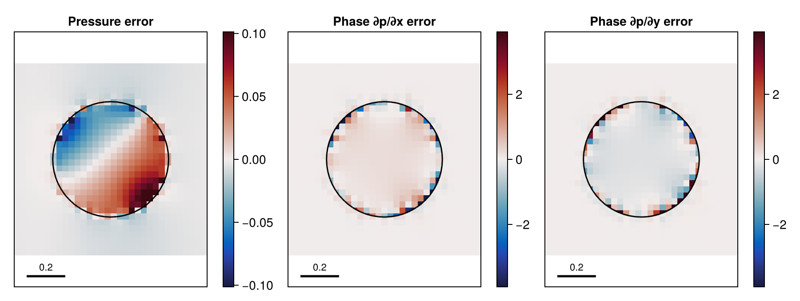
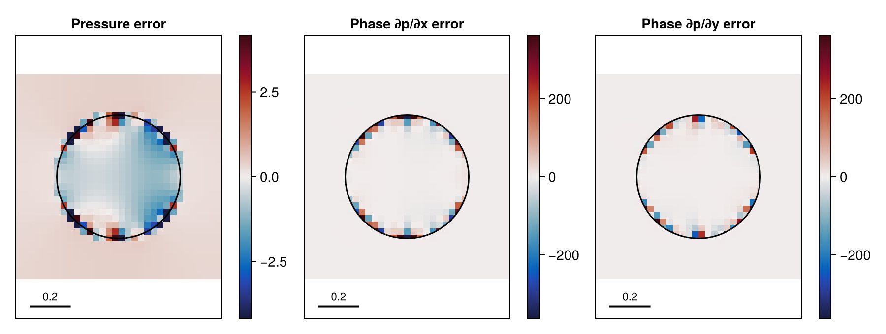
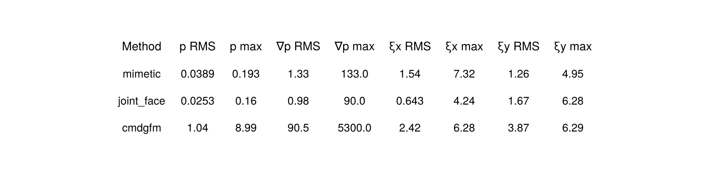

# 12 – Manufactured Poisson projection

A periodic two-phase manufactured solution compares pressure and phase-gradient errors across three projection methods.


## At a glance

| | |
| --- | --- |
| **Physics** | Manufactured two-velocity projection on the periodic unit square, with liquid/gas densities `(1000, 1)` and a circular liquid region of radius `0.3` centred at `(0.5,0.5)`. This is a single projection, not a time-dependent Navier–Stokes run. |
| **Algorithms** | A uniform `resolution × resolution` mesh and `:lhf` interface reconstruction; no AMR. Default `:mimetic` uses the jointly fitted smoothed-aperture variant, MINRES and a Cholesky block preconditioner. `:joint_face` changes the mimetic row layout; `:cmdgfm` uses CMDGFM, BiCGSTAB and a tree-GMG/active-jump-ILU block preconditioner. |
| **Worth varying** | `resolution=32` changes the uniform grid; `density=(1000.0,1.0)` changes the two phase coefficients; `method=:mimetic` selects the projection (`:joint_face` and `:cmdgfm` are also accepted); `tolerance=1e-9` and `max_iterations=5000` control the solve. |
| **Validated against** | Gauge-aligned pressure and physical phase gradients are compared with the manufactured fields. At `resolution=32`, pressure RMS/max errors are `0.0388801/0.192510` for `:mimetic`, `0.0253219/0.160006` for `:joint_face`, and `1.04378/8.98783` for `:cmdgfm`. |
| **Cost** | `:docs` and `:default` both solve all three methods at `resolution=32` (1024 cells); image dimensions differ. In a shared single-thread gallery process, setup and solve took 9.95 s (`:mimetic`), 5.16 s (`:joint_face`), and 5.92 s (`:cmdgfm`); incremental generator compilation, including rendering, was 37.21 s. |

## Setup

Let `r²=(x−0.5)²+(y−0.5)²`. The pressure is continuous at the interface but has a phase-dependent gradient:

```math
p_*(x,y)=\sin(2\pi x)+\cos(2\pi y)
+40\,(r^2-0.3^2)(x-y)\,\mathbf 1_{r<0.3}.
```

The predictor is the manufactured divergence-free phase velocity plus `∇p*/ρ`, and the single projection uses `Δt=1`. Periodic pressure has an arbitrary constant; the plotted pressure error subtracts its cell-volume-weighted mean. The phase-gradient plots show errors in the **physical** `∇p`, not the density-scaled jump `ξ=[∇p/ρ]`. See the [method reference](../../docs/src/method.md) for the staggered discretization, CMDGFM and mimetic projection.

## Run

From the repository root:

```julia
include("examples/12_manufactured_poisson/manufactured_poisson.jl")
run = run_example(resolution=32, method=:mimetic)
println(run.stats)
println(run.errors)
```

```sh
julia --project=examples examples/12_manufactured_poisson/make_figures.jl
julia --project=examples examples/12_manufactured_poisson/manufactured_poisson.jl
```

## Results

The hero shows gauge-aligned pressure error and the `x` and `y` phase-gradient errors for `:mimetic`. The interface is outlined; each staggered gradient is clipped to its liquid and gas PLIC regions. For each method, pressure colors saturate at ± four pressure RMS errors and both gradient components share a range of ± four phase-gradient RMS errors; scales differ between methods to reveal structure, so use the table for maxima.



The `:joint_face` variant uses face-row selection.



The CMDGFM solve uses a different pressure/jump system.



At `resolution=32`, the phase-gradient RMS/max errors are `1.331/132.96` (`:mimetic`), `0.9798/89.98` (`:joint_face`), and `90.55/5304.83` (`:cmdgfm`). Pressure RMS uses total cell volume; gradient RMS uses phase-fraction-weighted dual-face volumes, with its maximum excluding nearly absent phases. The table also reports density-scaled jump errors on mixed faces.

## Variations

```julia
run_example(resolution=64, method=:mimetic)            # finer uniform mesh
run_example(resolution=32, method=:cmdgfm)            # conservative ghost-fluid projection
run_example(resolution=32, density=(100.0, 1.0))       # change density contrast
```

A genuine convergence study must repeat several resolutions and report the actual error norms and observed rates; a single generated map does not establish an order.

## Files

- [manufactured_poisson.jl](manufactured_poisson.jl): manufactured fields, solvers and error calculations.
- [make_figures.jl](make_figures.jl): three method comparisons and error table.
- `assets/`: generated PNGs.
