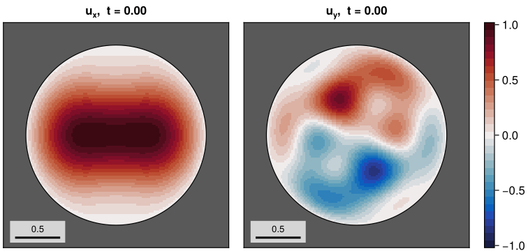
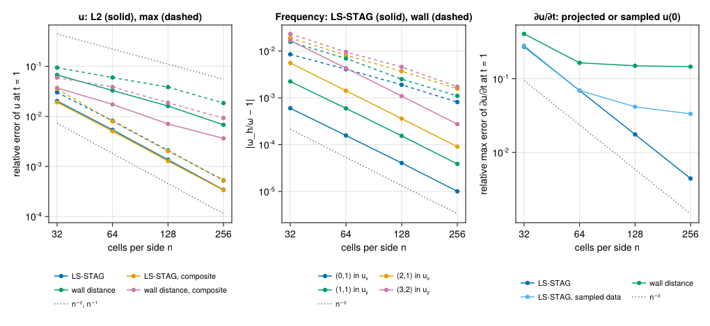
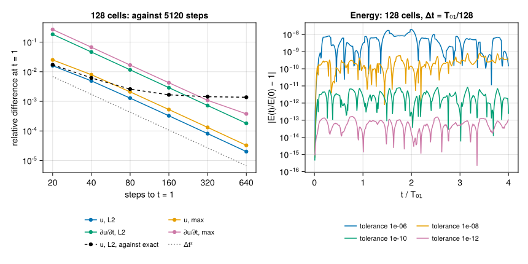

# 13 – Staggered wave equation on a disc

Both components of a staggered field ring as exact Bessel standing waves on a cut-cell disc, with the LS-STAG viscous operator as the Laplacian and implicit time steps far above the explicit limit. This example closes [#15](https://github.com/ronaldremmerswaal/TwoPhaseAMR.jl/issues/15) with the staggered Dirichlet problem; the issue's centred scalar and staggered Neumann variants are not part of it.



## At a glance

| | |
| --- | --- |
| **Physics** | The linear wave equation `u_tt = c²Δu`, `c = 1`, for both components of a staggered (MAC) field `u` on the disc `r < R = 1`, centred in the box `[-1.25, 1.25]²`. Outside the disc the box is an embedded solid, and `u = 0` on the circle (`NoSlip()`), so each component is a scalar Dirichlet problem. `u_x` starts as the (0,1) and (2,1) Bessel modes and `u_y` as the (1,1) and (3,2) modes, at rest; the solution is exact for all time. |
| **Algorithms** | `Δ_h = −V⁻¹K` from `StaggeredDiffusionOperator(geometry; closure)` with the default `LSStagClosure()`: a cut face's value sits at the midpoint of its open part, `K` is the symmetric positive semidefinite stiffness and `V` holds the open staggered volumes. The implicit midpoint rule (Crank–Nicolson, Newmark's average acceleration) for `u_t = v`, `v_t = c²Δ_h u` needs one shifted solve `(V + (cΔt/2)²K)ū = V(uⁿ + Δt vⁿ/2)` per step, by `StaggeredEllipticSolver`: conjugate gradients with the geometry-aware tree multigrid, the path of the Navier–Stokes viscous step. Uniform `n × n` mesh in 8×8 blocks, or a composite mesh whose blocks along the circle are refined once. |
| **Worth varying** | `resolution=128` cells per side; `composite=false`; `closure=LSStagClosure()` or `WallDistanceClosure()`; `steps=128` over `final_time=nothing`, one period of the (0,1) mode; the relative solver `tolerance=1e-10`; `initial_data=:projected` or `:sampled`; `modes`. |
| **Validated against** | The exact solution at the value points, the frequency of each mode and the discrete energy. LS-STAG is second order in space in the L2 and maximum norms of `u` and `∂u/∂t` (orders 1.98–1.99 from 128 to 256 cells; relative errors at 256 cells `3.42e-4`/`5.28e-4` for `u`), and so is every mode's frequency; the legacy wall-distance closure is first order. Time integration is second order, and the energy changes by less than the solver tolerance with steps 31 times the explicit limit. |
| **Cost** | Default (`:docs` and `:default` alike): 128 cells, one period in 128 steps; setup 0.48 s and stepping 1.26 s in a warm process, about 10 conjugate-gradient iterations per step for both components. The whole figure script, with the space, time and energy studies (32 runs, the largest 2000 steps on 84736 cells), took 1161 s on one thread. |

Gallery timings: Julia 1.12.7, one Julia thread and one BLAS thread, AMD Ryzen 9 5950X; package loading is excluded. The figure script ran while other jobs shared the machine.

## Setup

In polar coordinates `(r, θ)` about the centre of the disc,

```math
\begin{aligned}
u_x &= J_0(j_{0,1}r)\cos\omega_{0,1}t + 0.6\,J_2(j_{2,1}r)\cos 2\theta\,\cos\omega_{2,1}t,\\
u_y &= J_1(j_{1,1}r)\sin\theta\,\cos\omega_{1,1}t + 0.8\,J_3(j_{3,2}r)\cos 3\theta\,\cos\omega_{3,2}t,
\end{aligned}
\qquad \omega_{m,k}=\frac{c\,j_{m,k}}{R},
```

where `j_{m,k}` is the `k`-th zero of `J_m` (`bessel_zero`: 2.405, 5.136, 3.832 and 9.761). Every mode vanishes on the circle. The run ends after one period of the fundamental mode, `T₀₁ = 2πR/(c j_{0,1}) ≈ 2.613`.

The diffusion operator of the [viscous step](../../docs/src/navier-stokes.md) supplies, per velocity component, the stiffness `K` and the mass `V` with `Δ_h = −V⁻¹K`. One step of the implicit midpoint rule,

```math
\Bigl(V+\frac{c^2\Delta t^2}{4}K\Bigr)\bar u = V\Bigl(u^n+\frac{\Delta t}{2}v^n\Bigr),\qquad
u^{n+1}=2\bar u-u^n,\qquad v^{n+1}=\frac{4}{\Delta t}\bigl(\bar u-u^n\bigr)-v^n,
```

is one `solve!` of `StaggeredEllipticSolver(StaggeredEllipticOperator(operator; reaction=1, diffusion=(cΔt/2)²); preconditioner_options=(; geometry))`. The update is the Cayley transform of an operator that is skew-adjoint in the energy inner product, so

```math
E = \tfrac12\bigl(v^\top V v + c^2\,u^\top K u\bigr)
```

is conserved for every `Δt`; an inexact solve changes it by about the solver tolerance. A discrete mode of frequency `ω_h` turns by `2 arctan(ω_hΔt/2)` per step, a relative phase lag of `(ω_hΔt)²/12`.

Explicit schemes are limited by the small cut cells. Leapfrog is stable for `Δt ≤ 2/(c√λ_max)`, `λ_max` the largest eigenvalue of `−Δ_h`; `run.explicit_limit` uses the largest absolute row sum of `Δ_h` (`1/stable_timestep(operator; cfl=1)`), which at 128 cells is within 1 % of the power-iteration eigenvalue `9.15e6`. That limit is `6.59e-4`, against `h/(c√2) = 0.0138` for the same mesh without cut cells; the default `Δt = T₀₁/128 = 0.0204` is 31 times larger.

The initial displacement is not sampled from the modes: `initial_data=:projected` solves the discrete Helmholtz problem `(I − h²Δ_h)u₀ = (I − h²Δ)u(·,0)` (one solve, `h` the base cell size), whose exact solution is the initial displacement. Sampled values excite the stiff modes of the small cut cells, which the energy-conserving scheme never damps (see Results).

Errors are measured at the value points of the closure: LS-STAG places a cut face's value at the midpoint of its open part (from `TwoPhaseAMR._ls_stag_open_part`), the wall-distance closure at the face centre, which can lie in the solid, where the Bessel functions continue smoothly. L2 is the root mean square weighted by the open staggered volumes of both components, max the largest error over the faces with an open aperture; both are relative to the same norm of the exact solution at that time (at `t = 1`: `‖u‖ = 0.332/0.740`, `‖∂u/∂t‖ = 0.970/2.36` in L2/max). A mode's frequency is the least-squares slope of its unwrapped phase `atan(−b/ω, a)`, from the projections `a`, `b` of `u` and `∂u/∂t` on its exact shape; `(2/Δt) tan(ΩΔt/2)` removes the implicit-midpoint lag and leaves the spatial frequency `ω_h`.

## Run

From the repository root, in a Julia session started with `--project=examples`:

```julia
include("examples/13_disc_wave/disc_wave.jl")
run = run_example(resolution = 64)
run.errors                                  # absolute errors and exact norms at the final time
maximum(abs, run.energy ./ run.energy[1] .- 1)
[(f.mode.m, f.mode.k, f.spatial / f.exact - 1) for f in run.frequencies]
```

Run the default case headlessly, or regenerate the figures with all studies:

```sh
julia --project=examples examples/13_disc_wave/disc_wave.jl
julia --project=examples examples/13_disc_wave/make_figures.jl
```

## Results

The animation shows `u_x` and `u_y` of the default run over one period of the fundamental mode: the axisymmetric fundamental breathes under the (2,1) mode in `u_x`, and in `u_y` the (3,2) mode, with its nodal circle, goes through four periods under the (1,1) mode. Grey is the PLIC solid and the black line the exact circle. At `t = T₀₁` the relative errors of `u` are `9.07e-3` (L2) and `1.37e-2` (max), mostly the phase lag of the large time step: the measured frequency errors of the four modes, `−2.6e-4`, `−1.28e-3`, `−6.8e-4` and `−4.40e-3`, are the implicit-midpoint lags `(ωΔt)²/12 = 2.0e-4`, `9.2e-4`, `5.1e-4` and `3.31e-3` plus, within `3e-5`, the spatial errors measured below at 128 cells. The energy changes by at most `7.4e-12` of its initial value.



**Space.** `t = 1` in 2000 steps (`Δt = 5e-4`; from the time study below, the time error is below 1 % of the spatial error at 256 cells), solver tolerance `1e-12`. Relative errors of LS-STAG on the uniform mesh:

| n | u, L2 | order | u, max | order | ∂u/∂t, L2 | order | ∂u/∂t, max | order |
|---:|---:|---:|---:|---:|---:|---:|---:|---:|
| 32 | 2.028e-2 | | 3.026e-2 | | 1.725e-1 | | 2.719e-1 | |
| 64 | 5.387e-3 | 1.91 | 8.180e-3 | 1.89 | 4.388e-2 | 1.98 | 6.908e-2 | 1.98 |
| 128 | 1.360e-3 | 1.99 | 2.088e-3 | 1.97 | 1.109e-2 | 1.98 | 1.753e-2 | 1.98 |
| 256 | 3.424e-4 | 1.99 | 5.275e-4 | 1.99 | 2.803e-3 | 1.98 | 4.423e-3 | 1.99 |

The spatial frequency errors are second order too: from 128 to 256 cells `−4.05e-5 → −1.01e-5` for (0,1), `−3.60e-4 → −9.03e-5` for (2,1), `−1.54e-4 → −3.87e-5` for (1,1) and `−1.09e-3 → −2.74e-4` for (3,2). On the composite mesh (the blocks along the circle refined once, `n` the base resolution, 84736 cells at 256) the errors lie between 6 % below and 2 % above the uniform ones at the same `n`, with orders 1.91–1.95 from 128 to 256 cells (relative `u` errors `3.37e-4`/`5.39e-4` at 256): the error is dominated by the dispersion of the coarse interior, not by the wall.

The legacy `WallDistanceClosure()` is first order at the curved wall. Its relative `u` errors are `6.73e-2`, `3.29e-2`, `1.61e-2` and `6.79e-3` in L2 (orders 1.03, 1.03, 1.25) and `9.41e-2`, `5.98e-2`, `3.85e-2` and `1.85e-2` in the maximum norm (0.65, 0.64, 1.06) on the uniform meshes, 20 and 35 times the LS-STAG errors at 256 cells; on the composite mesh they are about half as large (`3.64e-3`/`9.26e-3` at 256, orders 0.96/1.01) and need twice the conjugate-gradient iterations. Its frequency errors are first order and at 256 cells 6–81 times larger (`−8.14e-4` for (0,1)). Its maximum error of `∂u/∂t` stalls at about 0.15 (0.164, 0.150, 0.146 from 64 to 256 cells). Faces whose centre lies in the solid keep their unknowns and wall conductances of the wrong sign for the open part they represent (#110).

**Initial data.** With sampled initial data LS-STAG's `u` converges at second order as well (orders 1.98/1.97 from 128 to 256 cells; at 256 cells within 0.4 % of the errors from the projected start) and so does `∂u/∂t` in L2, but its maximum error stalls: `0.280`, `0.069`, `0.042` and `0.033` from 32 to 256 cells (orders 2.02, 0.73, 0.32). Sampling puts truncation errors on the stiff modes of the smallest cut cells (the largest eigenvalue of `−Δ_h` is `1.1e8` at 256 cells), and the energy-conserving scheme keeps them oscillating at their own frequency. The Helmholtz projection leaves them out; its own absolute error at `t = 0` is `9.8e-7` (L2) at 256 cells, far below the error at `t = 1`.



**Time.** On the 128-cell mesh the differences at `t = 1` to a run with 5120 steps decrease at second order: in L2, relative to the exact norms, `1.60e-2`, `4.90e-3`, `1.29e-3`, `3.25e-4`, `8.13e-5` and `2.01e-5` for `u` with 20 to 640 steps (orders 1.71, 1.93, 1.98, 2.00, 2.02), orders 1.66–2.02 in the maximum norm, and 1.99–2.00 for `∂u/∂t` in L2. The maximum `∂u/∂t` difference loses order at the last halving (1.52, `3.8e-4`). The error against the exact solution levels off at the spatial error of the mesh (`1.36e-3` relative in L2).

**Energy.** Over four periods of the fundamental mode at `Δt = T₀₁/128` (31 times the leapfrog limit), the largest relative energy change is `1.95e-8`, `8.1e-10`, `8.5e-12` and `1.6e-13` for the solver tolerances `1e-6`, `1e-8`, `1e-10` and `1e-12` (7.2, 8.6, 10.3 and 12.2 conjugate-gradient iterations per step for both components): it follows the tolerance down to round-off.

## Variations

```julia
run_example(closure = WallDistanceClosure())        # legacy first-order wall closure
run_example(composite = true)                       # refine the blocks along the wall once
run_example(steps = 32)                             # larger steps: stable, energy conserved, more phase lag
run_example(initial_data = :sampled)                # sampled modes excite stiff cut-cell modes
run_example(modes = (DiscMode(1, 4, 1), DiscMode(2, 0, 2)))   # other standing waves
```

## Files

- [disc_wave.jl](disc_wave.jl): Bessel zeros and modes, mesh and geometry, the implicit-midpoint integrator, initial data, errors, frequencies and energy.
- [make_figures.jl](make_figures.jl): the animation and the space, time and energy studies.
- `assets/`: generated GIF and PNGs.
