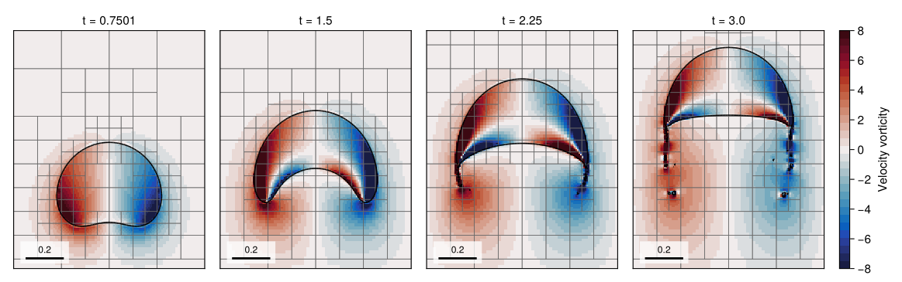
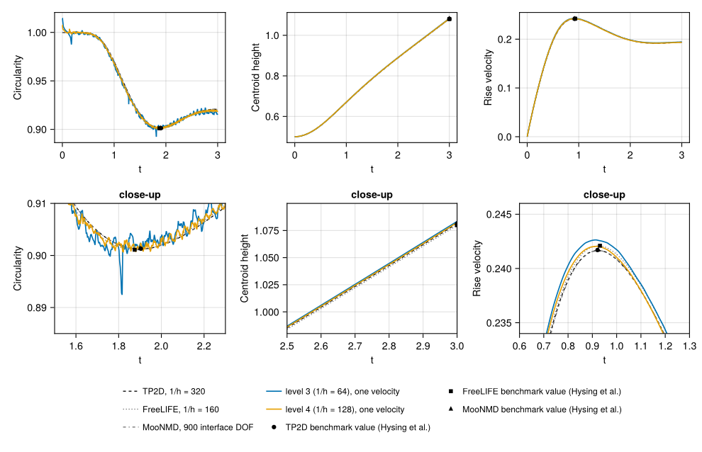
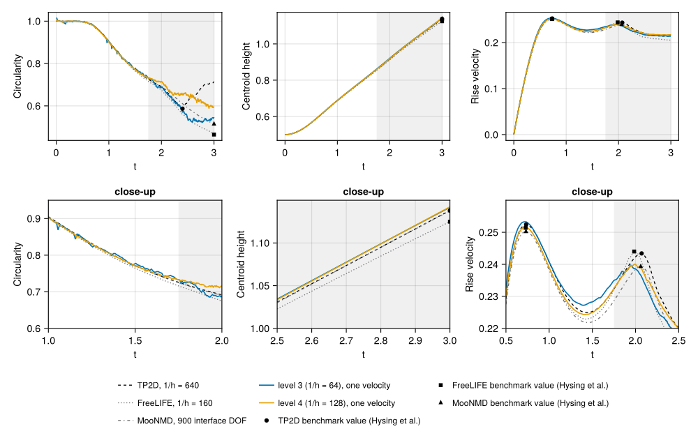
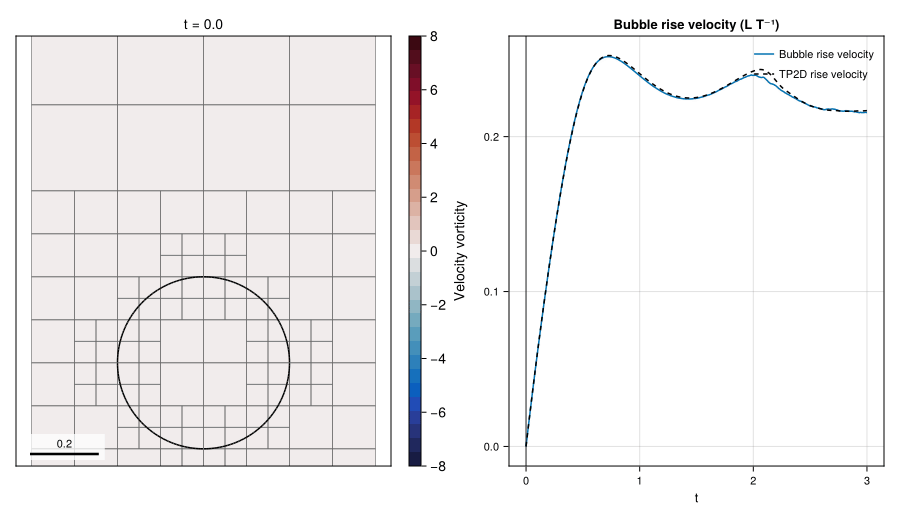
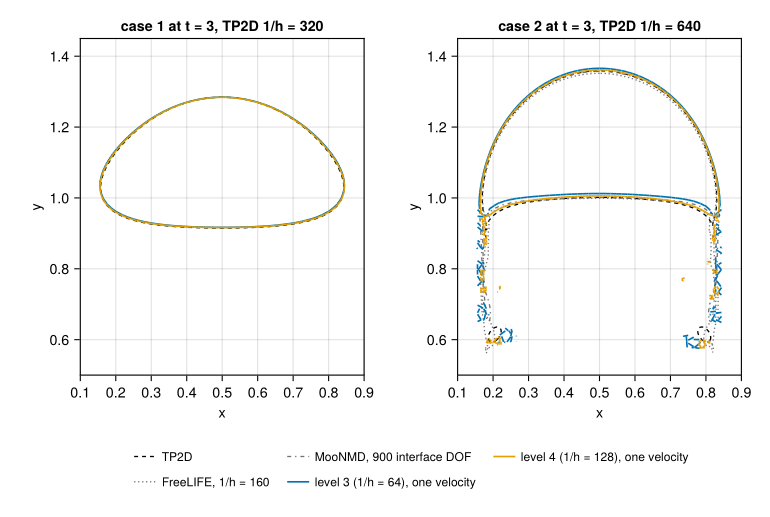

# 14 – Rising bubble

A bubble rises through a heavier liquid in the two-dimensional benchmark of Hysing et al. (2009): in case 1 it settles into an ellipse, in case 2 (density ratio 1000) it grows a skirt whose filaments break into satellite bubbles. Circularity, centroid height and rise velocity are compared with the benchmark's three reference codes.



## At a glance

| | |
| --- | --- |
| **Physics** | Test cases 1 and 2 of [Hysing et al. (2009)](https://doi.org/10.1002/fld.1934): a bubble of radius `0.25` starts at rest at `(0.5, 0.5)` in `[0,1] × [0,2]` under gravity `0.98`, `t ∈ [0, 3]`. Case 1: `ρ = (1000, 100)`, `μ = (10, 1)`, `σ = 24.5` (`Re = 35`, `Eo = 10`); case 2: `ρ = (1000, 1)`, `μ = (10, 0.1)`, `σ = 1.96` (`Re = 35`, `Eo = 125`), liquid first. All four walls are free-slip; the benchmark's top and bottom walls are no-slip, which the two-phase viscous operator cannot yet combine with free-slip sides (see Setup). |
| **Algorithms** | Default `OneVelocityModel()` for both cases, with WY geometric VOF, LHF PLIC normals with WY fallback, CGFM surface tension, Lax–Wendroff momentum transport, implicit-midpoint variable-viscosity diffusion (harmonic mean) and pressure projection with CG/tree-multigrid solvers. Interface AMR refines a band around the interface to `max_level` (update interval 5, coarsening delay 2); the rest of the domain stays at least at `far_field_level = max_level - 2`. Square cells: `dx = dy = 1/8` on level 0, `1/128` at the default level 4 around the interface (64 cells per bubble diameter) and `1/32` in the far field. The step is capillary-limited. Circularity, centroid height and rise velocity are custom diagnostics of the gas phase. |
| **Worth varying** | `case=1` selects the test case; `max_level=4` the interface resolution; `far_field_level=max_level-2` the background mesh; `final_time=3.0` the end time; `velocity_model=OneVelocityModel()`, or `TwoVelocityModel(pressure_projection = CMDGFMProjection())` for separate phase velocities; `boundary=FreeSlip()` the wall condition (`NoSlip()` for all four walls). |
| **Validated against** | The benchmark quantities and finest-grid time series of TP2D, FreeLIFE and MooNMD, and the paper's relative error norms. Case 1 at level 5 (`1/h = 256`): `c_min = 0.9010`, `V_c,max = 0.2418`, `y_c(3) = 1.0817` against TP2D's `0.9013`, `0.2417`, `1.0813`; the codes span `0.9011–0.9013`, `0.2417–0.2421` and `1.0799–1.0817`, and without the circularity's perimeter spikes (see Setup) `c_min = 0.9015`. Case 2 at level 5: first rise-velocity maximum `0.2508` at `t = 0.726` and second `0.2402` at `t = 2.023`, inside the codes' ranges `0.2502–0.2524` and `0.2393–0.2440`; `y_c(3) = 1.1400`, `0.002` above their `1.1249–1.1380`. The codes agree on case 2 only up to `t ≈ 1.75–2.0`; later shapes and circularity are compared visually. |
| **Cost** | Default and `:docs`: level 4. Case 1: 2874 steps and 7808 final cells; case 2: 924 steps and 12416 final cells. In the docs figure run, setup and simulation took 130.30 s for case 1 and 87.07 s for case 2 at level 4, after the level-3 runs (51.21 s and 16.29 s) had compiled the code, and the whole figure script, with both cases at levels 3 and 4, the figures and the 81-frame GIF, 331.4 s on one thread, including rendering. Level 5, outside the gallery envelope: case 1 8127 steps, 22784 final cells, 2617 s; case 2 2410 steps, 30656 final cells, 1776 s, in fresh processes. All timings were measured while other jobs shared the machine; an earlier docs run under heavier load took 276 s, 173 s and 628 s. |

Gallery timings: Julia 1.12.7, one Julia thread and one BLAS thread, AMD Ryzen 9 5950X; package loading is excluded.

## Setup

| Case | `ρ_l` | `ρ_g` | `μ_l` | `μ_g` | `σ` | `Re` | `Eo` | Density ratio | Viscosity ratio |
| --- | --- | --- | --- | --- | --- | --- | --- | --- | --- |
| 1 | 1000 | 100 | 10 | 1 | 24.5 | 35 | 10 | 10 | 10 |
| 2 | 1000 | 1 | 10 | 0.1 | 1.96 | 35 | 125 | 1000 | 100 |

With `L = 2r = 0.5` and `U_g = √(gL)`, `Re = ρ_l U_g L/μ_l` and `Eo = ρ_l U_g² L/σ`. The bubble is the gas phase `Ω_b` (fraction `1 − C`) with area `A_b` and perimeter `P_b`; the benchmark quantities are

```math
c=\frac{2\sqrt{\pi A_b}}{P_b},\qquad
y_c=\frac{1}{A_b}\int_{\Omega_b} y\,\mathrm{d}\mathbf{x},\qquad
V_c=\frac{1}{A_b}\int_{\Omega_b} v\,\mathrm{d}\mathbf{x}.
```

`:circularity` takes `A_b` from `PhaseVolume()` and `P_b` from `InterfaceMeasure()`, the total length of the PLIC segments. `:centroid` weights every cell centre with its gas volume. `:rise_velocity` weights every vertical face velocity with the gas volume of its staggered control volume (the spacing-weighted mean of its two cells' fractions); with two velocities it averages the gas velocity, which exists exactly on the faces with gas. All three include satellite bubbles after a breakup, as the benchmark's integrals over `Ω_b` do. The gas area changes by at most `6e-9` in any run.

**Walls.** The benchmark has free-slip side walls and no-slip top and bottom walls. The two-phase variable-viscosity operator currently takes one condition for all four walls, so `boundary` defaults to `FreeSlip()`: right at the side walls, `0.25` from the initial bubble, and free-slip instead of no-slip at the top and bottom walls, `0.25` below the bubble at `t = 0` and at least `0.64` above it at `t = 3`. Per-wall two-phase conditions are being added; the intended default is then `VelocityBoundaryConditions(left = FreeSlip(), right = FreeSlip(), bottom = NoSlip(), top = NoSlip())`. Wall sensitivity, below, reports all-no-slip runs.

**Circularity spikes.** The PLIC perimeter, not the shape, puts spikes into `c(t)` that the reference codes do not have. At `t = 0` the circle touches grid lines at four grid vertices at every level; the sliver cells there hold PLIC segments `0.82h` instead of `h` long, so `P_b` misses `1.5h` and `c(0) = 1.0144`, `1.0074`, `1.0037` at levels 3, 4, 5. Later dips lasting a few steps appear where the top, the bottom or a side of the bubble passes a grid line almost tangentially, and not at the regrids. In case 1 up to `t = 2`, at the 14 dips deeper than `0.002` at level 3 the nearest of these extreme points lies a median `0.014` cells from a grid line (`0.08` cells over all steps), and none falls within two steps of one of the 6 regrids; at level 4, 2 of the 31 dips deeper than `0.001` do, as many as chance gives with 27 regrids. The dips shrink with the mesh (root mean square `8.8e-4` at level 3, `3.4e-4` at level 4, deviation from the running median), so the measured circularity converges at first order. The tables give the raw minimum, as the benchmark defines it, and the minimum of the running median over 0.04 time units, which removes the dips.

See the [method reference](../../docs/src/method.md) for the interface transport, surface tension, viscous step and projection.

## Run

From the repository root, in a Julia session started with `--project=examples`:

```julia
include("examples/14_rising_bubble/rising_bubble.jl")
run = run_example(case = 1, max_level = 3)
@show minimum(diagnostic_history(run.flow, :circularity).values)
@show maximum(diagnostic_history(run.flow, :rise_velocity).values)
@show diagnostic_history(run.flow, :centroid).values[end]
```

Run the example headlessly or regenerate the Cairo figures:

```sh
julia --project=examples examples/14_rising_bubble/rising_bubble.jl            # case 1
julia --project=examples examples/14_rising_bubble/rising_bubble.jl --case=2
julia --project=examples -e 'include("examples/14_rising_bubble/make_figures.jl"); make_figures()'
```

Append `--studio` to the example command to follow the run in a browser;
press Ctrl+C to close Studio after the run.

`make_figures(size = :docs)` runs both cases at levels 3 and 4 and prints the benchmark quantities and error norms below; `size = :default` adds level 5. The level-5 and two-velocity rows below come from the same `run_example` at `max_level = 5` or with `velocity_model = TwoVelocityModel()`; every run is deterministic, and the figure script reproduces the level-3 and level-4 rows to the last digit.

## Results

The reference curves are the benchmark's published time series on each code's finest grid (TP2D `1/h = 320` in case 1 and `640` in case 2, FreeLIFE `1/h = 160`, MooNMD 900 interface degrees of freedom), from the [FeatFlow reference data](https://wwwold.mathematik.tu-dortmund.de/~featflow/en/benchmarks/cfdbenchmarking/bubble/bubble_reference.html), subsampled every 0.02 time units into `hysing_reference.csv`; the markers are the values tabulated in Hysing et al. (2009), Tables XII and XVI.

### Case 1



Circularity, centroid height and rise velocity against time, with close-ups below. The level-3 dip to `0.8924` at `t = 1.82` is a perimeter spike; without it the minimum is `0.9008`.

| Run | `1/h` | `c_min` (t) | running-median `c_min` (t) | `V_c,max` (t) | `y_c(3)` | Steps | Final cells | Time |
| --- | --- | --- | --- | --- | --- | --- | --- | --- |
| Level 3, one velocity | 64 | 0.8924 (1.816) | 0.9008 (1.822) | 0.2426 (0.913) | 1.0834 | 1016 | 3584 | 53 s |
| Level 3, two velocities | 64 | 0.8918 (1.808) | 0.9022 (1.746) | 0.2429 (0.901) | 1.0840 | 1016 | 3584 | 86 s |
| Level 4, one velocity | 128 | 0.9006 (1.821) | 0.9015 (1.895) | 0.2420 (0.918) | 1.0823 | 2874 | 7808 | 258 s |
| Level 4, two velocities | 128 | 0.9017 (1.780) | 0.9023 (1.896) | 0.2422 (0.915) | 1.0827 | 2874 | 7808 | 338 s |
| Level 5, one velocity | 256 | 0.9010 (1.860) | 0.9015 (1.876) | 0.2418 (0.916) | 1.0817 | 8127 | 22784 | 2617 s |
| TP2D | 320 | 0.9013 (1.9041) | | 0.2417 (0.9213) | 1.0813 | | | |
| FreeLIFE | 160 | 0.9011 (1.8750) | | 0.2421 (0.9313) | 1.0799 | | | |
| MooNMD | 900 DOF | 0.9013 (1.9000) | | 0.2417 (0.9239) | 1.0817 | | | |

Times are setup and simulation in a fresh process, including compilation, measured while other jobs shared the machine. At level 5 the three quantities differ from TP2D by `−0.0003`, `+0.0001` and `+0.0004`: `V_c,max` and `y_c(3)` lie within the codes' spread, `c_min` lies `0.0001` below it and its running-median minimum `0.0002` above. The time of the raw minimum is that of a spike; the running-median minimum falls at `t = 1.876–1.896`, against the codes' `1.875–1.904`. Raising the far field from level 2 to 3 at level 4 changes `c_min`, `V_c,max` and `y_c(3)` by `8e-5`, `2e-5` and `3e-5`.

### Case 2



The same quantities for case 2. The codes' benchmark quantities "agree very well with each other up until t=1.75–2.0" (Hysing et al., §5.4); afterwards the filaments of the skirt break up differently in TP2D and FreeLIFE and not at all in MooNMD, so the shapes and the circularity have no reference after `t ≈ 1.75` (gray band): the paper calls these results "rather inconclusive". The second velocity maximum and `y_c(3)` are integral quantities on which the codes still roughly agree; their spread is quoted, not a converged value.

| Run | `1/h` | `V_c,max1` (t) | `V_c,max2` (t) | `y_c(3)` | `c_min` (t) | Steps | Final cells | Time |
| --- | --- | --- | --- | --- | --- | --- | --- | --- |
| Level 3, one velocity | 64 | 0.2533 (0.717) | 0.2397 (1.946) | 1.1418 | 0.5220 (2.771) | 378 | 5120 | 45 s |
| Level 3, two velocities | 64 | 0.2531 (0.717) | 0.2395 (1.951) | 1.1428 | 0.5154 (2.952) | 347 | 5120 | 72 s |
| Level 4, one velocity | 128 | 0.2516 (0.718) | 0.2401 (1.986) | 1.1422 | 0.5869 (2.905) | 924 | 12416 | 151 s |
| Level 4, two velocities | 128 | 0.2516 (0.718) | 0.2403 (1.997) | 1.1425 | 0.6027 (2.965) | 852 | 11264 | 237 s |
| Level 5, one velocity | 256 | 0.2508 (0.726) | 0.2402 (2.023) | 1.1400 | 0.5490 (2.973) | 2410 | 30656 | 1776 s |
| Level 5, two velocities | 256 | 0.2508 (0.726) | 0.2404 (2.023) | 1.1401 | 0.5366 (2.992) | 2410 | 31424 | 1787 s |
| TP2D | 640 | 0.2524 (0.7332) | 0.2434 (2.0705) | 1.1380 | 0.5869 (2.4004) | | | |
| FreeLIFE | 160 | 0.2514 (0.7281) | 0.2440 (1.9844) | 1.1249 | 0.4647 (3.0) | | | |
| MooNMD | 900 DOF | 0.2502 (0.7317) | 0.2393 (2.0600) | 1.1376 | 0.5144 (3.0) | | | |

The first maximum converges downwards (`0.2533`, `0.2516`, `0.2508`), from above TP2D's value to between FreeLIFE's and MooNMD's. The second lies inside the codes' range at every level; at level 5 it falls at `t = 2.023`, between FreeLIFE's `1.984` and MooNMD's `2.060`. `y_c(3)` stays `0.002–0.004` above the codes'. `c_min` falls near `t = 3` and depends on the filaments: it has no reference.



The level-4 case-2 run until `t = 3`: vorticity of the one-velocity field on a fixed `±8` range, the PLIC interface and the AMR blocks, next to the rise velocity with TP2D's `1/h = 640` curve and a cursor at the shown time. The GIF has 81 output frames, one per keyframe, on a uniform simulation-time grid with spacing `3/80 = 0.0375`; each keyframe is the completed step nearest its requested time. The range saturates on purpose inside the skirt, where the thin gas layer reaches `|ω|` of several tens, so that the liquid wake stays visible; the hero at the top shows the same run at `t = 0.75`, `1.5`, `2.25` and `3` on the same saturated range. The bubble flattens, its rim folds down into a skirt from `t ≈ 1`, and the skirt's tips thin into filaments that shed satellite bubbles from `t ≈ 2.2–2.4`, the breakup window TP2D reports.

### Shapes at t = 3



Final PLIC segments of the figure runs against the codes' shapes at `t = 3` (FeatFlow reference data, chained into curves and decimated to within `2e-4` into `hysing_shapes.csv`). In case 1 the level-4 interface lies on TP2D's. In case 2 the cap agrees with all three codes, while the ends of the skirt differ among the codes themselves: MooNMD keeps long filaments, TP2D and FreeLIFE shed satellites, and the example's filaments break into small satellite bubbles, sub-cell debris at level 3.

### Error norms

Hysing et al. (2009, §2.6) measure a whole time series `q_t` against a reference `q_t,ref` with the relative norms

```math
\|e\|_1=\frac{\sum_t |q_{t,\mathrm{ref}}-q_t|}{\sum_t |q_{t,\mathrm{ref}}|},\qquad
\|e\|_2=\left(\frac{\sum_t |q_{t,\mathrm{ref}}-q_t|^2}{\sum_t |q_{t,\mathrm{ref}}|^2}\right)^{1/2},\qquad
\|e\|_\infty=\frac{\max_t |q_{t,\mathrm{ref}}-q_t|}{\max_t |q_{t,\mathrm{ref}}|},
```

and the rate of convergence `ROC = log10(‖e^{l−1}‖/‖e^l‖)/log10(h^{l−1}/h^l)`, with linear interpolation between the sample times. Here both series are interpolated linearly onto `t_k = 0.001 k`, `k = 1, …, 3000` (case 2: up to `t = 1.75`, where the codes part ways); like the paper's sums over time steps this leaves out the initial state. The references are the subsampled series of `hysing_reference.csv`; the complete published series change the example's norms by less than 3 % and those between the codes by up to 2 %, except MooNMD's rise-velocity `‖e‖∞` against TP2D in case 1 (`3.08e-3` instead of `2.66e-3`). `make_figures` prints all norms, also against FreeLIFE and MooNMD and between the codes.

| Case | Quantity | `1/h` | `‖e‖₁` | ROC₁ | `‖e‖₂` | ROC₂ | `‖e‖∞` | ROC∞ |
| --- | --- | --- | --- | --- | --- | --- | --- | --- |
| 1 | Circularity | 64 | 2.10e-3 | | 2.74e-3 | | 1.44e-2 | |
| | | 128 | 1.08e-3 | 0.96 | 1.37e-3 | 1.00 | 7.42e-3 | 0.96 |
| | | 256 | 8.38e-4 | 0.36 | 1.04e-3 | 0.40 | 3.70e-3 | 1.01 |
| | Centroid | 64 | 1.40e-3 | | 1.56e-3 | | 1.93e-3 | |
| | | 128 | 8.92e-4 | 0.65 | 9.42e-4 | 0.72 | 9.10e-4 | 1.08 |
| | | 256 | 5.44e-4 | 0.71 | 5.88e-4 | 0.68 | 6.77e-4 | 0.43 |
| | Rise velocity | 64 | 3.67e-3 | | 4.36e-3 | | 7.79e-3 | |
| | | 128 | 2.18e-3 | 0.75 | 2.87e-3 | 0.60 | 5.77e-3 | 0.43 |
| | | 256 | 2.24e-3 | −0.04 | 2.61e-3 | 0.13 | 4.64e-3 | 0.31 |
| 2, `t ≤ 1.75` | Circularity | 64 | 3.27e-3 | | 4.75e-3 | | 1.90e-2 | |
| | | 128 | 1.79e-3 | 0.87 | 2.36e-3 | 1.01 | 1.02e-2 | 0.89 |
| | | 256 | 1.87e-3 | −0.06 | 2.31e-3 | 0.03 | 4.52e-3 | 1.18 |
| | Centroid | 64 | 1.76e-3 | | 2.19e-3 | | 4.02e-3 | |
| | | 128 | 1.02e-3 | 0.79 | 1.16e-3 | 0.92 | 1.79e-3 | 1.17 |
| | | 256 | 5.24e-4 | 0.96 | 5.96e-4 | 0.96 | 7.67e-4 | 1.22 |
| | Rise velocity | 64 | 7.95e-3 | | 9.32e-3 | | 1.34e-2 | |
| | | 128 | 3.89e-3 | 1.03 | 4.51e-3 | 1.05 | 6.54e-3 | 1.03 |
| | | 256 | 6.63e-3 | −0.77 | 7.67e-3 | −0.77 | 9.70e-3 | −0.57 |

One velocity against TP2D. For scale, the codes differ from TP2D by

| Case | Code | Circularity `‖e‖₁/‖e‖₂/‖e‖∞` | Centroid | Rise velocity |
| --- | --- | --- | --- | --- |
| 1 | FreeLIFE | 3.70e-4 / 4.90e-4 / 9.85e-4 | 9.44e-4 / 1.06e-3 / 1.34e-3 | 2.17e-3 / 2.25e-3 / 3.11e-3 |
| 1 | MooNMD | 8.63e-5 / 1.19e-4 / 2.64e-4 | 3.23e-4 / 3.52e-4 / 4.01e-4 | 2.39e-4 / 3.19e-4 / 2.66e-3 |
| 2, `t ≤ 1.75` | FreeLIFE | 3.61e-3 / 4.98e-3 / 9.92e-3 | 2.97e-3 / 3.55e-3 / 5.17e-3 | 6.84e-3 / 6.93e-3 / 8.63e-3 |
| 2, `t ≤ 1.75` | MooNMD | 4.07e-4 / 5.36e-4 / 1.02e-3 | 3.95e-4 / 5.75e-4 / 1.09e-3 | 1.06e-2 / 1.11e-2 / 1.46e-2 |

At level 5 the example differs from TP2D no more than FreeLIFE does: centroid `5.4e-4` (FreeLIFE `9.4e-4`) and rise velocity `2.2e-3` (FreeLIFE `2.2e-3`) in case 1, rise velocity `6.6e-3` in case 2, where FreeLIFE and MooNMD differ from TP2D by `6.8e-3` and `1.1e-2`. The rise velocity stops converging towards TP2D at level 5 in both cases. In case 1 the remaining difference is a rise faster by up to `1.1e-3` (0.5 %) around `t = 0.5`, while the bubble is still near the bottom wall, and slower by up to `6e-4` around `t = 1.5–1.75`; it changes little from level 4 to 5. The free-slip bottom wall may cause it; the per-wall runs will tell. In case 2 the example's first maximum passes below TP2D's on its way towards FreeLIFE's and MooNMD's: against MooNMD the rise-velocity norms keep falling (`1.9e-2`, `9.1e-3`, `4.4e-3`, ROC 1.05 and 1.06). The circularity is limited by its first-order spikes; its `‖e‖∞` halves with every level.

The paper measures each code against its own finest grid. The example against its level 5, next to Tables IV, VII and X of the paper:

| Code | Grid, against | Circularity `‖e‖₁/‖e‖₂/‖e‖∞` | Centroid | Rise velocity |
| --- | --- | --- | --- | --- |
| This example, case 1 | `1/h = 64`, against 256 | 1.67e-3 / 2.33e-3 / 1.27e-2 | 8.94e-4 / 1.10e-3 / 1.54e-3 | 3.56e-3 / 3.73e-3 / 4.53e-3 |
| | `1/h = 128`, against 256 | 6.42e-4 / 8.69e-4 / 4.03e-3 | 3.55e-4 / 4.33e-4 / 5.66e-4 | 1.25e-3 / 1.37e-3 / 2.11e-3 |
| | ROC | 1.38 / 1.42 / 1.66 | 1.33 / 1.35 / 1.45 | 1.50 / 1.45 / 1.10 |
| TP2D (Table IV) | `1/h = 80`, against 320 | 3.01e-4 / 3.63e-4 / 9.67e-4 | 9.64e-4 / 1.02e-3 / 1.14e-3 | 2.90e-3 / 3.07e-3 / 5.08e-3 |
| | `1/h = 160`, against 320 | 8.83e-5 / 1.10e-4 / 4.32e-4 | 2.62e-4 / 2.71e-4 / 2.96e-4 | 7.73e-4 / 7.85e-4 / 1.94e-3 |
| | ROC | 1.77 / 1.72 / 1.16 | 1.88 / 1.91 / 1.95 | 1.91 / 1.97 / 1.39 |
| FreeLIFE (Table VII) | `1/h = 80`, against 160 | 1.05e-3 / 1.36e-3 / 2.51e-3 | 9.42e-4 / 1.25e-3 / 1.72e-3 | 3.99e-3 / 5.54e-3 / 1.00e-2 |
| MooNMD (Table X) | 600 DOF, against 900 | 1.07e-4 / 1.41e-4 / 2.90e-4 | 1.66e-5 / 2.11e-5 / 3.85e-5 | 2.33e-4 / 3.10e-4 / 1.28e-3 |
| This example, case 2, `t ≤ 1.75` | `1/h = 128`, against 256 | 1.32e-3 / 2.00e-3 / 9.51e-3 | 5.25e-4 / 7.00e-4 / 1.32e-3 | 4.68e-3 / 4.95e-3 / 6.95e-3 |
| | ROC | 1.50 / 1.35 / 0.71 | 1.37 / 1.39 / 1.42 | 1.62 / 1.60 / 1.52 |

In its own norms the example converges at 1.3–1.6 in `‖e‖₁` and `‖e‖₂`; the paper's codes reach 1.7–2.0 (TP2D) and 1.3–3.8 (FreeLIFE and MooNMD on their coarser grids). At `1/h = 128` the example's centroid and rise-velocity errors lie between TP2D's at `1/h = 80` and `160`, its circularity error between TP2D's and FreeLIFE's at `1/h = 80`. Each code is measured against its own finest grid, so these columns compare rates more than accuracy. The paper has no error norms for case 2.

### Wall sensitivity

With no-slip on all four walls (`boundary = NoSlip()`), level 4 gives

| Case | Walls | `c_min` | `V_c,max` (case 2: first, second) | `y_c(3)` |
| --- | --- | --- | --- | --- |
| 1 | free slip | 0.9006 | 0.2420 | 1.0823 |
| 1 | no slip | 0.9409 | 0.2096 | 1.0159 |
| 2 | free slip | 0.5869 | 0.2516, 0.2401 | 1.1422 |
| 2 | no slip | 0.7908 | 0.2235, 0.2140 | 1.0866 |

No-slip side walls, `0.25` from the bubble and along the liquid's downflow past it, slow the bubble by 13 % (case 1) and 11 % (case 2), far more than the remaining differences from the codes. The benchmark's side walls are free-slip like the example's, so these runs bound the wall effect only loosely: the top and bottom walls, which the example gets wrong, are farther from the bubble and lie across the flow. Their effect is contained in the differences from the codes above and will be measured once per-wall conditions are available.

### Velocity model

In case 1 both closures give `c_min` within `1.1e-3`, `V_c,max` within `3e-4` and `y_c(3)` within `6e-4` of each other; in case 2 the velocity maxima agree within `2e-4` and `y_c(3)` within `1e-3` (tables above). At level 4 one velocity is closer to TP2D in `V_c,max` and `y_c(3)`, two velocities in `c_min`. One velocity takes 0.6–0.8 of the time at levels 3 and 4 (case 1 258 s against 338 s, case 2 151 s against 237 s at level 4; at level 5 in case 2 both take 1780 s), so the example uses it for both cases. With viscous phases the velocity is continuous across the interface, which the two-velocity model approaches through its interphase drag; the separate phase velocities matter where the velocity jumps, as in [example 07](../07_interfacial_instability/). The late case-2 filaments, and with them `c_min`, differ between the closures as they differ between the benchmark's codes.

## Variations

```julia
run_example(case = 2)                                          # skirted bubble, density ratio 1000
run_example(max_level = 5)                                     # 1/h = 256 at the interface
run_example(velocity_model = TwoVelocityModel(pressure_projection = CMDGFMProjection()))
run_example(boundary = NoSlip())                               # no-slip on all four walls
```

## Files

- [rising_bubble.jl](rising_bubble.jl) – setup, both test cases and the benchmark diagnostics.
- [make_figures.jl](make_figures.jl) – resolution study, error norms, figures and animation.
- `hysing_reference.csv` – the codes' finest-grid time series of circularity, centroid and rise velocity, every 0.02 time units.
- `hysing_shapes.csv` – their bubble shapes at `t = 3`, decimated.

## References

- S. Hysing, S. Turek, D. Kuzmin, N. Parolini, E. Burman, S. Ganesan and L. Tobiska, [*Quantitative benchmark computations of two-dimensional bubble dynamics*](https://doi.org/10.1002/fld.1934), International Journal for Numerical Methods in Fluids 60 (2009), 1259–1288.
- FeatFlow, [Rising bubble benchmark: reference data](https://wwwold.mathematik.tu-dortmund.de/~featflow/en/benchmarks/cfdbenchmarking/bubble/bubble_reference.html): `data_bench_quantities.zip` (SHA-256 `faf4d794…`) and `data_bubble_shapes.zip` (`f55a621f…`), files dated 2009-05-20, downloaded 2026-11-25.
