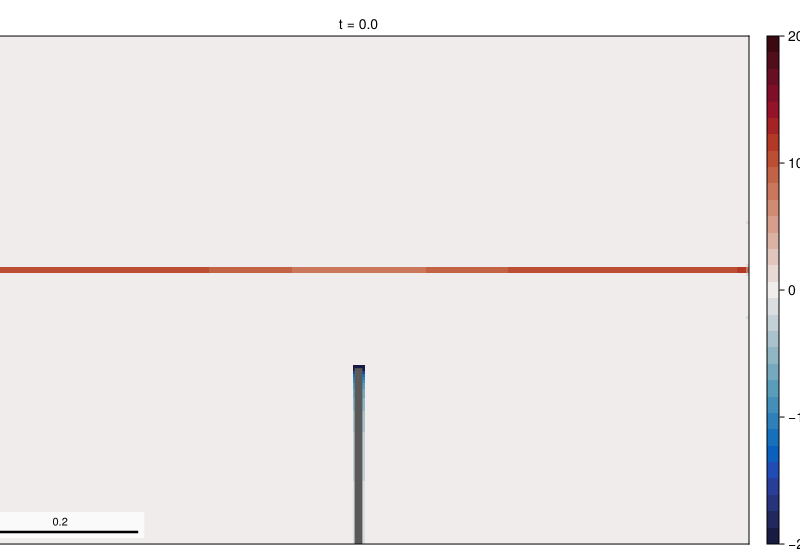
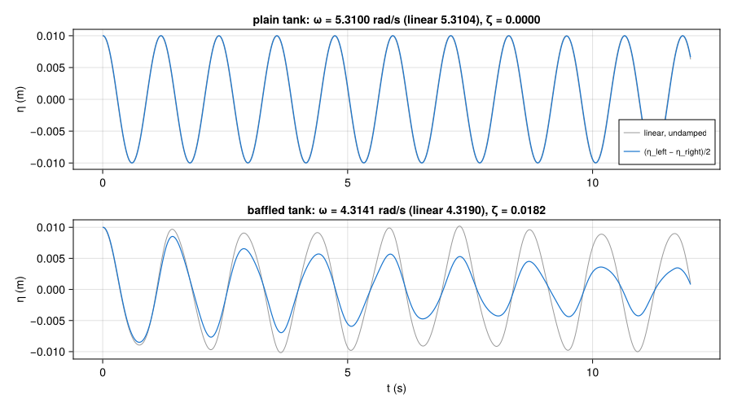
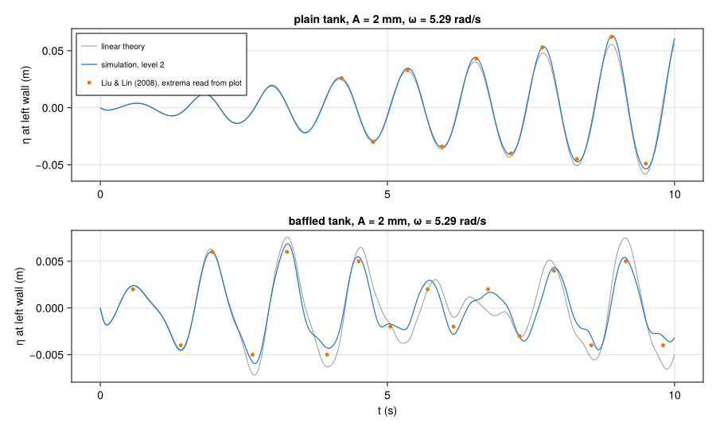
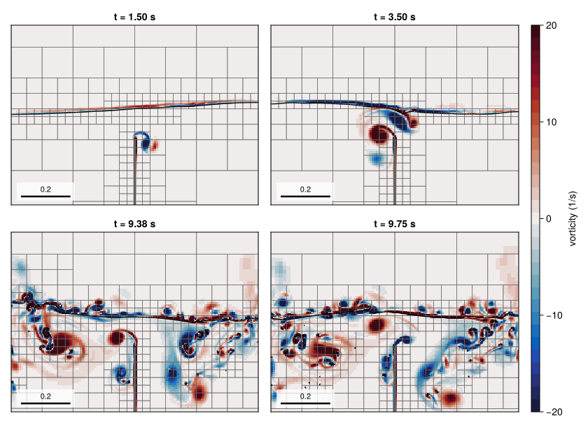
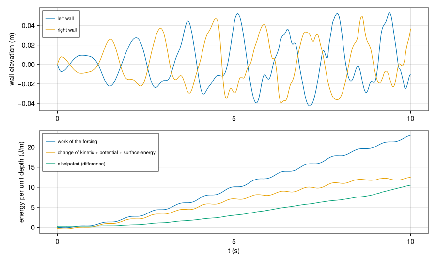

# 15 – Forced sloshing

Water sloshes in a closed tank that is shaken horizontally, with and without a bottom-mounted baffle, against linear potential-flow theory and a published benchmark.



## At a glance

| | |
| --- | --- |
| **Physics** | Two-dimensional water and air in a horizontally shaken closed tank, optionally with a fixed baffle |
| **Algorithms** | One velocity, PLIC interface transport, adaptive mesh and monotonized-central momentum advection |
| **Worth varying** | Forcing frequency and amplitude, baffle height, and refinement level |
| **Validated against** | Linear free and forced sloshing; Liu & Lin forced-response extrema read by eye from published plots (about ±1 mm) |
| **Cost** | Level-2 default forced run: 975 steps, 49.8 s; level-3 hero: 7968 steps, 3403.9 s |

Gallery timings: Julia 1.12.7, one Julia thread and one BLAS thread, AMD Ryzen 9 5950X; package loading is excluded, and timings may include compilation. The full figure run took 3914.2 s.

## Setup

The tank is `L × H = 1 m × 1 m` with still-water depth `h = 0.5 m`; all four
walls are free-slip, the contact angle is `90°` everywhere and gravity points
down. The liquid/gas densities are `1000/1.2 kg/m³`, dynamic viscosities
`0.001/0.000018 Pa s`, surface tension `0.0728 N/m`, and
`g = 9.81 m/s²`. A `32 × 32` base mesh with 8-cell blocks is refined at the
interface and baffle; levels 2 and 3 have finest spacings of 7.8125 and
3.90625 mm respectively.

The tank is displaced horizontally by `X(t) = -A sin(ωt)` as in the benchmark
of [Liu & Lin (2008)](https://doi.org/10.1016/j.jcp.2007.12.006):
the tank jumps to velocity `-Aω` while water and air are still at rest. The
simulation works in the tank frame, which is not inertial: it starts from the
uniform relative velocity `Aω`, projected once onto the impermeable,
incompressible velocities (`project!`, the impulsive pressure), and adds the
opposite of the tank acceleration to both phases as a time-dependent body force,

```math
\mathbf f(t) = -\ddot X(t)\,\mathbf e_x = -A\omega^2\sin(\omega t)\,\mathbf e_x ,
```

passed as `force=(x, y, t, axis) -> axis == 1 ? -A*ω^2*sin(ω*t) : 0` to
[`FlowSimulation`](../../docs/src/navier-stokes.md). The force is an acceleration: the
solver adds `dt*f` to every face velocity of both phases before diffusion and
projection (`src/navier_stokes/stages.jl`). Free sloshing (`forcing_amplitude=0`)
instead starts from rest with the surface `h + a₀cos(πx/L)`.

With the optional baffle, a `1 cm` thick plate of height `h_b` stands on the
floor at `x = L/2`. It is a [`PolygonIndicator`](../../docs/src/two-phase-flow.md)
rectangle, so the solid fractions come from exact polygon clipping, turned into
an embedded solid by `GeometryField(InterfaceField(mesh, polygon))`. Its faces
cut the cells next to the centre line and are impermeable with free slip, as
on the tank walls. The geometry indicator keeps the baffle at the finest level.

The wall probes `:left_elevation` and `:right_elevation` are volume based:
the liquid volume in the full-height strip of width `w = 1/64 m` next to a wall,
divided by `w`, minus `h` (`strip_elevation`). They are the strip-averaged
surface elevation while the surface is single valued, and spray or a film in
the strip simply counts as liquid height, so the signal stays continuous when
the surface at the wall overturns or breaks. The linear theory below is
averaged over the same strip; for the first mode this differs from the wall
value by `0.04%`.

### Linear theory

For the plain tank the antisymmetric modes are `cos(k_n x)` with `k_n = nπ/L`
and odd `n`. Liquid below and gas above, both inviscid, give

```math
\omega_n^2=\frac{(\rho_l-\rho_g)g+\sigma k_n^2}{\rho_l/\kappa_n+\rho_g/\kappa_n^g},
\qquad \kappa_n=k_n\tanh k_n h,\quad \kappa_n^g=k_n\tanh k_n(H-h),
```

and the left-wall elevation after the impulsive start is

```math
\eta(0,t)=\sum_{n\ \mathrm{odd}} q_n A\omega\,
\frac{\omega_n\sin\omega_n t-\omega\sin\omega t}{\omega_n^2-\omega^2},
\qquad q_n=-\frac{4L}{n^2\pi^2}\,\frac{\rho_l-\rho_g}{\rho_l/\kappa_n+\rho_g/\kappa_n^g},
```

with `-4L/(n²π²)` the cosine coefficient of `x - L/2`. Without the gas and
surface tension this is `q_n = -4Lω_n²/(n²π²g)` and `ω_n² = gk_n tanh k_n h`,
the linear solution of [Faltinsen (1978)](https://doi.org/10.5957/jsr.1978.22.3.193).
Here `ω₁ = 5.3104 rad/s`, 0.12% below the single-fluid `5.3166 rad/s`; surface
tension contributes `7×10⁻⁵`. Free sloshing from `h + a₀cos(πx/L)` gives
`η(0,t) = a₀cos(ω₁t)`. The `:linear_elevation` diagnostic evaluates this series
(100 modes) for the plain tank.

For the baffled tank, [`linear_sloshing.jl`](linear_sloshing.jl) solves the
same potential-flow problem numerically: a bilinear finite-element Steklov
eigenproblem for the velocity potential on the left half of the liquid, with
zero potential on the symmetry line above the baffle, condensed onto the
surface nodes. The same modal formula then uses its eigenfrequencies, wall
values and forcing coefficients; gas and surface tension enter through the
plain-tank wavenumber of each mode (a 0.1% correction). Without a baffle it
reproduces the cosine modes: at the default `2.5 mm` spacing the first
frequency is within a relative `1.9×10⁻⁶` of `cos(πx/L)`, and the error falls
by about four on halving the spacing (`7.5×10⁻⁶` at `5 mm`, `4.7×10⁻⁷` at
`1.25 mm`). This is the problem of [Evans & McIver (1987)](https://doi.org/10.1017/S0022112087000399),
who found that a bottom-mounted baffle changes the sloshing frequencies
noticeably only when its tip comes close to the surface.

## Run

From the repository root, in a Julia session started with `--project=examples`:

```julia
include("examples/15_sloshing/sloshing.jl")
run = run_example()                                   # plain tank, A = 2 mm, ω = 5.29 rad/s
@show diagnostic_history(run.flow, :left_elevation).values[end]
@show diagnostic_history(run.flow, :linear_elevation).values[end]
baffled = run_example(baffle_height = 0.375)          # the same forcing with the baffle
```

Run the example headlessly or regenerate the Cairo figures:

```sh
julia --project=examples examples/15_sloshing/sloshing.jl
julia --project=examples examples/15_sloshing/make_figures.jl
```

Append `--studio` to the example command to follow the run in a browser;
press Ctrl+C to close Studio after the run.

`size=:docs` and `size=:default` run the same cases.

## Results

### Free oscillation



The free cases start with a 1 cm mode-one perturbation. The plot fits the
antisymmetric wall-strip signal over 12 s and compares it with the same fit to
linear theory. The baffle lowers the first frequency and introduces damping;
the linear baffled calculation is inviscid and does not predict that damping.

At level 2 the plain and baffled fitted frequencies are 5.30995 and
4.31411 rad/s, versus 5.31037 and 4.31897 rad/s for the corresponding
linear fits. The fitted damping ratios are 0.00004 and 0.01818.

### Forced response



At `A = 2 mm`, `ω = 5.29 rad/s`, the plain tank is near resonance, whereas
the baffle shifts the natural frequency away from the forcing. Orange points
are extrema read by eye from Liu & Lin's numerical results as reproduced in
Figs. 3 and 6 of [Yu, Xue & Zhu (2020)](https://doi.org/10.3390/jmse8090671),
not experimental measurements or digitized full time series. They are quoted
to the nearest millimetre, about the accuracy of reading them off the plots,
and each is compared with the largest simulated excursion of the same sign
within `±0.3 s` of its time. Their wall-point values and this example's
finite-width strip are not identical observables in any case, so the
millimetre-scale differences quoted below do not separate the two effects.

At level 2 the mean absolute differences from those extrema are 1.50 mm
(plain) and 0.53 mm (baffled), versus 3.72 and 1.27 mm for linear theory;
the largest simulation differences are 4.64 and 0.96 mm. The baffled mean is
below the one-millimetre reading accuracy, so it confirms the phase and order
of the response but not the amplitude; the plain-tank differences are of that
same order.

As a resolution comparison, the separate level-3 MC runs gave mean absolute
differences from these extrema of 0.93 mm (plain) and 0.47 mm (baffled);
the respective maximum differences were 3.75 and 0.98 mm. At level 3 the
free frequencies were 5.30894 and 4.30548 rad/s, versus 5.31037 and
4.31897 rad/s from the same fit of linear theory. These comparisons are
resolution-dependent, not a convergence claim.

### Strongly forced baffle



The animation and snapshots use `A = 1 cm`, `ω = 4.314 rad/s` and level 3.
Colors show vorticity, the black line is the reconstructed interface, and the
gray rectangle is the baffle. The four snapshots cover the build-up and the
largest wall response. The next plot shows strip elevations and an energy
accounting: forcing work is integrated in time, and its difference from the
change in kinetic, gravitational and surface energy includes numerical as well
as physical dissipation; it is not a separately measured viscous dissipation.



The largest absolute wall-strip elevation is 5.33 cm at 9.40 s. At 10 s,
the forcing work is 23.005 J/m and the energy change 12.487 J/m, leaving
10.517 J/m in their difference.

The MC limiter trades peak response for reduced vorticity in this setup. In
separate level-2 runs of the same strong forcing, the largest absolute
wall-strip elevation was 6.20 cm with MC versus 7.21 cm with Lax–Wendroff.
Mean sampled RMS vorticity over `t ≥ 5 s`, in 2 cm bands above/below the
surface, was 18.7/7.6 s⁻¹ with MC versus 23.8/10.0 s⁻¹ with Lax–Wendroff;
the liquid more than 5 cm below the surface gave 3.95 versus 5.33 s⁻¹.
These are spatial RMS values averaged over recorded times, excluding a 6 cm
wide region centered on the baffle; they compare these particular level-2
solutions, not errors against a reference or measurements of the level-3 hero.

## Limitations

- The contact angle is static (`90°`) and constrains the curvature only;
  there is no contact-angle hysteresis or contact-line friction, which add
  damping in real tanks.
- The tank walls and baffle are free slip in these runs, so they do not
  model no-slip boundary layers.
- The simulation is two-dimensional and has no turbulence closure. The
  vortices shed near the baffle are resolved only to the local AMR spacing.
- The force callback has no access to the state, so the tank motion must be
  prescribed; coupled tank–liquid dynamics are out of reach.

## Variations

```julia
run_example(max_level = 3)                                            # finer surface band
run_example(forcing_amplitude = 0, initial_amplitude = 0.01, final_time = 12)  # free sloshing
run_example(baffle_height = 0.375, forcing_frequency = 4.314)         # baffled resonance
run_example(velocity_model = TwoVelocityModel())                      # separate phase velocities
```

## Files

- [sloshing.jl](sloshing.jl) – tank, baffle polygon, tank-frame forcing, wall probes and energy diagnostics.
- [linear_sloshing.jl](linear_sloshing.jl) – linear modal theory: plain-tank modes and the finite-element modes of the baffled tank.
- [make_figures.jl](make_figures.jl) – free and forced validation runs, the energy budget and the animation.
