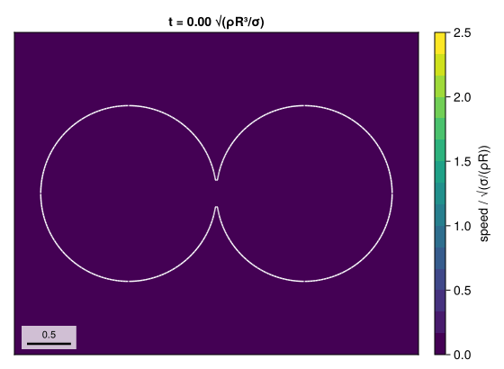
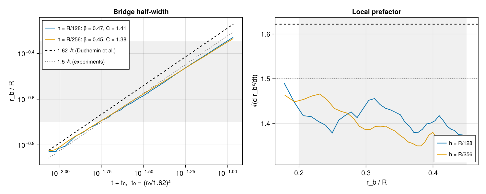
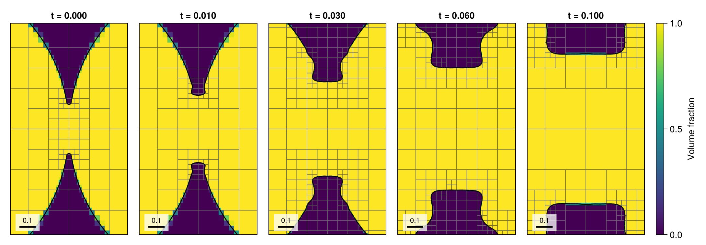
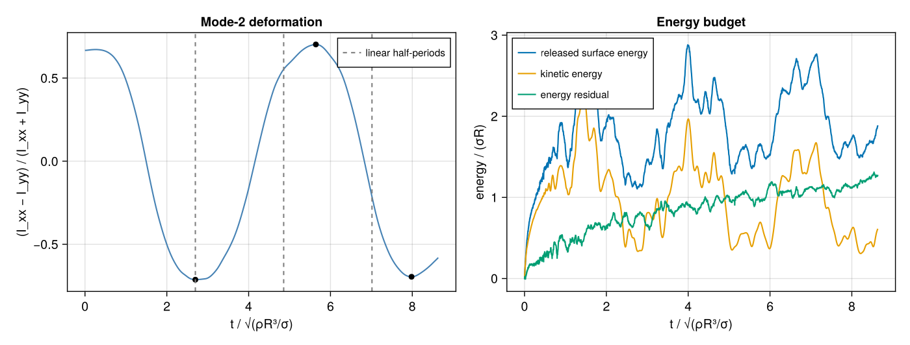

# 16 – Coalescence of two drops

Two equal planar drops merge under surface tension. The bridge grows close to the inertial `t^{1/2}` law over the measured window, but the finite seed prevents a test of the smallest-bridge asymptote. The merged drop then undergoes large-amplitude mode-2 oscillations.



## At a glance

| | |
| --- | --- |
| **Physics** | Two-phase, inviscid, no gravity. Two circles of radius `R = 1` touch at the origin and are joined at rest by a bridge of half-width `r₀ = 0.15`, which ends in tangent fillets of radius `r₀²/(2(R − r₀)) ≈ 0.0132`. `ρ_l = σ = 1`, `ρ_l/ρ_g = 1000`, so time is in units of the capillary time `τ = √(ρ_l R³/σ) = 1`. The domain is the box `[−4, 4]²` with free-slip walls, at least `2R` from the drops. |
| **Algorithms** | Default `OneVelocityModel()`: WY geometric VOF, LHF PLIC normals with WY fallback, CGFM surface tension, Lax–Wendroff momentum, CG/tree-multigrid projection; no viscous solve. Initial fractions are exact areas of a polygon of the outline (`PolygonIndicator`). AMR, square cells, update interval 5, coarsening delay 2: the interface band is at `band_level = 3` (`R/32`). Until `neck_time = 0.3`, `CurvatureRefinementIndicator` (8 cells per radius of curvature) refines the fillets and the retracting gap ends to `max_level = 5` (`R/128`, so the fillet spans 1.7 cells). |
| **Worth varying** | `max_level=5` sets the neck resolution (6 halves the cell); `bridge=0.15` sets `r₀`; `band_level=3` sets the band resolution of the oscillating drop; `ohnesorge=0` adds liquid viscosity `Oh √(ρ_l σ R)` (gas `0.0175` times that); `density_ratio=1000`; `neck_time=0.3`; `final_time=nothing` selects two linear mode-2 periods. The forwarded `velocity_model` defaults to `OneVelocityModel()`; `TwoVelocityModel()` uses separate phase velocities with the CMDGFM projection. |
| **Validated against** | Inertial bridge scaling and the linear mode-2 period, with finite-seed and large-amplitude limitations discussed below. |
| **Cost** | Default merger: 12,291 steps, 1,573 s; finer bridge case: 1,815 steps, 947 s. Full figure script: 2,572 s. |

Gallery timings: Julia 1.12.7, one Julia thread and one BLAS thread, AMD Ryzen 9 5950X; package loading is excluded. The figure script ran while other jobs shared the machine.

## Setup

The drops are the circles of radius `R` centred at `(±R, 0)`, which touch at the origin. The liquid also fills the gap between them up to `|y| = r₀`. Each end of this bridge is a fillet: the circle of radius `r_f` on the symmetry line that is tangent to both drops,

```math
r_f=\frac{r_0^2}{2(R-r_0)},\qquad \text{centred at }\bigl(0,\pm(r_0+r_f)\bigr).
```

In the inertial regime the bridge half-width grows as ([Eggers et al. 1999](https://doi.org/10.1017/S002211209900662X), eq. 30; [Duchemin et al. 2003](https://doi.org/10.1017/S0022112003004646), eq. 2.6)

```math
r_b(t)=C\Bigl(\frac{\sigma R}{\rho_l}\Bigr)^{1/4}t^{1/2},\qquad C=\sqrt{\frac{2\cdot10}{7.6}}\approx1.62 .
```

The gap between the drops at height `r` is `w ≈ r²/R`. The meniscus that pulls the bridge open therefore has curvature of order `R/r_b²`, much larger than the azimuthal curvature `1/r_b` of the bridge between spheres. As long as `r_b ≪ R`, cylinders (this example) and spheres follow the same law. Duchemin et al. obtain `C ≈ 1.62` by averaging over the gas voids that capillary waves on the retracting meniscus trap while `r_b < 0.035R`; experiments and three-dimensional simulations give `C ≈ 1.5` ([Eggers et al. 2025](https://doi.org/10.1146/annurev-fluid-121021-044919), eq. 11). The `t^{2/3}` growth sometimes quoted for two dimensions belongs to wedge-shaped contacts (conical drops, sessile drops, liquid lenses; Table 2 of the same review), not to circular drops. A law through the initial bridge has its virtual origin at `t = −t₀`, `t₀ = (r₀/1.62)² ≈ 0.0086`, so `r_b` is plotted against `t + t₀`. The fit window `0.2 ≤ r_b/R ≤ 0.45` starts once the fillet, which starts at rest, has accelerated (`t ≳ 0.01`), and ends before the bridge reaches the drop scale.

The fillet must be resolved. With a cusp instead, two circles that overlap and intersect at `(0, ±0.05)`, the gas gap above the cusp is thinner than a cell. A cell there cannot hold its two interfaces; its PLIC line comes out horizontal, and the retracting meniscus breaks the gap into grid-scale gas fragments. In a separate study with that start, the surface energy at `t = 0.1` had risen by 1.23 (`R/64` at the neck) and 3.31 (`R/128`) instead of falling, and `r_b(0.1) ≈ 0.27` instead of about 0.5. The default fillet behaves the same at `R/64`, where it spans 0.85 cells (+0.79). At `R/128` it spans 1.7 cells, and the surface energy falls monotonically. These fragments are numerical: Duchemin's voids form only while `r_b < 0.035R` and are `r_b²/R ≲ 10⁻³R` wide.

The merged drop has the area of the two disks and the bridge, so its equivalent radius is `R_eq ≈ √2`. Small shape oscillations of a planar drop have the frequencies ([Rayleigh 1879](https://doi.org/10.1098/rspl.1879.0015))

```math
\omega_n^2=\frac{(n^3-n)\,\sigma}{(\rho_l+\rho_g)\,R_{eq}^3},\qquad T_2=\frac{2\pi}{\omega_2}\approx4.32 .
```

`:bridge_half_width` is half the liquid length on the symmetry line `x = 0`, from the PLIC lines of the cells on both sides of the line. `:deformation` is `(I_xx − I_yy)/(I_xx + I_yy)`, from the second moments of the liquid about the origin: `2/3` for two touching circles, zero for one circle and `2ε` for `r = R_eq(1 + ε cos 2θ)`. `:surface_energy` is `σ` times the PLIC interface length and `:kinetic_energy` the mixture kinetic energy. The residual `E_s(0) − E_s − E_k` includes numerical dissipation and errors in the measured interface length; it does not measure dissipation alone.

## Run

From the repository root, in a Julia session started with `--project=examples`:

```julia
include("examples/16_coalescence/coalescence.jl")
run = run_example(final_time = 0.1)                 # bridge phase only
bridge = diagnostic_history(run.flow, :bridge_half_width)
@show bridge.times[end] bridge.values[end]
```

Run the example headlessly or regenerate the Cairo figures:

```sh
julia --project=examples examples/16_coalescence/coalescence.jl
julia --project=examples -e 'include("examples/16_coalescence/make_figures.jl"); make_figures()'
```

Append `--studio` to the example command to follow the run in a browser;
press Ctrl+C to close Studio after the run.

`size=:docs` and `size=:default` run the same cases.

The animation uses 92 keyframes from the default merger, rendered at 12 fps and 560 × 410 pixels with a fixed speed scale and no block overlay. The denser early keyframes emphasize bridge growth, so playback time is not proportional to simulation time.

## Results



**Bridge.** Over the fit window `0.2 ≤ r_b/R ≤ 0.45` the shifted log-log fit gives `r_b = 1.333 (t + t₀)^0.471` with the neck at `R/128` and `r_b = 1.268 (t + t₀)^0.454` at `R/256`. With the exponent fixed at ½, `C = 1.411` and `1.379`. The local prefactor `√(d r_b²/dt)` (right) has no plateau. It rises while the fillet accelerates from rest, peaks at about 1.44 near `r_b ≈ 0.25R`, and falls to 1.34 at `r_b ≈ 0.43R` (`R/256`) as the bridge approaches the drop scale. The measured prefactor is about 13% below Duchemin et al.'s 1.62 and 8% below the ≈1.5 of experiments with spherical drops. Halving the cell lowers `C` by 2% and the exponent by 0.017, so refinement does not close the gap in this window; note that the window lies outside the range `r_b ≪ R` of the theory, and Duchemin et al.'s constant is derived for `r_b < 0.035R`.

A separate run reaches smaller bridges: `run_example(max_level = 7, bridge = 0.10, final_time = 0.04)` puts the neck at `R/512`, where the fillet of the narrower bridge spans 2.9 cells (2053 steps, 61504 final cells, 872 s). Its local prefactor is 1.42–1.52 for `0.125 ≤ r_b/R ≤ 0.2` (fit `C = 1.47`, `β = 0.47`) and 1.35–1.45 for `0.2 ≤ r_b/R ≤ 0.3` (`C = 1.41`), close to the `R/128` and `R/256` values where the runs overlap. The prefactor thus grows as the bridge narrows, but the asymptotic regime stays out of reach: at `r_b = 0.035R` the fillet radius is `6×10⁻⁴R`.

Two velocities (CMDGFM) and `Oh = 0.01` give the same bridge within 1% at `R/128` (`C = 1.409` and `1.398`). At `Oh = 0.1` the bridge is 7% narrower at `t = 0.1`, as expected near the viscous–inertial crossover `r_b ≈ Oh·R`. These three runs come from the same study as the cusp start.



**Neck.** At `R/256` the two fillets retract as rounded bulbs, the gap ahead of them stays open, and no gas is left in the bridge. The block outlines show the curvature refinement following the gap ends.



**Oscillation and energy.** The deformation extrema are `−0.713`, `0.702`, and `−0.696` at `t = 2.6975`, `5.6429`, and `7.9817`. The intervals, 2.945 and 2.339, exceed the linear half-period 2.159. The linear period is a reference, not a quantitative prediction for these amplitudes. At the end, `E_s` has fallen from 11.9426 to 10.0681 and `E_k = 0.6134`; the residual is 1.2612. Liquid volume changes by `3.9×10⁻⁹`.

In a separate `R/256` run to `t = 0.06`, measured PLIC surface energy outside the neck rises by up to 0.055, while the total residual reaches −0.0284 before turning positive. The neck residual briefly reaches −0.0137 near startup and is positive at the later sampled times. Far-field interface-length bias is comparable to the total energy imbalance; the negative residual alone is not evidence of energy creation. These runs do not establish energy convergence.

### Optional MC momentum advection

At the same level-5 neck resolution (`R/128`), monotonized central (MC) reduced the cell-scale vorticity near the upper neck. The diagnostic subtracts the four-neighbour mean on an `R/128` raster, rejects stencils that cross the interface, and averages the resulting per-phase RMS over ten snapshots through `t = 0.1`. It measures grid-scale content, not vorticity error against a reference.

| Matched run metric | Lax–Wendroff (default) | MC |
| --- | ---: | ---: |
| Mean near-neck high-pass vorticity RMS, liquid | 32.08 | 12.48 |
| Mean near-neck high-pass vorticity RMS, gas | 50.82 | 21.36 |
| Bridge half-width at `t = 0.1` | 0.46841 | 0.46766 |
| Decay between the two negative mode-2 extrema | 2.45% | 1.96% |
| Time between those extrema | 5.284 | 5.295 |

The largest matched-time difference in bridge half-width through `t = 0.1` was `0.00145R` (0.543%). MC did not increase the measured mode-2 decay, but it redistributed the final kinetic and measured surface energies; the final total-energy residual changed by only `0.0022`. These comparisons give no independent reference for late-time damping. The main figures and animation use Lax–Wendroff.

## Variations

```julia
run_example(final_time = 0.1, max_level = 6)       # bridge phase at R/256
run_example(final_time = 0.1, bridge = 0.25)       # larger initial bridge
run_example(ohnesorge = 0.01)                      # weakly viscous drops
run_example(velocity_model = TwoVelocityModel(pressure_projection = CMDGFMProjection()))
run_example(
    final_time = 0.1,
    numerics = NavierStokesOptions(advection = AdvectionOptions(scheme = MonotonizedCentral())),
)
```

## Files

- [coalescence.jl](coalescence.jl) – fillet initial condition, bridge and deformation diagnostics, and the run.
- [make_figures.jl](make_figures.jl) – bridge-law resolution study, neck close-ups, oscillation and energy budget, and the animation.

## References

- J. Eggers, J. R. Lister and H. A. Stone, [*Coalescence of liquid drops*](https://doi.org/10.1017/S002211209900662X), Journal of Fluid Mechanics 401 (1999), 293–310.
- L. Duchemin, J. Eggers and C. Josserand, [*Inviscid coalescence of drops*](https://doi.org/10.1017/S0022112003004646), Journal of Fluid Mechanics 487 (2003), 167–178.
- J. Eggers, J. E. Sprittles and J. H. Snoeijer, [*Coalescence dynamics*](https://doi.org/10.1146/annurev-fluid-121021-044919), Annual Review of Fluid Mechanics 57 (2025), 61–87.
- Lord Rayleigh, [*On the capillary phenomena of jets*](https://doi.org/10.1098/rspl.1879.0015), Proceedings of the Royal Society of London 29 (1879), 71–97.
