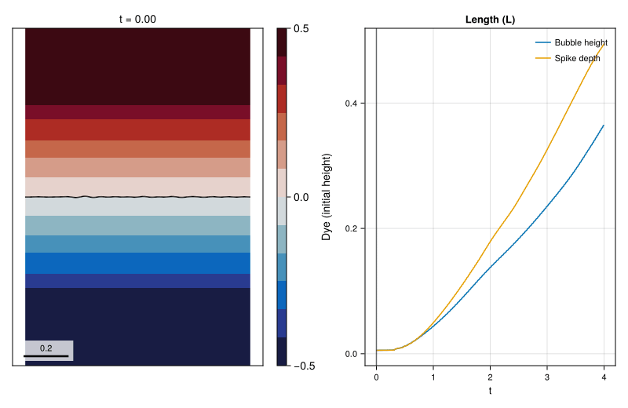
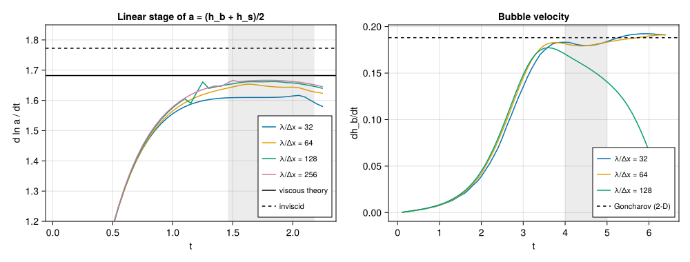
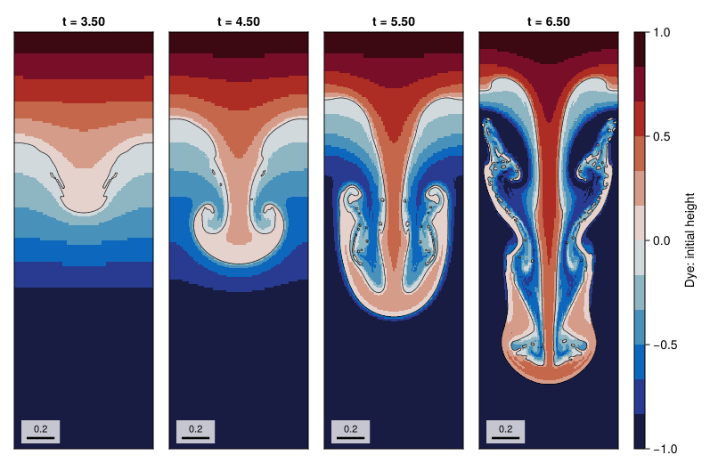
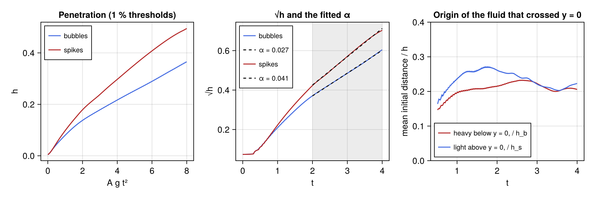
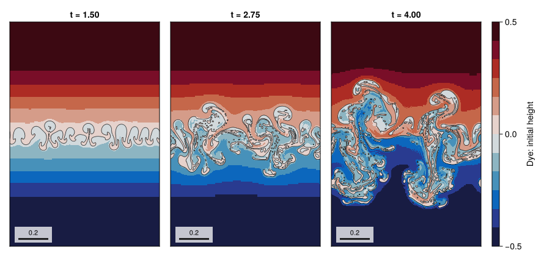

# 17 – Rayleigh–Taylor instability

Heavy fluid over light: a single mode is checked against viscous linear theory and compared with the two-dimensional potential-flow bubble speed, then a multimode layer grows into a mixing zone whose dye shows where its fluid came from.



## At a glance

| | |
| --- | --- |
| **Physics** | Viscous, immiscible two-phase Rayleigh–Taylor instability at Atwood number `A=0.5` (heavy density 3 over light density 1), gravity `g=1` downward, equal kinematic viscosities in both fluids. The box `[0,1] × [y₀,y₁]` is periodic in `x` with free-slip walls at the bottom and top. **Single mode** (`case=:single_mode`): one wavelength `λ=1`, initial amplitude `0.002`, `[0,1] × [-3,2]`, perturbation Reynolds number `Re_p = λ√(Agλ/(1+A))/ν = 1000`, no surface tension, until `t=6.5`. **Multimode** (`case=:multimode`, the default): modes 8–16 with random phases from `MersenneTwister(2026)` and root-mean-square amplitude `0.001`, `[0,1] × [-1,1]`, `Re = 3000` on the box width, Bond number `(ρ_h-ρ_l)gL²/σ = 4·10⁴` (capillary cutoff wavelength `2π/√Bo = 0.031`), until `t=4`. A passive phase scalar, the dye, carries each parcel's initial height. |
| **Algorithms** | `OneVelocityModel()`: one shared velocity, VOF/PLIC interface (height-function normals with WY fallback) with Weymouth–Yue transport, Lax–Wendroff momentum advection, implicit-midpoint variable-viscosity diffusion and the CG/tree-multigrid pressure projection; CGFM surface tension in the multimode run. AMR refines the interface band to `max_level` and, through a `VorticityRefinementIndicator` (refine where `h|ω| > 0.02`, coarsen below a third of it), the vortical regions up to `max_level`, checking every 5 steps with coarsening delay 2. Blocks of 8×8 cells sit on a level-0 mesh of spacing `1/8`, so level 4 resolves the single wavelength with `λ/Δx = 128` and level 5 gives the multimode run `Δx = 1/256`, 16 cells across its shortest initial mode. The dye is a `PhaseScalar` registered with `TwoPhase(...; scalars = (dye,))`: the phase fluxes transport it and the AMR transfer conserves it. Steps are automatic (CFL 0.45 with the gravity-wave and capillary bounds); the linear-stage study fixes `dt = 0.005`. |
| **Worth varying** | `case=:multimode` or `:single_mode`; `atwood=0.5`; `reynolds` (1000 single mode, 3000 multimode) and `bond` (`Inf` single mode, `4e4` multimode); `max_level` (4 single mode, 5 multimode); `final_time` (6.5, 4); `modes`, `amplitude` and `seed` of the initial interface; `velocity_model=TwoVelocityModel()` for two intrinsic velocities with the CMDGFM projection (one vorticity criterion per phase); `vorticity_tolerance=0.02`. |
| **Validated against** | Viscous single-mode linear theory (Chandrasekhar). The nonlinear bubble speed is compared with Goncharov's two-dimensional potential-flow law, but the measured late-time slopes do not converge across these grids. |
| **Cost** | Level-5 multimode to `t = 4`: 1363 steps, 117 mesh updates, 55,232 final and peak cells, 1676.9 s including setup. In a separate single-mode run, levels 2, 3 and 4 took 320, 747 and 1501 steps in 10.9, 61.9 and 374.2 s, respectively (`finish_single_mode.log`); the figure run timings differ. |

Gallery timings: Julia 1.12.7, one Julia thread and one BLAS thread, AMD Ryzen 9 5950X; package loading is excluded.

## Setup

The heavy fluid (the `TwoPhase` liquid) lies above `y = η(x)` and the light fluid below; with `ρ_h = (1+A)/(1-A)`, `ρ_l = 1` and the box width `L = 1`,

```math
\eta(x,0)=\sum_{m} a\cos(2\pi m x+\varphi_m),\qquad
\nu=\frac{L\sqrt{AgL/(1+A)}}{\mathrm{Re}},\quad \mu_{h,l}=\rho_{h,l}\,\nu,\qquad
\sigma=\frac{(\rho_h-\rho_l)\,g\,L^2}{\mathrm{Bo}}.
```

The fluids start at rest. The single mode is `m = 1`, `φ = 0`, `a = 0.002` (`ka = 0.013`), so the bubble rises on the axis `x = 0` and the spike falls on `x = 1/2`; its diagnostics `:bubble_height` and `:spike_height` are the tips on these axes: the highest light fluid in the cell column at `x = 0` and the lowest heavy fluid at `x = 1/2`. In the multimode run they are the penetration depths of the mixing zone, the heights where the horizontally averaged heavy-fluid fraction leaves 1 % of its pure values (rows on the finest spacing). The dye `PhaseScalar` starts as `s = y` in both fluids and is transported conservatively with the phase fluxes; `:spike_origin` is the mean initial height of the heavy fluid now below `y = 0`, `:bubble_origin` the mean initial depth of the light fluid above it.

**Linear growth.** The growth rate `n` of the normal mode `exp(ikx + nt)`,
`k = 2π/λ`, is the root of the interface conditions for two semi-infinite
viscous fluids: continuous velocity and tangential stress, with normal
stress balanced by gravity and capillarity (Chandrasekhar 1961, §94).
`linear_growth_rate` solves the resulting 4×4 determinant. The tests check
the root against the equivalent implicit relation of Xie, Tao & Li (2017)
for equal and unequal kinematic viscosities. Without viscosity it reduces to

```math
n^2 = Agk-\frac{\sigma k^3}{\rho_h+\rho_l}
```

(Sharp 1984). The explicit approximation `√(Agk + ν²k⁴) − νk²` (Bellman &
Pennington 1954) gives `1.74981` for `Re_p = 1000`, compared with the viscous
root `1.68219` and the inviscid rate `1.77245`.

**Terminal bubble velocity.** In two dimensions the potential-flow bubble of a periodic array saturates at

```math
U_b=\sqrt{\frac{2A}{1+A}\,\frac{g}{3k}},\qquad
\mathrm{Fr}_b=\frac{U_b}{\sqrt{Ag\lambda/(1+A)}}=\frac{1}{\sqrt{3\pi}}=0.3257
```

(Goncharov 2002, whose geometric constant is 3 in two and 1 in three dimensions); for `A = 1` this is Layzer's (1955) two-dimensional `√(g/(3k)) = 0.230√(gλ)`. The often quoted Davies & Taylor (1950) coefficients are for bubbles in tubes and spherical caps, i.e. three-dimensional, and do not apply.

**Mixing.** Once the initial modes saturate, the penetrations grow as `h_{b,s} = α_{b,s} A g t²`; `make_figures` fits `√h` against `t`, so `α = slope²/(Ag)` does not depend on a virtual time origin.

## Run

From the repository root, in a Julia session started with `--project=examples`:

```julia
include("examples/17_rayleigh_taylor/rayleigh_taylor.jl")
run = run_example(case = :single_mode, max_level = 3)
@show diagnostic_history(run.flow, :bubble_height).values[end]
multimode = run_example(max_level = 4, final_time = 2.0)
```

Run the multimode default headlessly or regenerate the Cairo figures:

```sh
julia --project=examples examples/17_rayleigh_taylor/rayleigh_taylor.jl
julia --project=examples -e 'include("examples/17_rayleigh_taylor/make_figures.jl"); make_figures()'
```

Append `--studio` to the example command to follow the run in a browser;
press Ctrl+C to close Studio after the run.

`make_figures` runs the gallery configuration at both sizes: the linear stage of the single mode at `λ/Δx = 32, 64, 128, 256` with the fixed step `0.005`, the single mode to `t = 6.5` with automatic steps at `λ/Δx = 32, 64, 128`, and the level-5 multimode run.

## Results

### Single mode



With fixed `dt = 0.005`, fitting the logarithm of the mean tip amplitude
from 6 to 20 times its initial value gives the rates below. The theoretical
viscous rate is `1.68219`; the start from rest is not a pure growing
eigenmode, and the fitting window is finite.

| Level | Cells per wavelength | Rate | Difference from viscous theory |
| --- | ---: | ---: | ---: |
| 2 | 32 | 1.61032 | −4.27% |
| 3 | 64 | 1.64611 | −2.14% |
| 4 | 128 | 1.65992 | −1.32% |
| 5 | 256 | 1.66418 | −1.07% |

For the nonlinear stage, least-squares slopes of the bubble height over
`t = 4–5` are `0.18054`, `0.18018`, and `0.15597` at levels 2, 3, and 4,
against Goncharov's inviscid `0.18806`. Over the last half unit of time the
slopes are `0.19150`, `0.19086`, and `0.03602`. At `t = 6.5` the level-4 bubble
height is `0.5774`, versus `0.7440` and `0.7528` at the coarser levels; the
spike depths are `1.4439`, `1.5129`, and `1.5367`. The late drop's cause is
unresolved. An axis-column tip can change when the topology changes, so
these slopes do not establish the converged speed of a coherent bubble.



With `Bo = 80` the level-3 linear rate is `1.16857` against viscous theory
`1.18330` (−1.24%). At `A = 0.9`, level 3, the fitted bubble speed changes
from `0.23038` over `t = 2.5–3.5` to `0.25162` over `t = 3–4`, against
`0.22419` from the potential-flow formula.

### Multimode

At level 5 and `t = 4`, the bubble and spike penetrations are `0.3650`
and `0.4949`. The liquid volume changes by `4.4e-10`, and the two phase-dye
integrals change by `3.1e-11` and `3.5e-11`. The pressure projections converge
throughout the run.

| Fit window | Bubble `α_b` | Spike `α_s` |
| --- | ---: | ---: |
| `1.5–3.5` | 0.02749 | 0.04628 |
| `2–4` | 0.02675 | 0.04108 |
| `2.5–4` | 0.02744 | 0.03958 |





The horizontally averaged fraction thresholds measure the extent of the
mixing layer, not individual tips. The fitted rates vary with the time
window. Threshold, finite box, initial spectrum, surface tension, and
resolution may also affect them. This seeded two-dimensional run has no matching reference
dataset and does not establish convergence or three-dimensional turbulent
mixing coefficients. The colour marks the initial height carried by each
phase, not a diffusing concentration.

## Variations

```julia
run_example(case = :single_mode, bond = 80.0)                  # capillary: k/k_c ≈ 0.70
run_example(case = :single_mode, velocity_model = TwoVelocityModel(), max_level = 3)
run_example(seed = 1, max_level = 4)                            # another realization
run_example(modes = 4:8, max_level = 4)                         # longer initial modes
```

## References

- S. Chandrasekhar, *Hydrodynamic and Hydromagnetic Stability*, Oxford University Press (1961), ch. X, §94 — viscous two-fluid dispersion relation.
- C. Xie, J. Tao, J. Li, [Viscous Rayleigh–Taylor instability with and without diffusion effect](https://doi.org/10.1007/s10483-017-2169-9), *Appl. Math. Mech.* 38, 263–270 (2017) — implicit form of that relation.
- R. Bellman, R. H. Pennington, [Effects of surface tension and viscosity on Taylor instability](https://doi.org/10.1090/qam/63198), *Q. Appl. Math.* 12, 151–162 (1954) — the explicit approximation.
- D. H. Sharp, [An overview of Rayleigh–Taylor instability](https://doi.org/10.1016/0167-2789(84)90510-4), *Physica D* 12, 3–18 (1984).
- V. N. Goncharov, [Analytical model of nonlinear, single-mode, classical Rayleigh–Taylor instability at arbitrary Atwood numbers](https://doi.org/10.1103/PhysRevLett.88.134502), *Phys. Rev. Lett.* 88, 134502 (2002).
- D. Layzer, [On the instability of superposed fluids in a gravitational field](https://doi.org/10.1086/146048), *Astrophys. J.* 122, 1–12 (1955).
- R. M. Davies, G. I. Taylor, [The mechanics of large bubbles rising through extended liquids and through liquids in tubes](https://doi.org/10.1098/rspa.1950.0023), *Proc. R. Soc. Lond. A* 200, 375–390 (1950) — three-dimensional, not used.
- T. Wei, D. Livescu, [Late-time quadratic growth in single-mode Rayleigh–Taylor instability](https://doi.org/10.1103/PhysRevE.86.046405), *Phys. Rev. E* 86, 046405 (2012).
- D. L. Youngs, [Numerical simulation of turbulent mixing by Rayleigh–Taylor instability](https://doi.org/10.1016/0167-2789(84)90512-8), *Physica D* 12, 32–44 (1984).
- Y.-N. Young, H. Tufo, A. Dubey, R. Rosner, [On the miscible Rayleigh–Taylor instability: two and three dimensions](https://doi.org/10.1017/S0022112001005870), *J. Fluid Mech.* 447, 377–408 (2001).
- W. Cabot, [Comparison of two- and three-dimensional simulations of miscible Rayleigh–Taylor instability](https://doi.org/10.1063/1.2191856), *Phys. Fluids* 18, 045101 (2006).
- A. Celani, A. Mazzino, L. Vozella, [Rayleigh–Taylor turbulence in two dimensions](https://doi.org/10.1103/PhysRevLett.96.134504), *Phys. Rev. Lett.* 96, 134504 (2006).
- Q. Zhou, [Temporal evolution and scaling of mixing in two-dimensional Rayleigh–Taylor turbulence](https://doi.org/10.1063/1.4818554), *Phys. Fluids* 25, 085107 (2013).
- G. Dimonte et al., [A comparative study of the turbulent Rayleigh–Taylor instability using high-resolution three-dimensional numerical simulations: The Alpha-Group collaboration](https://doi.org/10.1063/1.1688328), *Phys. Fluids* 16, 1668–1693 (2004) — three-dimensional.

## Files

- [rayleigh_taylor.jl](rayleigh_taylor.jl) – setup, linear theory, terminal bubble velocity, tip and mixing-zone diagnostics, and the dye.
- [make_figures.jl](make_figures.jl) – resolution study, mixing-rate fit, dye panels and the animation.
