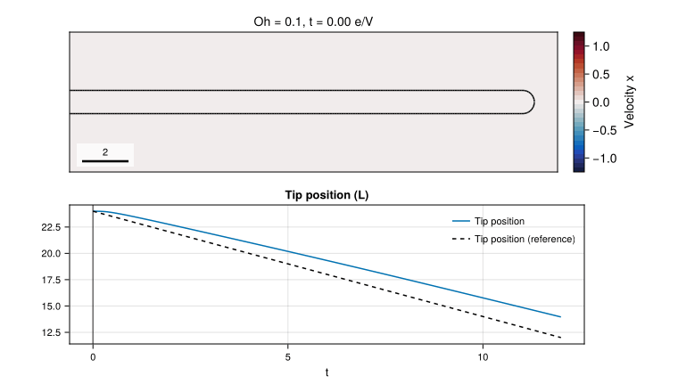
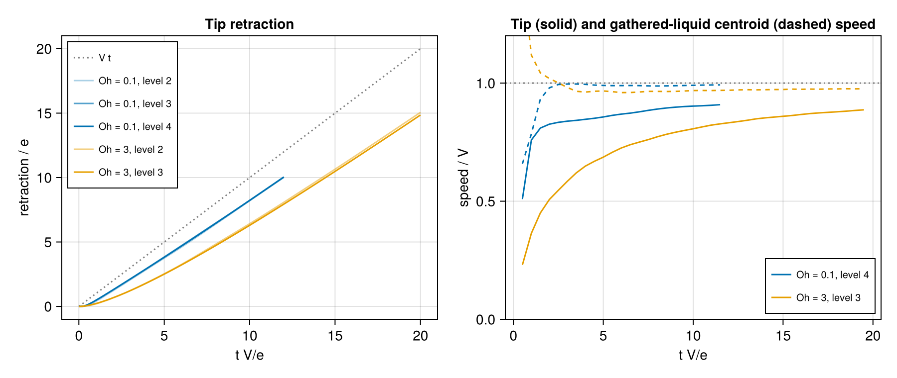
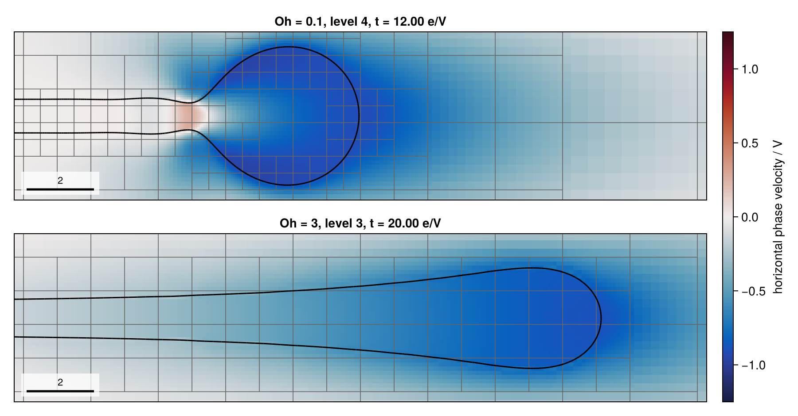
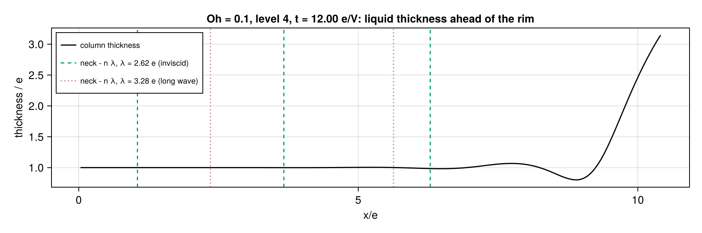
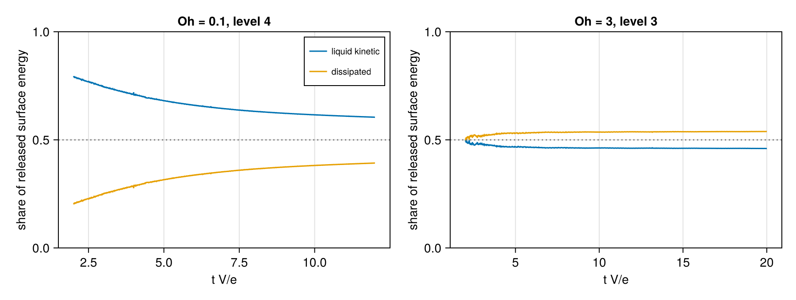

# 18 – Taylor–Culick sheet retraction

A planar liquid sheet retracts from its free end under surface tension. At `Oh = 0.1` the edge gathers into a rim with a neck and capillary waves ahead of it; at `Oh = 3` it thickens into a club without a neck. Both approach the Taylor–Culick speed.



## At a glance

| | |
| --- | --- |
| **Physics** | A liquid sheet of thickness `e` in a gas with `ρ_l/ρ_g = 1000`, no gravity. The example's units are `e = 1`, `ρ_l = 1` and the Taylor–Culick speed `V = √(2σ/(ρ_l e)) = 1`, so `σ = 1/2` and times are in `e/V`. The liquid viscosity follows from `Oh = μ_l/√(ρ_l σ e)` (default `0.1`); the gas viscosity is `μ_g = 2×10⁻³ √(ρ_l σ e)` for every `Oh` (`μ_l/μ_g = 50` at `Oh = 0.1`, `1500` at `Oh = 3`). The sheet `\|y\| < e/2` reaches from the free-slip wall `x = 0`, a symmetry plane (the run is half of a free sheet with two ends), to a semicircular end at `x = 24`, in the closed free-slip box `[0, 32] × [−8.2, 7.8]`. |
| **Algorithms** | `TwoVelocityModel()` with `CMDGFMProjection()` (block-preconditioned BiCGSTAB) and the default interphase drag, frozen-interface WY transport, `:lhf` PLIC with WY fallback, CGFM surface tension, Lax–Wendroff momentum advection and implicit-midpoint viscosity. `InterfaceRefinementIndicator` refines the sheet and the rim to `max_level`, checked every 5 steps with coarsening delay 2: unit cells on level 0 and `2^max_level` cells across the thickness, 8 at the default level 3. |
| **Worth varying** | `ohnesorge=0.1`; `density_ratio=1000` and `gas_ohnesorge=2e-3` (the gas viscosity in units of `√(ρ_l σ e)`); `sheet_length=24`, which lengthens the box with it; `max_level=3`; `final_time=12.0`; `velocity_model=OneVelocityModel()` for one shared velocity. |
| **Validated against** | The Taylor–Culick speed `V` and the ideal liquid momentum `2σt`. At `Oh = 0.1` and level 4 the gathered-liquid centroid moves at `0.990V` over `t = 8–12`, the tip at `0.902V`, and the momentum stays within 1.1% of `2σt` for `t ≥ 1`. At `Oh = 3` and level 3 the tip is still accelerating (`0.879V` over `t = 16–20`) while the centroid moves at `0.975V`. The largest thickness follows the [Savva & Bush (2009)](https://doi.org/10.1017/S0022112009005795) law within 2% up to `t = 4`. The `Oh = 0.1` capillary-wave crest spacing is `2.50e`, against `2.62e` for inviscid varicose waves standing in the rim's frame. |
| **Cost** | Default (level 3, `T = 12`): 851 steps, 8192 final cells, 71.9 s. In the figure script, level 4 took 668.6 s (2406 steps, 17216 final cells) and `Oh = 3` on level 3 with `sheet_length = 56` to `T = 20` took 316.9 s (1418 steps, 15616 final cells); all eight runs and the rendering took 1475 s including package loading and compilation. |

Gallery timings: Julia 1.12.7, one Julia thread and one BLAS thread, AMD Ryzen 9 5950X; package loading is excluded unless stated. These runs shared the machine with other jobs.

## Setup

The two surfaces of the sheet pull its free edge with the force `2σ` per unit length, and the edge gathers the sheet it overtakes. An edge moving at a constant speed `V` gains the momentum `ρ_l e V²` per unit time, so ([Taylor 1959](https://doi.org/10.1098/rspa.1959.0196); [Culick 1960](https://doi.org/10.1063/1.1735765))

```math
V=\sqrt{\frac{2\sigma}{\rho_l e}},\qquad
\mathrm{Oh}=\frac{\mu_l}{\sqrt{\rho_l\sigma e}},\qquad
\tau_\mathrm{inv}=\frac{e}{V},\qquad
\tau_\mathrm{vis}=\frac{\mu_l e}{2\sigma}=\frac{\mathrm{Oh}}{\sqrt2}\,\tau_\mathrm{inv},
```

which is also the speed of long antisymmetric waves on the sheet (Taylor). The speed does not depend on the viscosity, which shapes the edge and sets the transient. [Savva & Bush (2009)](https://doi.org/10.1017/S0022112009005795), whose `Oh` is `μ_l/√(2ρ_lσe)`, find the transient on the inertial time `τ_inv` below `Oh = √2` and on the viscous time `τ_vis` above it, and their regime map (Fig. 2) has capillary waves ahead of the rim below `Oh ≈ 0.14` and a rim that spreads into the sheet up to `Oh ≈ 14`. By [Brenner & Gueyffier (1999)](https://doi.org/10.1063/1.869942) a rim forms only when the Stokes length `ν_l/V = Oh e/√2` is shorter than the sheet; on a sheet that the viscous region spans, the edge slows down instead of reaching `V` ([Deka & Pierson 2020](https://doi.org/10.1103/PhysRevFluids.5.093603)). The liquid momentum is exactly `2σt` from rest as long as the sheet ahead is undisturbed and the gas exerts no force, whatever the shape of the edge. The kinetic energy of a steady rim grows at `σV`, half of the surface energy `2σV` that the shortening sheet releases; Culick attributed the other half to dissipation in the inelastic accretion of the sheet ([Sanjay et al. 2022](https://doi.org/10.1017/jfm.2022.671), appendix A).

The level set is `|y| − 1/2` for `x ≤ 23.5` and the distance to the circle of radius `1/2` about `(23.5, 0)` beyond; both phases start at rest. The box is shifted by `0.2` in `y` so that no sheet surface lies on a cell face of any level: such a surface has pure cells on both sides, no PLIC segment and no curvature. The diagnostics are `:tip_position`, the liquid length on the midplane (`interface_height` in `x` at `y = 0`); `:edge_thickness`, twice the largest `|y|` on the PLIC interface; the liquid `x`-momentum `:liquid_momentum` and `:liquid_kinetic_energy`, with the mass-compatible face fractions of `mixture_density`; and `KineticEnergy()`, `SurfaceEnergy()`, `LinearMomentum()` and `PhaseVolume()`.

At `Oh = 3` the viscous stresses spread the retraction along the sheet like a diffusion with the extensional coefficient `4ν_l`, over about `2√(4ν_l t) = 26e` by `t = 20`. In exploratory runs with `sheet_length = 24` and `40` the region reached the symmetry wall and the liquid momentum fell 19% (by `t = 16`) and 3% (by `t = 20`) below `2σt`; the figure script therefore uses `sheet_length = 56` there.

The two-velocity CMDGFM projection is the documented choice for thin films ([choosing a model](../../docs/src/choosing-a-model.md)); `MimeticProjection()` is not used, because, unlike the CMDGFM, it does not bound the light-phase values next to the interface. One shared velocity gives the same late tip speed within 0.3% at level 3 (see below).

## Run

From the repository root, in a Julia session started with `--project=examples`:

```julia
include("examples/18_taylor_culick/taylor_culick.jl")
run = run_example()
tip = diagnostic_history(run.flow, :tip_position)
@show (tip.values[1] - tip.values[end]) / tip.times[end]
```

Run the example headlessly or regenerate the Cairo figures:

```sh
julia --project=examples examples/18_taylor_culick/taylor_culick.jl
julia --project=examples -e 'include("examples/18_taylor_culick/make_figures.jl"); make_figures()'
```

Append `--studio` to the example command to follow the run in a browser;
press Ctrl+C to close Studio after the run.

`make_figures` runs eight cases for both sizes, which only scale the figures: `Oh = 0.1` on levels 2, 3 and 4 to `t = 12`, `Oh = 3` on levels 2 and 3 to `t = 20` with `sheet_length = 56`, and three level-3 variants of the default case.

## Results

### Retraction speed



Speeds are in units of `V`, measured from least-squares slopes of position on windows of one `e/V`. The gathered-liquid centroid weights each column by `max(h − e, 0)`, where `h` is its liquid thickness; it tracks the excess liquid in the thickened edge, not a material point. The table gives slopes over the last four time units, `t = 8–12` for `Oh = 0.1` and `t = 16–20` for `Oh = 3`, and the liquid momentum against the ideal `2σt`.

| Run | Cells per `e` | Steps | Final cells | Time | Tip speed | Gathered-liquid centroid speed | `P/(2σt)` at the end | Largest deviation for `t ≥ 1` |
| --- | --- | --- | --- | --- | --- | --- | --- | --- |
| `Oh = 0.1`, level 2 | 4 | 301 | 3200 | 77.5 s* | 0.908 | 0.985 | 0.968 | 9.4% |
| `Oh = 0.1`, level 3 | 8 | 851 | 8192 | 71.9 s | 0.896 | 0.981 | 0.979 | 2.1% |
| `Oh = 0.1`, level 4 | 16 | 2406 | 17216 | 668.6 s | 0.902 | 0.990 | 0.990 | 1.1% |
| `Oh = 3`, level 2 | 4 | 502 | 7552 | 40.8 s | 0.887 | 0.977 | 0.974 | 13.6% |
| `Oh = 3`, level 3 | 8 | 1418 | 15616 | 316.9 s | 0.879 | 0.975 | 0.985 | 3.3% |

\* Includes the first-call compilation of the script.

The momentum balance converges with the resolution, to 1.1% at 16 cells per thickness: the CGFM force on the curved edge adds up to the `2σ` of the flat surfaces. The speeds change by at most 1.5% between levels 3 and 4 (`Oh = 0.1`) and 2 and 3 (`Oh = 3`), and the level-4 and level-3 tips end within `0.0003e`.

At `Oh = 0.1` the gathered-liquid centroid is at `0.980V` on the window around `t = 2` and `0.9876–0.9958V` for `t = 3–11` at level 4, consistent with an inertial transient of a few `τ_inv` ([Savva & Bush (2009)](https://doi.org/10.1017/S0022112009005795); [Gordillo et al. (2011)](https://doi.org/10.1063/1.3663577)). The tip lies behind the centre of the growing rim and lags by the growth rate: `(1 − V_tip/V)√(Vt/e)` stays at `0.31 ± 0.02` from `t = 4` to `11`, consistent with the `t^(−1/2)` asymptotic rate. The first half-unit-spaced window with tip speed at or above `0.9V` is centred at `t = 9.5`. If that scaling persists, the tip would reach `0.95V` near `t = 40`, beyond the measured interval.

At `Oh = 3` there is no nearly circular rim. The centroid can move quickly as the thickened region spreads, even while the tip is still accelerating: on the level-3 window around `t = 19`, the centroid moves at `0.975V` and the tip at `0.884V`. The liquid momentum is within 3.3% of `2σt` for `t ≥ 1`, consistent with a long viscous transient rather than a missing capillary force. Early on, the largest thickness follows the high-viscosity law for a semicircular end, `e(1 + t/(4τ_vis))` (Savva & Bush, eq. 2.29): `+1.7%`, `+0.8%` and `−0.2%` at `t = 1`, `2` and `4` on level 3. It then falls below the law by 2.2%, 5.2% and 10.3% at `t = 8`, `12` and `20`. The law is for `Oh ≫ 1`; in their convention the run has `Oh = 2.1`.

### Rim, neck and capillary waves



At `t = 12` the `Oh = 0.1` rim is nearly round, `4.11e` across after a retraction of `10.0e`, and moves at about `−V` as a whole; a neck `0.80e` thick joins it to the sheet. At `t = 20` the `Oh = 3` edge is a club `3.01e` thick that tapers into the sheet across the whole window, without a neck: the diffusing rim of Savva & Bush, with a Stokes length of `2.1e`.



Ahead of the neck at `x = 8.91` the column thickness has a crest at `x = 7.72`, a trough at `6.47` and a weak second crest at `5.22`: crest to crest `2.50e`, neck to trough `2.44e`. Waves that stand still in the frame of the rim travel through the sheet at `V`. With the linear dispersion relation of symmetric capillary waves on an inviscid sheet, `ω² = (σk³/ρ_l) tanh(ke/2)`, this requires `(ke/2) tanh(ke/2) = 1`, so `λ = 2.62e` (derived here); Gordillo et al.'s long-wave model gives `πe/√(1 − 4Ω²) = 3.28e` with their `Ω = √2 Oh`. The measured spacings are 5–7% below the inviscid value and 24–26% below the long-wave one. The waves decay within two wavelengths, and the neck stays far from pinching off: Gordillo et al. find that the neck tends to half the sheet thickness as `Oh → 0` and no pinch-off in two dimensions ([Song & Tryggvason 1999](https://doi.org/10.1063/1.870113) had suggested one in the inviscid limit).

### Energy



| Run | Released surface energy | Liquid kinetic | Gas kinetic | Dissipated | Rates on `[T/2, T]`: release, liquid kinetic |
| --- | --- | --- | --- | --- | --- |
| `Oh = 0.1`, level 4, `t = 12` | 8.592 | 5.195 (0.605) | 0.022 (0.003) | 3.375 (0.393) | 0.808, 0.454 |
| `Oh = 3`, level 3, `t = 20` | 14.329 | 6.597 (0.460) | 0.019 (0.001) | 7.714 (0.538) | 0.832, 0.381 |

Energies are per unit depth, in units of `ρ_l V² e²`, with shares of the released surface energy in parentheses; the dissipated energy is the release minus the kinetic energy of both phases, viscous and numerical (the CMDGFM conserves momentum but not kinetic energy). Over the second half of the runs the liquid kinetic energy grows at 91% (`Oh = 0.1`) and 76% (`Oh = 3`, still accelerating) of Culick's `σV = 0.5`. The surface energy falls at `0.81` and `0.83`, less than the `2σV = 1` of a sheet consumed at `V`, because the growing edge gains surface. Culick's split does not depend on the viscosity, and the two runs bracket it: the dissipated share rises from about 0.2 at `t = 2` to 0.39 at `t = 12` at `Oh = 0.1`, where the young rim keeps part of its energy in internal motion, and stays near 0.53 from `t ≈ 3` on at `Oh = 3`.

### Faces without curvature

CGFM surface tension applies no force on a face whose curvature is not resolved. The solver counts such faces (`total_unresolved_curvature_faces` in the `simulate!` result), and the count is zero in all eight runs. In exploratory runs with the box centred on the sheet, the flat surfaces lay on cell faces: the solver then counted 5189 such faces on level 3 and 91507 on level 4. A one-off level-3 census with a scratch script placed all of them between pure cells on the flat sheet, where the curvature is zero anyway, and none next to the rim or neck after the first step; shifting the box changed the level-4 tip at `t = 12` from `13.9577` to `13.9576`. Resolution, not missing curvature, is what fails on level 1: with two cells across, the edge does not retract (the tip has moved `0.23e` forward at `t = 1`, and the liquid holds 12% of `2σt`), although no face lacks a curvature.

### Gas density and velocity model

| Level-3 `Oh = 0.1` variant | Tip speed | Gathered-liquid centroid speed | `P/(2σt)` at `t = 12` | Gas kinetic share | Time |
| --- | --- | --- | --- | --- | --- |
| default: `ρ_l/ρ_g = 1000`, two velocities | 0.896 | 0.981 | 0.979 | 0.003 | 71.9 s |
| `ρ_l/ρ_g = 100` | 0.883 | 0.969 | 0.955 | 0.019 | 58.9 s |
| `ρ_l/ρ_g = 10` | 0.807 | 0.893 | 0.816 | 0.114 | 56.8 s |
| `OneVelocityModel()` | 0.898 | 0.987 | 0.985 | 0.003 | 82.8 s |

The theory assumes a vacuum. Compared with the default, the liquid momentum at `t = 12` falls by 2.4 and 16.2 percentage points of `2σt` at density ratios 100 and 10, and the gathered-liquid centroid slows by 1.3% and 9.0%. A rim that drags the added mass `ρ_g πR²` of a cylinder would move at `V/√(1 + ρ_g/ρ_l)`, only 0.5% and 4.7% slower (an estimate, not a literature result). The gas can also cause sheet flapping ([Lhuissier & Villermaux (2009)](https://doi.org/10.1103/PhysRevLett.103.054501)), which this symmetric planar run does not excite. One shared velocity reproduces the two-velocity tip speed within 0.3% and the centroid speed within 0.6%.

## Variations

```julia
run_example(max_level = 4)                                 # 16 cells per thickness
run_example(ohnesorge = 3.0, sheet_length = 56, final_time = 20.0)  # viscous edge
run_example(density_ratio = 10.0)                          # a dense gas slows the rim
run_example(velocity_model = OneVelocityModel())           # one shared velocity
```

## Files

- [taylor_culick.jl](taylor_culick.jl) – setup, diagnostics and the `run_example` entry point.
- [make_figures.jl](make_figures.jl) – the eight runs, their speed, momentum and energy reductions, the figures and the animation.

## References

- G. I. Taylor, The dynamics of thin sheets of fluid. III. Disintegration of fluid sheets, *Proc. R. Soc. Lond. A* 253, 313–321 (1959), [doi:10.1098/rspa.1959.0196](https://doi.org/10.1098/rspa.1959.0196).
- F. E. C. Culick, Comments on a ruptured soap film, *J. Appl. Phys.* 31, 1128–1129 (1960), [doi:10.1063/1.1735765](https://doi.org/10.1063/1.1735765).
- M. P. Brenner and D. Gueyffier, On the bursting of viscous films, *Phys. Fluids* 11, 737–739 (1999), [doi:10.1063/1.869942](https://doi.org/10.1063/1.869942).
- M. Song and G. Tryggvason, The formation of thick borders on an initially stationary fluid sheet, *Phys. Fluids* 11, 2487–2493 (1999), [doi:10.1063/1.870113](https://doi.org/10.1063/1.870113).
- N. Savva and J. W. M. Bush, Viscous sheet retraction, *J. Fluid Mech.* 626, 211–240 (2009), [doi:10.1017/S0022112009005795](https://doi.org/10.1017/S0022112009005795).
- H. Lhuissier and E. Villermaux, Soap films burst like flapping flags, *Phys. Rev. Lett.* 103, 054501 (2009), [doi:10.1103/PhysRevLett.103.054501](https://doi.org/10.1103/PhysRevLett.103.054501).
- L. Gordillo, G. Agbaglah, L. Duchemin and C. Josserand, Asymptotic behavior of a retracting two-dimensional fluid sheet, *Phys. Fluids* 23, 122101 (2011), [doi:10.1063/1.3663577](https://doi.org/10.1063/1.3663577).
- H. Deka and J.-L. Pierson, Revisiting the Taylor–Culick approximation. II. Retraction of a viscous sheet, *Phys. Rev. Fluids* 5, 093603 (2020), [doi:10.1103/PhysRevFluids.5.093603](https://doi.org/10.1103/PhysRevFluids.5.093603).
- V. Sanjay, U. Sen, P. Kant and D. Lohse, Taylor–Culick retractions and the influence of the surroundings, *J. Fluid Mech.* 948, A14 (2022), [doi:10.1017/jfm.2022.671](https://doi.org/10.1017/jfm.2022.671).
